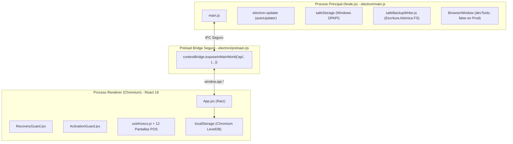

# SIMPLE PROX v1.3.12 — ARQUITECTURA TÉCNICA GENERAL

**DOCUMENTO:** `01_ARQUITECTURA.md`  
**VERSIÓN:** 1.3.12  
**FECHA:** 17 de Noviembre de 2026  
**ESTADO:** [VERIFICADO]

---

## 1. STACK TECNOLÓGICO Y VERSIONES

Inspeccionado directamente desde [package.json](file:///c:/Users/Pininas/KioscoProX/package.json):

* **Runtime de Escritorio:** Electron `^41.3.0` (Arquitectura Multi-proceso Chromium + Node.js).
* **Empaquetador y Distribuidor:** `electron-builder` `^26.8.1` (Salida NSIS para Windows x64 e ia32).
* **Actualizaciones en Caliente:** `electron-updater` `^6.8.9` (Canal GitHub Releases con manifests YAML y SHA-512).
* **Librería de UI:** React `^19.2.0` y React-DOM `^19.2.0` (Modo Concurrent Rendering).
* **Build Tool / Bundler:** Vite `^7.3.1` con `@vitejs/plugin-react-swc` `^4.2.2`.
* **Criptografía:** WebCrypto API nativa (`crypto.subtle` Ed25519 y SHA-256) + Node.js `node:crypto`.
* **Almacenamiento Seguro del SO:** Electron `safeStorage` (Windows DPAPI para tokens de terminal).
* **Iconografía:** `lucide-react` `^0.577.0`.
* **Procesamiento de Planillas:** `xlsx` (SheetJS) `^0.18.5`.
* **Cliente Cloud:** `@supabase/supabase-js` `^2.112.4`.

---

## 2. MODELO MULTI-PROCESO Y SEGURIDAD ELECTRON

Simple ProX implementa el modelo de seguridad recomendado por Electron, con **aislamiento estricto de contexto** y **prohibición de integración Node en el renderer**:



### A. Proceso Principal ([electron/main.js](file:///c:/Users/Pininas/KioscoProX/electron/main.js))
- **Creación de Ventana (Líneas 18-33):**
  - Dimensiones: 1366x768 (mínimo: 1024x600).
  - `autoHideMenuBar: true`: Oculta la barra de menú nativa de Windows.
  - `devTools: process.env.NODE_ENV === 'development'`: **En producción, DevTools queda 100% deshabilitado**, impidiendo la inspección o mutación en memoria del frontend por parte de usuarios.
- **Seguridad Web (Líneas 24-29):**
  - `nodeIntegration: false`: El renderer no tiene acceso a llamadas de sistema operativo directas.
  - `contextIsolation: true`: Código de preload y código web se ejecutan en contextos de memoria aislados.
- **Política de Navegación Externa Deny-by-Default (Líneas 81-105):**
  - Todas las aperturas de enlaces (`window.open`, target blank, WhatsApp) son interceptadas mediante `win.webContents.setWindowOpenHandler`.
  - Si la URL es segura (`https:`, `http:`, `mailto:`), se delega al navegador externo del sistema con `shell.openExternal`.
  - La creación de ventanas hijas dentro de Electron es categóricamente rechazada (`action: 'deny'`).
- **Ciclo de Actualización Automática (Líneas 14-16, 36-80, 113-122):**
  - `autoUpdater.autoDownload = true`: Descarga desatendida en segundo plano al detectar nueva versión.
  - `autoUpdater.autoInstallOnAppQuit = true`: Si hay un update descargado, se instala al cerrar la ventana.
  - Comprobación a los 4 segundos de iniciar y cada 4 horas periódicas.

### B. Puente Preload ([electron/preload.cjs](file:///c:/Users/Pininas/KioscoProX/electron/preload.cjs))
Expone únicamente las funciones necesarias bajo el namespace `window.api`:
- **Ventana y Cierre:** `onAppCloseRequested`, `removeAppCloseListener`, `confirmClose`.
- **Almacenamiento Seguro DPAPI:**
  - `secureStoreEncrypt(plainText)`: Cifra un token con la clave maestra de usuario de Windows.
  - `secureStoreDecrypt(encryptedHex)`: Descifra un token protegido.
- **Sistema de Respaldos:** `saveBackupFile`, `readBackupFile`.
- **Infraestructura de Crash-Recovery:** `recoveryCheckJournal`, `recoverySaveJournal`, `recoveryClearJournal`, `recoverySaveSnapshot`, `recoveryReadSnapshot`.
- **Ciclo de Vida de Actualizaciones:** `getAppVersion`, `checkForUpdates`, `applyUpdate`, eventos de progreso (`onUpdateAvailable`, `onUpdateDownloaded`, `onUpdateError`).

---

## 3. ARQUITECTURA DEL FRONTEND (REACT 19)

### A. Jerarquía de Montaje y Guardias
El punto de entrada [src/main.jsx](file:///c:/Users/Pininas/KioscoProX/src/main.jsx) implementa una jerarquía defensiva estricta:

```jsx
<StrictMode>
  <RecoveryGuard>
    <App />
  </RecoveryGuard>
</StrictMode>
```

1. **Nivel 0 — [RecoveryGuard.jsx](file:///c:/Users/Pininas/KioscoProX/src/components/RecoveryGuard.jsx):**  
   Se ejecuta antes que cualquier lógica de negocio. Consulta el diario de contingencia (`recovery-check-journal`). Si detecta que una restauración previa quedó interrumpida a mitad de camino por corte de luz o cuelgue del SO, **detiene el montaje de `App`** y ofrece la restauración automática del snapshot previo para evitar que React inicialice con estados inconsistentes.
2. **Nivel 1 — [App.jsx](file:///c:/Users/Pininas/KioscoProX/src/App.jsx):**  
   - Controla la guardia de licencia (`checkLicense()`).
   - Si la terminal no está activada, monta [ActivationGuard.jsx](file:///c:/Users/Pininas/KioscoProX/src/components/ActivationGuard.jsx).
   - Si no completó la configuración inicial, monta [Onboarding.jsx](file:///c:/Users/Pininas/KioscoProX/src/screens/Onboarding.jsx).
   - Si está activada y configurada, monta la navegación principal con la barra inferior ([BottomNav.jsx](file:///c:/Users/Pininas/KioscoProX/src/components/BottomNav.jsx)) y el carrusel de anuncios B2B ([OfertasBannerWidget.jsx](file:///c:/Users/Pininas/KioscoProX/src/components/OfertasBannerWidget.jsx)).

---

## 4. GESTIÓN DE ESTADO Y PERSISTENCIA (OFFLINE-FIRST)

### A. El Hook Central `useKiosco` ([src/hooks/useKiosco.js](file:///c:/Users/Pininas/KioscoProX/src/hooks/useKiosco.js))
Es el núcleo de estado en memoria de Simple ProX. Gestiona todas las colecciones comerciales y expone las acciones hacia las pantallas:
- **Colecciones de Estado:** `products`, `sales`, `purchases`, `clients`, `caja`, `shifts`, `users`, `categoryTree`, `suppliers`, `businessConfig`, `reservations`.
- **Estrategia de Inicialización:**
  Al instanciarse, cada estado ejecuta una función perezosa (`lazy initializer`) que lee desde `localStorage`. Si el almacenamiento está vacío (primera instalación), genera un juego de datos demo de 5 meses mediante [demoDataGenerator.js](file:///c:/Users/Pininas/KioscoProX/src/utils/demoDataGenerator.js).
- **Persistencia Reactiva:**
  Cada colección tiene un hook `useEffect` dedicado que serializa a JSON y escribe a `localStorage` de forma automática ante cualquier mutación.

### B. Persistencia Física en Disco
- En el entorno de producción de Electron en Windows, `localStorage` es gestionado nativamente por el motor de almacenamiento **LevelDB de Chromium**, ubicado en:  
  `%APPDATA%\Simple ProX\Local Storage\leveldb\`
- LevelDB opera con un log transaccional append-only que asegura que cortes de energía no corrompan la integridad física de los archivos de base de datos.
- **Cero Dependencia de Internet:** Ni las ventas, ni los clientes, ni el inventario realizan peticiones a la nube durante la operación diaria. La aplicación es 100% autónoma.
