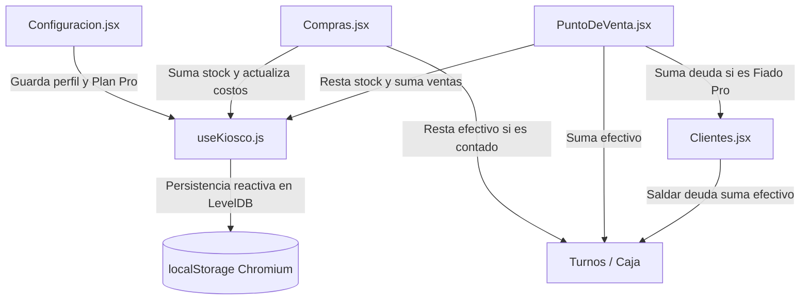

# MODULOS POS Y PANTALLAS (SIMPLE PROX v1.3.12)

> **Documento:** `DOCUMENTACION_IA/02_MODULOS_POS.md`  
> **Estado:** `[IMPLEMENTADO]` / `[VERIFICADO]`  
> **Referencia de Código:** Commit `4e145bba6b4553c289727a90c569124bef8ed24b` + rama `security/phase-0.2.2-event-idempotency`  
> **Regla de oro:** No modificar ninguno de estos módulos sin verificar primero dependencias cruzadas con el hook central `useKiosco.js` y persistencia en `localStorage`.

---

## 1. VISTA GENERAL DE LA INTERFAZ Y NAVEGACIÓN

La aplicación opera como una Single Page Application (SPA) en React montada en `src/App.jsx`.
A diferencia de sistemas que destruyen el DOM al navegar, Simple ProX mantiene **montadas permanentemente** las pantallas activas dentro de contenedores `<div style={{ display: currentScreen === '...' ? 'block' : 'none' }}>`.

### Implicancias de esta Arquitectura:
1. **Preservación de Estado Volátil:** Si un cajero está cargando una venta en `PuntoDeVenta` y cambia a `Clientes` o `Inventario`, el carrito, los inputs y los focos se conservan intactos al regresar.
2. **Ciclos de Vida de Efectos (`useEffect`):** Los temporizadores o listeners registrados en componentes montados continúan ejecutándose en segundo plano, por lo que deben condicionarse a la pantalla activa o al desmontaje de la aplicación.
3. **Control de Acceso Global (`isProtectedTab`):**
   Las pestañas `productos`, `inventario`, `usuarios`, `reportes` y `configuracion` están custodiadas por un overlay de PIN de Administrador (`Lock` guard en `App.jsx`, líneas 240-275). Si el usuario activo no tiene rol `admin` ni autenticación global (`globalAdminAuthed`), la pantalla se bloquea visualmente exigiendo el PIN maestro.

---

## 2. INVENTARIO DE PANTALLAS (12 MÓDULOS)

```
src/screens/
├── PuntoDeVenta.jsx   (POS principal, facturación, cobros, fiado, banners)
├── Productos.jsx      (Catálogo, altas, bajas, modificaciones, combos, import/export)
├── Inventario.jsx     (Ajustes rápidos de stock, alertas críticas, vencimientos)
├── Compras.jsx        (Recepción de mercadería, actualización de costos/stock)
├── Turnos.jsx         (Apertura/Cierre de caja, arqueo X/Z, control de efectivo)
├── Clientes.jsx       (Cuenta corriente, saldos deudores, historial, import/export)
├── Reportes.jsx       (Estadísticas de ventas, métodos de pago, rentabilidad Pro)
├── Usuarios.jsx       (Gestión de cajeros y administradores, PINes)
├── Configuracion.jsx  (Perfil del comercio, respaldo .spx, licencias, impresoras)
├── Ofertas.jsx        (Catálogo B2B de mayoristas, WhatsApp CTA, métricas)
├── Soporte.jsx        (Manual rápido, atajos de teclado F1-F12, diagnóstico)
└── Onboarding.jsx     (Asistente de configuración inicial en primer arranque)
```

---

## 3. FICHA TÉCNICA DETALLADA POR PANTALLA

---

### 3.1. Punto de Venta (`src/screens/PuntoDeVenta.jsx`)
* **Propósito:** Módulo crítico de facturación y cobro. Operación de alta velocidad optimizada para teclado y lector de código de barras.
* **Componentes / Submodales:**
  - Carrito de compras y selector de cantidades/precios.
  - Modal de Métodos de Pago (Efectivo, Débito, Crédito, Transferencia, MercadoPago, Fiado).
  - Modal de Cobro Mixto / Múltiples Medios.
  - Modal de Búsqueda Manual de Productos (F7) con autocompletado en tiempo real.
  - Modal de Notificaciones y Alertas (F8 - Stock y vencimientos Pro).
  - Modal de Pago Rápido / Calculadora de Vuelto (F9 / F10).
  - Modal de Saldar Deuda de Clientes (`payDebt`).
  - Integración de Banner Publicitario B2B en encabezado POS (`ofertas.activeBanner`).
* **Atajos de Teclado:**
  - `F1`: Efectivo | `F2`: Débito | `F3`: Crédito | `F4`: Transferencia | `F5`: MercadoPago.
  - `F6`: Fiado (Cuenta corriente - exclusivo **Plan Pro**).
  - `F7`: Buscar producto | `F8`: Panel Notificaciones | `F9`: Cobro rápido efectivo | `F10`: Calculadora | `F12`: Finalizar venta.
  - `Enter`: Agregar producto por código de barras.
* **Claves de Almacenamiento Afectadas:**
  - Modifica `kioscoprox_sales` (agrega comprobante con ID timestamp).
  - Modifica `kioscoprox_products` (deduce stock automáticamente).
  - Modifica `kioscoprox_caja` (incrementa `efectivo` si el método es Efectivo).
  - Modifica `kioscoprox_clients` (incrementa `deuda` si el método es Fiado).
* **Reglas de Negocio y Validaciones:**
  - Si la caja está cerrada (`caja.isOpen === false`), permite operar pero advierte o solicita apertura de turno.
  - No permite venta sin ítems en carrito.
  - Si el método es 'Fiado', exige obligatoriamente seleccionar un cliente.
* **Diferencias Básico vs Pro:**
  - **Básico:** Método 'Fiado' (F6) deshabilitado. Permite cobrar deudas preexistentes de clientes, pero no originar nuevas ventas a crédito. Sin panel de notificaciones F8 de vencimientos.
  - **Pro:** Método 'Fiado' habilitado con asignación directa a cuenta corriente del cliente. Notificaciones F8 activas.
* **Riesgo en Modificaciones:** CRÍTICO. Modificaciones en el redondeo de totales o deducción de stock pueden causar discrepancias contables irreversibles en caja.

---

### 3.2. Productos (`src/screens/Productos.jsx`)
* **Propósito:** Catálogo maestro de artículos, gestión de precios, costos, categorías y códigos de barra.
* **Componentes / Submodales:**
  - Tabla de productos con ordenamiento, filtrado por categoría y búsqueda textual.
  - Modal de Alta / Modificación de Producto.
  - Modal de Creación y Edición de Combos / Packs.
  - Modal de Importación Masiva (Excel / CSV) con previsualización.
  - Modal de Exportación a Excel/CSV.
  - Ajuste global de márgenes porcentuales.
* **Claves de Almacenamiento Afectadas:**
  - `kioscoprox_products`
  - `kioscoprox_category_tree`
* **Reglas de Negocio y Validaciones:**
  - Validación de código de barras / SKU duplicado.
  - Cálculo automático: $\text{Precio} = \text{Costo} \times (1 + \frac{\text{Margen}}{100})$.
  - Si se modifica el costo en Compras o Productos, se recalcula el precio final respetando el margen.
* **Diferencias Básico vs Pro:**
  - **Básico:** Límite máximo de **500 productos** por carga individual y hasta **1000 productos** en importación masiva. Creación de "Combos" bloqueada.
  - **Pro:** Límite ampliado a **2500 productos**. Creación y gestión de "Combos" habilitada.
* **Riesgo en Modificaciones:** ALTO. La importación masiva (`batchImportProducts`) debe preservar el mapeo de `id`, `code` y `sku` para evitar duplicación de catálogo.

---

### 3.3. Inventario (`src/screens/Inventario.jsx`)
* **Propósito:** Auditoría y control de existencias, detección de quiebres de stock y gestión de reposición.
* **Componentes / Submodales:**
  - Tarjetas de resumen: Valor total del stock (costo y venta), Stock Crítico, Sin Stock, Por Vencer.
  - Tabla de existencias con botones de ajuste rápido de unidades (+1, -1, fijar manual).
  - Sugerencias de reposición vinculadas al sistema de Ofertas B2B (`stockOfferMatcher.js`).
* **Claves de Almacenamiento Afectadas:**
  - `kioscoprox_products` (actualiza campo `stock`).
* **Reglas de Negocio y Validaciones:**
  - Stock no puede ser negativo tras un ajuste manual (se fuerza a $\ge 0$).
  - Detección de stock crítico: $\text{stock} \le \text{minStock}$.
* **Diferencias Básico vs Pro:**
  - **Básico:** La tarjeta de "Productos por Vencer" está deshabilitada (no audita fechas de expiración).
  - **Pro:** Control activo de vencimientos en 30/60/90 días con alertas visuales y filtro interactivo.
* **Riesgo en Modificaciones:** MEDIO. Asegurar que los ajustes de stock no alteren los campos de costo o margen del producto.

---

### 3.4. Compras (`src/screens/Compras.jsx`)
* **Propósito:** Registro de compras a distribuidores, recepción de mercadería y actualización de stock/costos.
* **Componentes / Submodales:**
  - Formulario de comprobante de compra (Proveedor, Nro de Factura, Fecha, Método de Pago).
  - Selector de ítems comprados (Cantidad, Costo Unitario).
  - Historial de compras registradas con desglose de ítems y auditoría de modificaciones.
* **Claves de Almacenamiento Afectadas:**
  - `kioscoprox_purchases`
  - `kioscoprox_products` (incrementa `stock` y actualiza `cost`).
  - `kioscoprox_caja` (deduce `efectivo` si el método fue en Efectivo y la caja está abierta).
* **Reglas de Negocio y Validaciones:**
  - Al registrar una compra, actualiza automáticamente el costo del producto y recomputa el precio de venta manteniendo el margen predeterminado.
  - En edición de compras (`updatePurchase`), ejecuta un rollback exacto de las cantidades previas en stock y caja antes de aplicar los nuevos valores.
* **Diferencias Básico vs Pro:** Módulo disponible funcionalmente en ambos planes.
* **Riesgo en Modificaciones:** ALTO. La función `updatePurchase` tiene lógica transaccional sensible que afecta simultáneamente `purchases`, `products` y `caja`.

---

### 3.5. Turnos y Caja (`src/screens/Turnos.jsx`)
* **Propósito:** Control de flujo de efectivo por turno de trabajo, arqueo de caja y cierre diario.
* **Componentes / Submodales:**
  - Panel de Estado de Caja (Abierta / Cerrada, Usuario responsable, Hora de inicio).
  - Formulario de Apertura de Turno con Monto Inicial.
  - Registro de Movimientos de Caja (Ingresos / Retiros manuales con motivo justificado).
  - Modal de Cierre de Caja (Cierre X / Z): conteo de billetes, cálculo de diferencia ($\text{Real} - \text{Esperado}$).
  - Impresión / Exportación de Resumen de Turno.
* **Claves de Almacenamiento Afectadas:**
  - `kioscoprox_caja` (`isOpen`, `efectivo`, `openedAt`, `movimientos`).
  - `kioscoprox_shifts` (acumula registros históricos de turnos cerrados).
* **Reglas de Negocio y Validaciones:**
  - Si la caja ya está abierta, no permite abrir un nuevo turno sin cerrar el actual.
  - Todo ingreso/retiro requiere un motivo documentado.
  - El cierre de caja resetea `caja.isOpen` a `false` y transfiere el estado completo al historial `kioscoprox_shifts`.
* **Diferencias Básico vs Pro:** Módulo disponible en ambos planes.
* **Riesgo en Modificaciones:** CRÍTICO. Si el estado de `caja` se corrompe, los módulos de `PuntoDeVenta` y `Compras` pueden fallar en sus deducciones o incrementos de efectivo.

---

### 3.6. Clientes (`src/screens/Clientes.jsx`)
* **Propósito:** Gestión de cartera de clientes, control de cuentas corrientes y cobranza de deudas.
* **Componentes / Submodales:**
  - Directorio de clientes con buscador por Nombre, DNI/CUIT o Teléfono.
  - Modal de Alta / Edición de Cliente.
  - Modal de Saldar Deuda (`payDebt`): registra pago total o parcial en efectivo/digital e impacta caja.
  - Modal de Importación / Exportación Masiva (CSV / Excel).
  - Historial de comprobantes de venta vinculados al cliente.
* **Claves de Almacenamiento Afectadas:**
  - `kioscoprox_clients`
  - `kioscoprox_caja` (al saldar deudas en efectivo, ingresa movimiento `deposit`).
* **Reglas de Negocio y Validaciones (v1.3.12 quirúrgica):**
  - **Cliente "Consumidor Final":** Es un registro de sistema protegido; está prohibido eliminarlo.
  - **Clientes con Deuda Activa:** No pueden ser eliminados si `deuda > 0`. El sistema rechaza la eliminación con código `HAS_DEBT`.
  - **Clientes con Ventas Históricas:** No pueden ser eliminados si existen comprobantes asociados para no romper la integridad referencial (`HAS_SALES`).
* **Diferencias Básico vs Pro:**
  - En ambos planes se permite registrar clientes, consultar saldos y saldar deudas (`payDebt`).
  - La generación de nueva deuda en POS (Fiado) requiere Plan Pro.
* **Riesgo en Modificaciones:** MEDIO-ALTO. Respetar estrictamente las validaciones de eliminación implementadas en v1.3.12.

---

### 3.7. Reportes (`src/screens/Reportes.jsx`)
* **Propósito:** Analítica comercial, métricas de facturación y toma de decisiones.
* **Componentes / Submodales:**
  - Gráficos de evolución de ventas (Día, Semana, Mes).
  - Desglose de ingresos por método de pago (Efectivo, Débito, MercadoPago, etc.).
  - Ranking de productos más vendidos (unidades y facturación).
  - Exportación de reportes a PDF y Excel.
* **Claves de Almacenamiento Afectadas:** Solo lectura (`kioscoprox_sales`, `kioscoprox_products`, `kioscoprox_shifts`).
* **Reglas de Negocio y Validaciones:**
  - Las cancelaciones o devoluciones se reflejan en las métricas consolidadas.
* **Diferencias Básico vs Pro:**
  - **Básico:** Muestra totales brutos de venta, cantidad de transacciones y métodos de pago.
  - **Pro:** Desbloquea el cálculo de **Ganancia Neta / Rentabilidad** ($\text{Ventas} - \text{Costo de Mercadería Vendida}$) y márgenes porcentuales por categoría.
* **Riesgo en Modificaciones:** BAJO. Es un módulo de lectura analítica que no muta datos transaccionales.

---

### 3.8. Usuarios (`src/screens/Usuarios.jsx`)
* **Propósito:** Administración de operadores del sistema y control de permisos basados en roles.
* **Componentes / Submodales:**
  - Lista de usuarios con indicador de rol (`admin` / `cajero`).
  - Formulario de creación y reseteo de clave / PIN de 4 dígitos.
* **Claves de Almacenamiento Afectadas:**
  - `kioscoprox_users`
* **Reglas de Negocio y Validaciones:**
  - Debe existir siempre al menos un usuario con rol `admin`.
  - El PIN debe ser numérico de 4 dígitos.
* **Diferencias Básico vs Pro:**
  - **Básico:** Límite estricto de **hasta 2 usuarios**.
  - **Pro:** Límite ampliado a **hasta 5 usuarios** (o ilimitado según variante).
* **Riesgo en Modificaciones:** ALTO. Un error en la validación de PIN puede dejar bloqueado el acceso a las pantallas protegidas del sistema.

---

### 3.9. Configuración (`src/screens/Configuracion.jsx`)
* **Propósito:** Parámetros globales del negocio, licenciamiento digital, impresoras y copias de seguridad.
* **Componentes / Submodales:**
  - **Perfil del Comercio:** Razón Social, CUIT, Dirección, Teléfono, Mensajes de ticket.
  - **Tarjeta de Plan y Licencia:** Visualización del plan actual y formulario de activación de Plan Pro mediante certificado digital Ed25519 (`isValidProLicense`).
  - **Copias de Seguridad (Backup .spx):**
    - Generación y descarga de archivo de respaldo cifrado / empaquetado `.spx`.
    - Restauración segura con migración automática y preservación de `installationId`.
  - **Configuración de Impresión:** Selección de ancho de ticket (58mm / 80mm), márgenes y corte automático.
  - **Margen Global:** Reajuste masivo de márgenes para productos sin costo fijo.
* **Claves de Almacenamiento Afectadas:**
  - `kioscoprox_business_config`
  - Todas las claves durante una restauración de backup (`safeBackupWriter.js`).
* **Reglas de Negocio y Validaciones:**
  - Al guardar el perfil del comercio, se debe preservar obligatoriamente `isActivated: true`, `installationId` y `licenseToken`.
  - La activación Pro valida el token contra la clave pública maestra en memoria antes de persistir `plan: 'Pro'`.
* **Diferencias Básico vs Pro:**
  - Permite activar el certificado Pro desde el plan Básico.
* **Riesgo en Modificaciones:** CRÍTICO. Cualquier fallo al guardar `businessConfig` puede desencadenar la reaparición no deseada de `ActivationGuard`.

---

### 3.10. Ofertas B2B (`src/screens/Ofertas.jsx`)
* **Propósito:** Catálogo comercial B2B donde distribuidores y mayoristas exponen ofertas a los comercios minoristas.
* **Componentes / Submodales:**
  - Carrusel y grilla de campañas publicitarias activas.
  - Botón de acción directa (CTA) para realizar pedidos vía WhatsApp al distribuidor.
  - Notificación de coincidencia entre ofertas mayoristas y faltantes de stock (`stockOfferMatcher.js`).
  - Toggle de visualización de publicidad para comercios Plan Pro.
* **Claves de Almacenamiento Afectadas:**
  - `kioscoprox_ads_cache` (campañas descargadas localmente).
  - `kioscoprox_ads_metrics_queue` (registro offline de impresiones y clicks).
* **Reglas de Negocio y Validaciones:**
  - Si no hay conexión a Internet, muestra ofertas cacheadas localmente (`adSyncEngine.js`).
  - Los eventos de impresión y click se encolan con UUID idempotente si no hay conectividad.
* **Diferencias Básico vs Pro:**
  - **Básico:** Los banners y la sección de ofertas se muestran siempre (no pueden ocultarse).
  - **Pro:** Dispone de la opción para ocultar publicidad comercial (`hideAds: true`).
* **Riesgo en Modificaciones:** BAJO respecto al POS. El sistema de ofertas está completamente desacoplado del flujo de facturación.

---

### 3.11. Soporte y Diagnóstico (`src/screens/Soporte.jsx`)
* **Propósito:** Centro de ayuda al usuario, guía rápida de atajos de teclado y panel de diagnóstico del sistema.
* **Componentes / Submodales:**
  - Tabla de atajos de teclado (F1 a F12).
  - Panel informativo: Versión del ejecutable (v1.3.12), Installation ID, Plan actual, Arquitectura.
  - Enlaces de contacto técnico directo vía WhatsApp y documentación oficial.
* **Claves de Almacenamiento Afectadas:** Solo lectura.
* **Diferencias Básico vs Pro:** Muestra atajos adicionales exclusivos de Pro (ej. F6 Fiado, F8 Notificaciones).
* **Riesgo en Modificaciones:** NULO. Pantalla exclusivamente informativa.

---

### 3.12. Onboarding (`src/screens/Onboarding.jsx`)
* **Propósito:** Asistente de configuración inicial ejecutado la primera vez que arranca la aplicación (cuando `businessConfig.isOnboarded === false`).
* **Componentes / Submodales:**
  - Paso 1: Bienvenida e identidad comercial (Nombre de fantasía, Rubro principal).
  - Paso 2: Creación del usuario Administrador inicial (Nombre y PIN de 4 dígitos).
  - Paso 3: Configuración de moneda y formato de ticket por defecto.
* **Claves de Almacenamiento Afectadas:**
  - `kioscoprox_business_config` (`isOnboarded: true`).
  - `kioscoprox_users` (crea el primer administrador).
* **Reglas de Negocio y Validaciones:**
  - No permite avanzar sin ingresar nombre del negocio y PIN válido.
  - Una vez finalizado, marca `isOnboarded: true` y redirecciona al POS principal.
* **Riesgo en Modificaciones:** MEDIO. Afecta únicamente instalaciones nuevas o reseteadas.

---

## 4. MATRIZ DE DIFERENCIAS BÁSICO VS PRO

| Capacidad / Módulo | Plan Básico | Plan Pro | Implementación / Control |
| :--- | :---: | :---: | :--- |
| **Venta a Fiado (F6)** | ❌ Bloqueado | ✅ Habilitado | `PuntoDeVenta.jsx` (líneas 484, 495) |
| **Cobro de Deudas Clientes** | ✅ Habilitado | ✅ Habilitado | `useKiosco.js` (`payDebt`) |
| **Límite de Catálogo** | 500 manual / 1000 import | 2500 productos | `Productos.jsx` (líneas 419, 569, 575) |
| **Creación de Combos** | ❌ Bloqueado | ✅ Habilitado | `Productos.jsx` (línea 2042) |
| **Alertas de Vencimiento** | ❌ Deshabilitado | ✅ Habilitado | `Inventario.jsx` (línea 132), `Soporte.jsx` |
| **Límite de Operadores** | Máximo 2 usuarios | Hasta 5 / Ilimitado | `Usuarios.jsx` (líneas 30, 34) |
| **Rentabilidad / Márgenes** | ❌ Oculto | ✅ Detallado | `Reportes.jsx` (líneas 643, 663) |
| **Ocultar Anuncios B2B** | ❌ Obligatorio | ✅ Opcional (`hideAds`) | `Configuracion.jsx`, `Ofertas.jsx` |

---

## 5. DEPENDENCIAS CRUZADAS Y FLUJO DE DATOS



---

## 6. PROTOCOLO DE PRUEBAS DE REGRESIÓN OBLIGATORIO (AGENTS.md)

Cualquier cambio quirúrgico en cualquiera de las 12 pantallas debe someterse a la siguiente batería de comprobación antes de declararse terminado:

1. **Prueba de POS y Facturación:** Agregar un producto al carrito, finalizar venta en efectivo, verificar que se incremente el efectivo en caja y disminuya el stock del producto.
2. **Prueba de Cuenta Corriente (Fiado):**
   - En Plan Pro: Asignar venta a un cliente con método Fiado; verificar incremento exacto de deuda.
   - En Plan Básico: Verificar que la opción Fiado no esté disponible.
   - En ambos planes: Cobrar deuda desde Clientes o POS; verificar que la deuda disminuya y el efectivo en caja aumente.
3. **Prueba de Integridad de Clientes:**
   - Intentar eliminar "Consumidor Final" $\rightarrow$ debe ser rechazado.
   - Intentar eliminar un cliente con deuda $\rightarrow$ debe ser rechazado con mensaje explicativo.
   - Intentar eliminar un cliente con ventas históricas $\rightarrow$ debe ser rechazado.
4. **Prueba de Compras y Costos:** Cargar una compra con nuevo costo unitario; verificar que el stock aumente y el precio de venta se actualice respetando el margen comercial.
5. **Prueba de Turno de Caja:** Realizar un Cierre X / Z; verificar que la caja pase a `isOpen: false` y el turno se almacene en el historial de `Turnos`.
6. **Prueba de No-Afectación de Licencia:** Guardar datos del comercio en `Configuracion.jsx`; cerrar y reabrir la aplicación; verificar que `ActivationGuard` **NO** se dispare.
