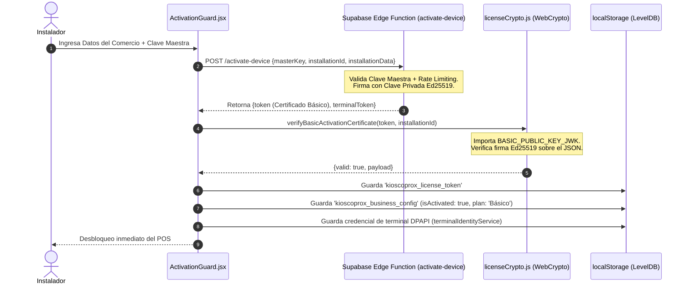

# SISTEMA DE LICENCIAS, PLANES Y ACTIVACIÓN CRIPTOGRÁFICA

> **Documento:** `DOCUMENTACION_IA/03_LICENCIAS_Y_PLANES.md`  
> **Estado:** `[IMPLEMENTADO]` / `[INSPECCIONADO]` / `[TEST_MANUAL_DOCUMENTADO]`  
> **Referencia de Código:** Commit `4e145bba6b4553c289727a90c569124bef8ed24b` + rama `security/phase-0.2.2-event-idempotency`  
> **Regla de oro:** No alterar la estructura de almacenamiento de licencias ni la validación asimétrica Ed25519 sin pruebas de regresión en instalaciones existentes.

---

## 1. PRINCIPIOS DE DISEÑO Y MODELO OFFLINE-FIRST

El sistema de licenciamiento de Simple ProX fue diseñado bajo tres principios inquebrantables:
1. **Verificación Offline Autónoma:** Una vez que la terminal fue activada, **nunca requiere conexión a Internet para validar su licencia**. Puede operar meses continuos fuera de línea sin bloquearse.
2. **Criptografía Asimétrica de Curva Elíptica (Ed25519):** No utiliza claves numéricas débiles ni algoritmos simétricos reversibles. La aplicación cliente solo posee las **claves públicas** y verifica firmas digitales generadas exclusivamente en el servidor o entorno administrativo con la clave privada.
3. **Vinculación Estricta al Hardware (`installationId`):** Cada certificado digital está firmado contra el identificador único e inmutable de la máquina. Un certificado copiado a otra computadora es rechazado inmediatamente.

---

## 2. EL IDENTIFICADOR DE INSTALACIÓN (`installationId`)

### A. Definición y Generación ([src/services/installationService.js](file:///c:/Users/Pininas/KioscoProX/src/services/installationService.js))
- Al primer arranque del sistema, se genera un identificador único con prefijo `spx_inst_` seguido de una combinación pseudoaleatoria basada en timestamp y entropía criptográfica:
  ```javascript
  // src/services/installationService.js (línea ~12)
  const id = 'spx_inst_' + Date.now().toString(36) + '_' + Math.random().toString(36).substring(2, 9);
  ```
- **Persistencia Física:** Se almacena en la clave `kioscoprox_installation_id` de `localStorage`.
- **Inmutabilidad:** Si la clave ya existe, `getInstallationId()` devuelve siempre el valor persistido. Está estrictamente prohibido regenerar este ID en actualizaciones o cambios de perfil comercial.
- **Preservación en Respaldos (`.spx`):** Durante la restauración de copias de seguridad ([safeBackupWriter.js](file:///c:/Users/Pininas/KioscoProX/electron/safeBackupWriter.js) / [backupService.js](file:///c:/Users/Pininas/KioscoProX/src/services/backupService.js)), el `installationId` local de la máquina receptora se preserva forzosamente para no anular la licencia del equipo de destino.

---

## 3. ESQUEMA CRIPTOGRÁFICO ASIMÉTRICO (Ed25519)

Toda la verificación matemática local se implementa en [src/utils/licenseCrypto.js](file:///c:/Users/Pininas/KioscoProX/src/utils/licenseCrypto.js) utilizando la API estándar **WebCrypto** (`crypto.subtle`), garantizando compatibilidad tanto en el proceso Renderer de Electron como en entornos Node.js / pruebas.



---

## 4. DUALIDAD DE CERTIFICADOS: PLAN BÁSICO VS PLAN PRO

Simple ProX maneja **dos esquemas de certificados** independientes, cada uno respaldado por su propio par de claves asimétricas:

### A. Certificado de Activación Básico (`verifyBasicActivationCertificate`)
* **Emisor:** Edge Function `activate-device` en Supabase.
* **Clave Pública en Cliente:** `BASIC_PUBLIC_KEY_JWK` ([src/utils/licenseCrypto.js](file:///c:/Users/Pininas/KioscoProX/src/utils/licenseCrypto.js), líneas 138-144):
  ```json
  {
    "crv": "Ed25519",
    "x": "E8DDN-xpkQijtwuNNIA_W9FzXhZQFqjBUDo9PSffCmc",
    "kty": "OKP"
  }
  ```
* **Formato del Token:** `Base64(JSON_Payload) . Base64(Signature)`
* **Estructura del Payload JSON:**
  ```json
  {
    "version": 1,
    "type": "initial_activation",
    "plan": "Básico",
    "installationId": "spx_inst_...",
    "issuedAt": 1789000000000,
    "installationData": {
      "negocio": "Kiosco Central",
      "direccion": "Av. San Martín 123",
      "telefono": "2664000000",
      "instalador": "Técnico Oficial",
      "hardwareId": "PC-A8B9C0",
      "geo": { "city": "San Luis", "ip": "181.x.x.x" }
    }
  }
  ```
* **Reglas de Aceptación:**
  1. Firma digital válida verificada con `BASIC_PUBLIC_KEY_JWK`.
  2. Coincidencia exacta de `payload.installationId === localInstallationId`.
  3. `payload.type === 'initial_activation'`.
  4. `payload.plan === 'Básico'`.

---

### B. Certificado Digital Plan Pro (`verifyProLicenseCertificate` / `verifyEd25519License`)
* **Emisor:** Generador administrativo de licencias comerciales (entorno offline seguro o script autorizado).
* **Clave Pública en Cliente:** `PUBLIC_KEY_JWK` ([src/utils/licenseCrypto.js](file:///c:/Users/Pininas/KioscoProX/src/utils/licenseCrypto.js), líneas 22-28):
  ```json
  {
    "crv": "Ed25519",
    "x": "g2YZsqZVp1AkXx_ThaNWqGTd4PkbExIRjmXHTjNtVF4",
    "kty": "OKP"
  }
  ```
* **Formato del Token:** `Base64(Canonical_String) . Base64(Signature)`
* **Estructura Canónica (Pipe-delimited):**
  $$\text{Payload} = \text{version} \,|\, \text{licenseId} \,|\, \text{installationId} \,|\, \text{plan} \,|\, \text{iat} \,|\, \text{exp}$$
  *Ejemplo:* `1|LIC-PRO-2026-001|spx_inst_abc123|Pro|1789000000000|0`
* **Campos:**
  - `version`: Debe ser `1`.
  - `licenseId`: Identificador único del comprobante comercial.
  - `installationId`: Identificador de la terminal receptora.
  - `plan`: Debe ser `'Pro'`.
  - `iat`: Timestamp Unix de emisión en milisegundos.
  - `exp`: Timestamp Unix de vencimiento en milisegundos ($0 = \text{permanente / vitalicia}$).
* **Reglas de Aceptación:**
  1. Firma digital válida verificada con `PUBLIC_KEY_JWK`.
  2. Coincidencia exacta de `installationId`.
  3. `plan === 'Pro'`.
  4. Expiración: Si $\text{exp} > 0$, requiere que $\text{Date.now()} \le \text{exp}$. Si $\text{exp} = 0$, la licencia es permanente.

---

## 5. GUARDIANES DE ACTIVACIÓN Y CICLO DE VIDA EN RUNTIME

### A. La Pantalla de Bloqueo Inicial ([src/components/ActivationGuard.jsx](file:///c:/Users/Pininas/KioscoProX/src/components/ActivationGuard.jsx))
Si `businessConfig.isActivated` es falso o la verificación de licencia falla al arrancar:
1. `App.jsx` no renderiza el POS ni las pantallas comerciales; monta exclusivamente `<ActivationGuard />`.
2. El formulario solicita:
   - Nombre de fantasía del kiosco.
   - Dirección física del local.
   - Teléfono de contacto.
   - Nombre del instalador / técnico.
   - **Clave Maestra:** Contraseña administrativa provista por el distribuidor.
3. Al presionar "Activar Terminal", se ejecuta `processActivation()` en [activationService.js](file:///c:/Users/Pininas/KioscoProX/src/services/activationService.js).
4. El token recibido es verificado localmente con WebCrypto **antes de guardarse**. Si la firma o el `installationId` no concuerdan, la activación es abortada de inmediato.
5. Si valida, persiste en `localStorage` e invoca `onActivated()` para refrescar el estado raíz sin recargar la aplicación.

---

### B. Guardia de Verificación Continua en `App.jsx` ([src/App.jsx](file:///c:/Users/Pininas/KioscoProX/src/App.jsx), líneas 96-180)
La función `checkLicense()` se ejecuta al montar la aplicación y luego en un intervalo horario recurrente ($60 \text{ minutos}$):

```javascript
// src/App.jsx (líneas 114-150)
const token = localStorage.getItem('kioscoprox_license_token');
const instId = kiosco.businessConfig?.installationId || '';

let result = await verifyBasicActivationCertificate(token, instId);
if (!result.valid && verifyEd25519License) {
  const legacyRes = await verifyEd25519License(token, instId);
  if (legacyRes.valid) result = legacyRes;
}
```

#### Protección de Carrera durante Venta Activa (`window.__ACTIVE_SALE__`)
Para evitar que un vencimiento de token o una falla temporal bloquee al cajero mientras cobra a un cliente:
- Si la verificación falla pero `window.__ACTIVE_SALE__ === true`, el sistema fija:
  ```javascript
  setLicensePendingLock(true);
  ```
- Un segundo temporizador rápido ($5 \text{ segundos}$) comprueba cuándo finalizó la transacción activa (`!window.__ACTIVE_SALE__`) para aplicar el bloqueo recién en ese momento, protegiendo la operación comercial.

---

## 6. MATRIZ DETALLADA DE DIFERENCIAS ENTRE PLANES

| Característica / Función | Plan Básico | Plan Pro | Archivo y Lógica de Control |
| :--- | :---: | :---: | :--- |
| **Precio / Comercialización** | Gratuito o de entrada | Suscripción / Pago anual | Comercial |
| **Certificado Criptográfico** | Emitido por `activate-device` | Token Ed25519 Pro firmado | `licenseCrypto.js` |
| **Venta a Fiado (F6)** | ❌ Bloqueado | ✅ Habilitado | `PuntoDeVenta.jsx` (L484, L495) |
| **Cobro de Deudas Clientes** | ✅ Habilitado | ✅ Habilitado | `useKiosco.js` (`payDebt`) |
| **Límite Catálogo Productos** | 500 manual / 1000 import | 2500 productos | `Productos.jsx` (L419, L569, L575) |
| **Creación de Combos / Packs** | ❌ Bloqueado | ✅ Habilitado | `Productos.jsx` (L2042) |
| **Alertas de Vencimiento** | ❌ Deshabilitado | ✅ En 30/60/90 días | `Inventario.jsx` (L132) |
| **Límite de Operadores** | Hasta 2 usuarios | Hasta 5 / Ilimitado | `Usuarios.jsx` (L30, L34) |
| **Cálculo de Rentabilidad** | ❌ Oculto | ✅ Ganancia neta visible | `Reportes.jsx` (L643, L663) |
| **Ocultar Publicidad B2B** | ❌ Banners obligatorios | ✅ Opción `hideAds` activa | `Configuracion.jsx`, `Ofertas.jsx` |
| **Atajo F8 (Notificaciones)** | ❌ Oculto | ✅ Panel interactivo | `Soporte.jsx`, `PuntoDeVenta.jsx` |

---

## 7. GESTIÓN DEL CAMBIO DE PLAN: BÁSICO A PRO

El cambio de plan **no reinstala la aplicación ni modifica la base de datos local**:
1. El usuario o técnico ingresa a `Configuración` $\rightarrow$ Tarjeta de Plan Actual.
2. Presiona *"Activar Plan Pro (Certificado Digital)"*.
3. Pega el token Ed25519 Pro provisto por el mayorista o soporte comercial.
4. `Configuracion.jsx` (línea ~113) ejecuta `isValidProLicense(rawId, inputToken)`.
5. Si la firma es válida y coincide con el `installationId`, actualiza `businessConfig`:
   ```javascript
   kiosco.updateBusinessConfig({
     ...kiosco.businessConfig,
     plan: 'Pro',
     licenseKey: inputToken
   });
   ```
6. **Disparo asíncrono no bloqueante:** Notifica a Supabase (`registerMerchantRemotely`) para reflejar el estado Pro en el Panel Administrador, sin interrumpir la operación si no hay conexión a Internet.
7. Los límites de productos, usuarios y menús avanzados se desbloquean inmediatamente en memoria de React.

---

## 8. RIESGOS CONOCIDOS Y DIRECTIVAS PARA MODIFICACIONES QUIRÚRGICAS

> [!WARNING] RIESGO CRÍTICO DE DESACTIVACIÓN INVOLUNTARIA
> Cualquier función que sobrescriba el objeto `kioscoprox_business_config` en `localStorage` (como `saveCommerceProfile` en [installationService.js](file:///c:/Users/Pininas/KioscoProX/src/services/installationService.js) o el guardado de datos del negocio en [Configuracion.jsx](file:///c:/Users/Pininas/KioscoProX/src/screens/Configuracion.jsx)) **debe realizar un spread operator defensivo de los campos de activación**:
> ```javascript
> isActivated: prev.isActivated !== undefined ? prev.isActivated : true,
> installationId: prev.installationId || existingId,
> plan: prev.plan || 'Básico'
> ```
> Omitir estos campos provoca que `checkLicense()` en `App.jsx` considere que la terminal no está activada y muestre intempestivamente la pantalla de `ActivationGuard`.

### Checklist Obligatorio para Desarrolladores o Asistentes IA:
- [ ] No modificar las claves JWK en `src/utils/licenseCrypto.js`.
- [ ] No eliminar la clave `kioscoprox_license_token` al limpiar datos demo o de catálogo.
- [ ] En restauraciones de backup (`.spx`), verificar que `installationId` sea respetado.
- [ ] No exigir peticiones HTTP salientes para autorizar la navegación del POS.
