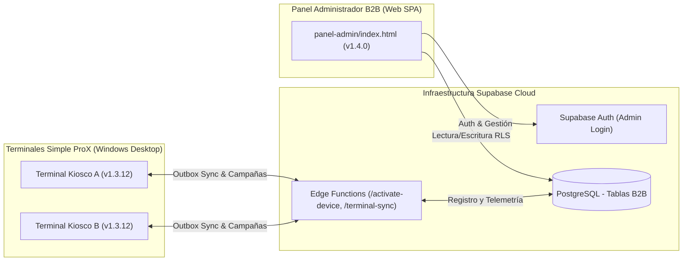

# PANEL ADMINISTRADOR B2B (ARQUITECTURA SPA, GESTIÓN Y TELEMETRÍA)

> **Documento:** `DOCUMENTACION_IA/04_PANEL_ADMIN_B2B.md`  
> **Estado:** `[IMPLEMENTADO]` / `[INSPECCIONADO]`  
> **Referencia de Código:** Commit `4e145bba6b4553c289727a90c569124bef8ed24b` + rama `security/phase-0.2.2-event-idempotency`  
> **Archivo Principal:** [panel-admin/index.html](file:///c:/Users/Pininas/KioscoProX/panel-admin/index.html) (324 KB, SPA autónoma)  
> **Regla de oro:** No asumir que el panel admin cuenta con controles que no están en el DOM; la revocación de terminales es una función de backend no expuesta aún en la UI.

---

## 1. PROPÓSITO Y ARQUITECTURA GENERAL

El **Panel Administrador B2B** (Versión 1.4.0) es la consola web centralizada utilizada por los administradores de la red Simple ProX y los mayoristas/distribuidores. Su función principal es gestionar la pauta publicitaria comercial que se despliega en las terminales de escritorio instaladas en los comercios minoristas (kioscos, almacenes y minimercados).

### A. Principios de Construcción
1. **SPA Autónoma sin Build:** Está implementado como un único archivo monolítico de alto rendimiento ([panel-admin/index.html](file:///c:/Users/Pininas/KioscoProX/panel-admin/index.html)) que combina HTML5 semántico, variables CSS modernas (Dark Mode nativo) y JavaScript vanilla reactivo.
2. **Cero Dependencia de Servidores Node.js:** Puede ser servido como archivo estático desde cualquier CDN, bucket de almacenamiento (Cloudflare Pages, Vercel, Supabase Storage, Netlify) o ejecutado localmente con un servidor HTTP ligero (`npx serve`, Python `http.server`, etc.).
3. **Conexión Directa a Supabase:** Utiliza el SDK cliente oficial `@supabase/supabase-js` v2 cargado vía CDN (`cdn.jsdelivr.net`), comunicándose directamente con la base de datos PostgreSQL y las Edge Functions a través de la API REST / PostgREST.



---

## 2. AUTENTICACIÓN Y SEGURIDAD

### A. Control de Sesión Administrativa
- **Autenticación con Supabase Auth:** La interfaz cuenta con una cortina modal bloqueante (`#auth-overlay`) que intercepta toda interacción hasta que el operador inicia sesión con correo y contraseña válidos mediante `supabaseClient.auth.signInWithPassword`.
- **Persistencia de Token:** La sesión se mantiene mediante el gestor interno de Supabase Auth en `localStorage`.
- **Cierre Seguro:** Al presionar "Cerrar Sesión" (`handleLogout()`), se invoca `supabaseClient.auth.signOut()`, se limpian de la vista los listados de comercios y campañas en memoria, y se vuelve a mostrar el diálogo de ingreso.

### B. Seguridad en el Transporte
- El panel requiere configurar la URL del proyecto (`api-url-input`) y la clave pública anónima de Supabase (`api-key-input`).
- Las operaciones de modificación en las tablas maestras están custodiadas por **Row Level Security (RLS)** en PostgreSQL: solo los usuarios autenticados con rol administrativo (`authenticated` con claims de admin) tienen permisos de inserción, actualización y borrado (`INSERT`, `UPDATE`, `DELETE`).

---

## 3. LOS 6 MÓDULOS FUNCIONALES DEL PANEL

El menú lateral (`<aside>`) organiza la administración en 6 secciones principales:

```
Panel Administrador B2B (v1.4.0)
├── 1. Campañas B2B        (switchTab('campaigns'))
├── 2. Métricas y Clics    (switchTab('metrics'))
├── 3. Comercios Activos   (switchTab('merchants'))
├── 4. Distribuidores      (switchTab('distributors'))
├── 5. Cobros y Finanzas   (switchTab('finance'))
└── 6. Configuración API   (switchTab('settings'))
```

---

### 3.1. Campañas B2B (`switchTab('campaigns')`)
* **Propósito:** Creación, programación y control del ciclo de vida de los anuncios comerciales mayoristas.
* **Campos del Anuncio:**
  - **Título y Descripción:** Texto comercial visible en el banner y en la pantalla de Ofertas del POS.
  - **Distribuidor / Proveedor:** Mayorista anunciante vinculado desde la tabla `distributors`.
  - **Imagen del Banner:** URL pública optimizada del banner (dimensiones recomendadas: $1200 \times 400 \text{ px}$).
  - **Segmentación Geográfica:** Filtrado por provincia (`target_provinces`) y localidades específicas, asegurando que un kiosco de San Luis no vea ofertas de distribuidores que solo operan en Rosario o Córdoba.
  - **Límites de Entrega (Cupos):**
    - `daily_quota`: Límite máximo de impresiones diarias autorizadas para la campaña.
    - `total_quota`: Presupuesto total de impresiones contratadas.
  - **Llamada a la Acción (CTA WhatsApp):** Número de teléfono del distribuidor y plantilla de mensaje preformateada (ej. *"Hola, vi la oferta de Coca-Cola en Simple ProX y quiero hacer un pedido"*).
  - **Estado:** Activa (`active`), Pausada (`paused`), Finalizada (`completed`) o Borrador (`draft`).

---

### 3.2. Métricas y Clics (`switchTab('metrics')`)
* **Propósito:** Dashboard de rendimiento publicitario y telemetría de conversión para los mayoristas.
* **Métricas Principales:**
  - **Impresiones Totales:** Veces que el banner fue renderizado en la barra superior del POS o en la pantalla de Ofertas.
  - **Aperturas de Oferta:** Clics en la vista previa del banner para ver detalles del producto.
  - **Clics en CTA WhatsApp:** Clics efectivos en el botón de contacto con el mayorista (conversión directa B2B).
  - **Tasa de Clic (CTR):** Porcentaje de conversión calculado:
    $$\text{CTR} = \left( \frac{\text{Clics WhatsApp}}{\text{Impresiones}} \right) \times 100$$
* **Filtros Temporales:** Visualización consolidada por día, semana, mes o histórico acumulado.

---

### 3.3. Comercios Activos (`switchTab('merchants')`)
* **Propósito:** Auditoría y seguimiento de la red de terminales instaladas en comercios.
* **Información Desplegada por Terminal:**
  - `ID Terminal`: Identificador único `installationId` (ej. `spx_inst_...`).
  - `Comercio`: Nombre de fantasía del local y dirección.
  - `Plan`: Etiqueta distintiva `Básico` (gris) o `Pro` (dorado/amarillo).
  - `Provincia / Localidad`: Ubicación geográfica reportada en el registro.
  - `Versión App`: Versión del ejecutable en funcionamiento (alerta visual si $< 1.3.12$).
  - `Último Contacto`: Timestamp relativo de la última sincronización exitosa (`last_sync_at`).
  - `Instalador`: Técnico o responsable que registró la terminal.
  - `Estado`: Indicador `Activo` (punto verde) o `Inactivo` (punto gris si lleva más de 7 días sin sincronizar).
* **Filtros Rápidos:** Pestañas superiores para filtrar por *Todos*, *Activos*, *Conectados Hoy* y *Versión Desactualizada*.

> [!IMPORTANT] AUDITORÍA FORENSE DE LA SECCIÓN COMERCIOS ACTIVOS
> La vista de "Comercios Activos" funciona actualmente como un **tablero de monitoreo de solo lectura**.  
> **No dispone de botones de interfaz para revocar, suspender o editar terminales**.  
> El endpoint administrativo de revocación existe en el backend (`POST /revoke` en la Edge Function `terminal-sync`), pero su invocación requiere llamadas administrativas externas y aún no cuenta con un botón en esta tabla.

---

### 3.4. Directorio de Distribuidores (`switchTab('distributors')`)
* **Propósito:** Base de datos de empresas mayoristas habilitadas para pautar en la plataforma.
* **Campos:**
  - Nombre de la empresa o distribuidora.
  - CUIT / Identificación fiscal.
  - Teléfono de contacto comercial y número de WhatsApp para pedidos.
  - Correo electrónico de facturación.
  - Estado del convenio (Activo, En Revisión, Suspendido).
* **Integración:** Cada campaña creada en el módulo 3.1 debe asociarse forzosamente a un distribuidor activo de este directorio.

---

### 3.5. Cobros y Finanzas (`switchTab('finance')`)
* **Propósito:** Control comercial del cobro de abonos y aranceles a los distribuidores por el uso de la red publicitaria.
* **Funcionalidades:**
  - Registro de cuotas comerciales periódicas emitidas a cada mayorista.
  - Seguimiento de estados de pago: `Pendiente`, `Pagado`, `Vencido`.
  - Fechas de vencimiento y montos pactados por cupos de publicidad.

---

### 3.6. Configuración API (`switchTab('settings')`)
* **Propósito:** Parámetros de conexión técnica con la infraestructura cloud.
* **Campos:**
  - `api-url-input`: URL del endpoint de Supabase (por defecto: `https://qtixbiikhvhzwshfgyeo.supabase.co`).
  - `api-key-input`: Clave pública anon key del proyecto.
* **Persistencia Local:** Los valores se guardan en el `localStorage` del navegador donde se ejecuta el panel, permitiendo reconectar automáticamente sin volver a ingresarlos en cada sesión.

---

## 4. INTEGRACIÓN TÉCNICA CON LAS TERMINALES DE ESCRITORIO

El Panel Administrador no se comunica punto a punto con las terminales Windows; toda la interacción es asíncrona a través de Supabase:

```
[Panel Admin Web]
       │
       ▼ (Escribe / Actualiza)
┌──────────────────────────────────────────────┐
│        Supabase: Tablas campaigns,           │
│         distributors, merchants              │
└──────────────────────────────────────────────┘
       ▲
       │ (Lee periódicamente cada 15-60 min)
[Motor adSyncEngine.js de las Terminales POS]
```

1. **Distribución de Ofertas:**
   Cuando el administrador publica una campaña en el panel, la Edge Function `terminal-sync` la filtra por cupo diario restante y provincia del comercio antes de servirla al motor `adSyncEngine.js` de la terminal.
2. **Recepción de Métricas:**
   Cuando un cajero visualiza un banner o hace clic en el WhatsApp del mayorista, la terminal almacena el evento en su cola local fuera de línea (`kioscoprox_ads_metrics_queue`). Al recuperar conectividad, la terminal descarga la cola en la Edge Function, la cual actualiza las tablas analíticas que el Panel Admin visualiza en su pestaña de *Métricas y Clics*.

---

## 5. LIMITACIONES Y FUNCIONALIDADES PENDIENTES (ROADMAP)

1. **Gestión Directa de Terminales desde la UI:**
   Falta implementar en la tabla de *Comercios Activos* un menú contextual o botón de acción para ejecutar la revocación de terminales (`POST /revoke`) sin requerir scripts manuales.
2. **Carga Directa de Imágenes:**
   Actualmente el formulario de campañas solicita la URL externa de la imagen; no cuenta con un cargador directo (`file upload`) integrado a Supabase Storage con compresión automática en el navegador.
3. **Roles Granulares de Distribuidor:**
   El panel opera actualmente con una cuenta de Administrador General; está planificado crear vistas restringidas para que cada distribuidor acceda únicamente a sus propias campañas y métricas sin visualizar las de sus competidores.
