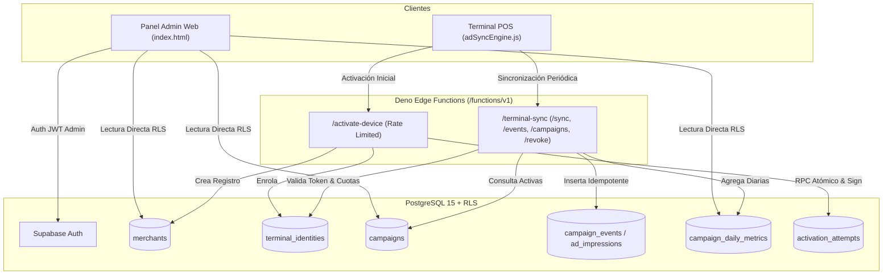

# BACKEND SUPABASE (ESQUEMA SQL, RLS, RPCS Y EDGE FUNCTIONS)

> **Documento:** `DOCUMENTACION_IA/05_SUPABASE_BACKEND.md`  
> **Estado:** `[IMPLEMENTADO]` / `[INSPECCIONADO]` / `[TEST_AUTOMATIZADO]`  
> **Referencia de Código:** Commit `4e145bba6b4553c289727a90c569124bef8ed24b` + rama `security/phase-0.2.2-event-idempotency`  
> **Directorio Backend:** [supabase/](file:///c:/Users/Pininas/KioscoProX/supabase/)  
> **Regla de oro:** Cero exposición de claves `service_role` o secretos en el código cliente. La aplicación POS solo se comunica con endpoints protegidos o utiliza claves públicas anónimas con RLS estricto.

---

## 1. ARQUITECTURA GENERAL DEL BACKEND

La infraestructura en la nube de Simple ProX utiliza la plataforma **Supabase** (PostgreSQL 15 gestionado + Deno Edge Functions). Está diseñada como una capa de servicios complementaria: **ninguna falla en la nube interrumpe el funcionamiento local del POS**.



---

## 2. INVENTARIO DE TABLAS Y ESQUEMA RELACIONAL

### A. Comercios y Terminales
1. **`merchants`** ([supabase/migrations/20261013_merchants_admin_rls.sql](file:///c:/Users/Pininas/KioscoProX/supabase/migrations/20261013_merchants_admin_rls.sql))
   - `id` (UUID / text, PK): Coincide con `installation_id`.
   - `store_name` (text): Nombre comercial del kiosco.
   - `plan` (text): `'Básico'` o `'Pro'`.
   - `address` (text), `phone` (text), `installer` (text).
   - `province_code` (text), `province_name` (text), `city_code` (text), `city_name` (text).
   - `app_version` (text): Versión reportada por el ejecutable (ej. `1.3.12`).
   - `last_sync_at` / `last_active` (timestamptz): Registro de latido de la terminal.
   - `status` (text): `'active'`, `'inactive'`, `'revoked'`.
2. **`terminal_identities`** ([supabase/migrations/20261020_enroll_terminal_license_rpc.sql](file:///c:/Users/Pininas/KioscoProX/supabase/migrations/20261020_enroll_terminal_license_rpc.sql))
   - `installation_id` (text, PK / FK `merchants.id`).
   - `token_hash` (text): Hash SHA-256 de la credencial de autenticación de la terminal.
   - `status` (text): `'active'`, `'revoked'`, `'suspended'`.
   - `enrolled_at` (timestamptz), `revoked_at` (timestamptz), `revocation_reason` (text).
3. **`terminal_enrollment_tickets`**
   - Tickets de enrolamiento de un solo uso para re-asociación controlada de terminales.

### B. Publicidad B2B y Mayoristas
1. **`campaigns`** ([supabase/migrations/20261026_campaign_daily_quota_support.sql](file:///c:/Users/Pininas/KioscoProX/supabase/migrations/20261026_campaign_daily_quota_support.sql))
   - `id` (UUID, PK): Identificador único de campaña.
   - `title` (text), `description` (text), `category` (text).
   - `supplier_name` (text), `distributor_id` (UUID FK).
   - `image_url` (text), `logo_url` (text).
   - `price` (numeric), `regular_price` (numeric).
   - `cta_text` (text), `whatsapp_number` (text), `whatsapp_message` (text).
   - `target_provinces` (text[]): Array de provincias autorizadas (ej. `['AR-D', 'AR-X']`).
   - `daily_limit` (integer): Cupo máximo de impresiones por día en toda la red.
   - `is_daily_limit_enabled` (boolean): Activa/desactiva el corte por cupo diario.
   - `status` (text): `'active'`, `'paused'`, `'completed'`.
   - `start_date` (timestamptz), `end_date` (timestamptz).
2. **`distributors`** ([supabase/migrations/20261102_b2b_commercial_management.sql](file:///c:/Users/Pininas/KioscoProX/supabase/migrations/20261102_b2b_commercial_management.sql))
   - `id` (UUID, PK), `name` (text), `cuit` (text), `whatsapp` (text), `email` (text), `status` (text).
3. **`commercial_fees`**
   - Gestión de abonos comerciales y cuotas de distribución de pauta.

### C. Métricas y Telemetría
1. **`campaign_events` / `ad_impressions`**
   - Registro granular de eventos recibidos desde las terminales.
   - Campos: `id` (UUID del evento para idempotencia), `campaign_id` (FK), `installation_id` (FK), `event_type` (`'impression'`, `'click_banner'`, `'click_cta'`), `event_time` (timestamptz), `received_at` (timestamptz).
2. **`campaign_daily_metrics`** ([supabase/migrations/20261106_campaign_statistics_aggregates.sql](file:///c:/Users/Pininas/KioscoProX/supabase/migrations/20261106_campaign_statistics_aggregates.sql))
   - Tabla preagregada por campaña y fecha (`campaign_id`, `metric_date`, `impressions_count`, `clicks_count`, `unique_merchants_count`). Evita colapsar la base de datos al calcular analíticas en el Panel Admin.
3. **`activation_attempts`** ([supabase/migrations/20261011_activation_rate_limit.sql](file:///c:/Users/Pininas/KioscoProX/supabase/migrations/20261011_activation_rate_limit.sql))
   - Almacena hashes de IP y de dispositivo con contador de fallos para prevención de ataques de fuerza bruta.

---

## 3. POLÍTICAS DE SEGURIDAD (ROW LEVEL SECURITY - RLS)

PostgreSQL aplica RLS de forma obligatoria en todas las tablas comerciales:
- **Rol `anon` (Público):**
  - Cero permisos de lectura directa sobre `merchants`, `terminal_identities`, `commercial_fees` ni `activation_attempts`.
  - Solo puede leer campañas activas mediante la Edge Function o con vistas públicas restringidas sin datos comerciales de distribuidores.
- **Rol `authenticated` (Administradores con sesión iniciada en Panel Admin):**
  - Permiso `SELECT`, `INSERT`, `UPDATE` sobre `campaigns`, `distributors`, `commercial_fees` y `campaign_daily_metrics`.
  - Permiso `SELECT` sobre `merchants` para auditoría de la red de comercios.
- **Rol `service_role` (Edge Functions del Servidor):**
  - Acceso total para ejecutar RPCs atómicas, verificar hashes de credenciales, enrolar dispositivos y purgar métricas antiguas.

---

## 4. FUNCIONES Y PROCEDIMIENTOS ALMACENADOS (RPCs)

### A. `check_and_record_activation_attempt` ([supabase/migrations/20261011_activation_rate_limit.sql](file:///c:/Users/Pininas/KioscoProX/supabase/migrations/20261011_activation_rate_limit.sql))
- **Objetivo:** Rate limiting atómico contra ataques de fuerza bruta sobre la Clave Maestra.
- **Parámetros:** `p_device_key`, `p_ip_key`, `p_max_device_attempts` (5), `p_max_ip_attempts` (15), `p_window_seconds` (900s), `p_block_seconds` (900s).
- **Lógica:** Si la IP o el hash del dispositivo superan el umbral en la ventana de 15 minutos, bloquea inmediatamente la respuesta devolviendo `{ allowed: false, retry_after_seconds: ... }` antes de procesar cualquier hash.

### B. `enroll_terminal_license_rpc` ([supabase/migrations/20261020_enroll_terminal_license_rpc.sql](file:///c:/Users/Pininas/KioscoProX/supabase/migrations/20261020_enroll_terminal_license_rpc.sql))
- **Objetivo:** Registro atómico e idempotente de la terminal en `terminal_identities` y `merchants`.
- **Garantía:** Si la terminal ya fue enrolada legítimamente, rechaza re-enrolamientos no autorizados con el código `ALREADY_ENROLLED`, protegiendo la identidad del comercio contra suplantación.

### C. Retención y Purga Automática con `pg_cron` ([supabase/migrations/20261111_schedule_daily_purge_cron.sql](file:///c:/Users/Pininas/KioscoProX/supabase/migrations/20261111_schedule_daily_purge_cron.sql))
- Para evitar que la tabla de eventos brutos (`campaign_events`) crezca indefinidamente saturando el almacenamiento:
  - Los eventos individuales mayores a **90 días** son purgados automáticamente a las 03:00 UTC tras haberse consolidado en `campaign_daily_metrics`.

---

## 5. DENO EDGE FUNCTIONS (DESPLIEGUE EN PRODUCCIÓN)

Ubicadas en `supabase/functions/`, ejecutadas en el runtime aislado de Deno con TypeScript:

### 5.1. `/activate-device` ([supabase/functions/activate-device/index.ts](file:///c:/Users/Pininas/KioscoProX/supabase/functions/activate-device/index.ts))
* **Método:** `POST`
* **Entrada:**
  ```json
  {
    "masterKey": "CLAVE_MAESTRA",
    "installationId": "spx_inst_...",
    "installationData": { "negocio": "...", "direccion": "...", "hardwareId": "..." }
  }
  ```
* **Flujo Interno:**
  1. Extrae IP real y calcula hashes SHA-256 de dispositivo y red.
  2. Ejecuta RPC `check_and_record_activation_attempt`. Si está bloqueado $\rightarrow$ HTTP 429.
  3. Compara `masterKey` contra el secreto de entorno `MASTER_ACTIVATION_KEY`. Si no coincide $\rightarrow$ HTTP 401.
  4. Limpia el contador de intentos fallidos con `clear_activation_rate_limit`.
  5. Carga el secreto `BASIC_ACTIVATION_PRIVATE_KEY` (clave privada Ed25519 en formato PEM/JWK).
  6. Genera el payload JSON, firma digitalmente con Ed25519 y construye el token `Base64(Payload).Base64(Signature)`.
  7. Registra el comercio en `merchants` y retorna el certificado junto a la credencial de sincronización.

---

### 5.2. `/terminal-sync` ([supabase/functions/terminal-sync/index.ts](file:///c:/Users/Pininas/KioscoProX/supabase/functions/terminal-sync/index.ts))
Es el motor central de enlace con el parque de terminales en producción. Implementa múltiples rutas bajo el mismo endpoint:

| Ruta Interna | Método | Autenticación Requerida | Función |
| :--- | :---: | :--- | :--- |
| `/enroll-with-license` | `POST` | Certificado Básico Ed25519 | Enrolamiento inicial y generación de credencial de terminal |
| `/campaigns` | `GET` | Credencial de Terminal activa | Entrega de campañas activas filtradas por provincia y cupo diario |
| `/events` | `POST` | Credencial de Terminal activa | Ingesta de lote de impresiones y clics con claves de idempotencia |
| `/heartbeat` | `POST` | Credencial de Terminal activa | Registro de presencia (`last_seen_at`, `app_version`) |
| `/register` | `POST` | Credencial de Terminal activa | Actualización del perfil comercial (prohibiendo cambiar `installation_id`) |
| `/revoke` | `POST` | **Token Administrativo (JWT Admin)** | **Revocación forzosa:** marca `is_revoked = true` e inhabilita sincronización |

---

## 6. IDEMPOTENCIA Y RESILIENCIA OFFLINE EN LA SINCRONIZACIÓN

Para garantizar que caídas de red o reintentos no dupliquen métricas:
1. **Generación de UUIDs en Origen:** Cada evento de impresión o clic generado en el POS recibe un `event_id` único (UUID v4) en el momento de su ocurrencia en memoria.
2. **Cola Outbox Local (`kioscoprox_outbox_queue`):** Si no hay Internet, los eventos se acumulan en `localStorage`.
3. **Ingesta Idempotente en Backend:** Al enviar el lote a `/events`, Supabase ejecuta una inserción condicional con `ON CONFLICT (id) DO NOTHING`. Si un paquete se retransmite por un corte de conexión a mitad de camino, los eventos ya insertados son descartados silenciosamente sin distorsionar las métricas de los mayoristas.

---

## 7. GESTIÓN ESTRICTA DE SECRETOS Y CREDENCIALES

```
SECRETO / CREDENCIAL             UBICACIÓN / ALCANCE           NUNCA EXPONER EN:
───────────────────────────────  ────────────────────────────  ────────────────────────
MASTER_ACTIVATION_KEY            Supabase Vault / Edge Fn Env  Cliente React, Git, LocalStorage
BASIC_ACTIVATION_PRIVATE_KEY     Supabase Vault / Edge Fn Env  Cliente React, Git, Preload
SUPABASE_SERVICE_ROLE_KEY        Supabase Vault / Edge Fn Env  Frontend, Panel Admin, Preload
BASIC_PUBLIC_KEY_JWK             licenseCrypto.js (Pública)    N/A (Es clave pública OKP)
PUBLIC_KEY_JWK (Pro)             licenseCrypto.js (Pública)    N/A (Es clave pública OKP)
Supabase Anon Public Key         Configuración de Conexión     N/A (Custodiada por RLS)
```
