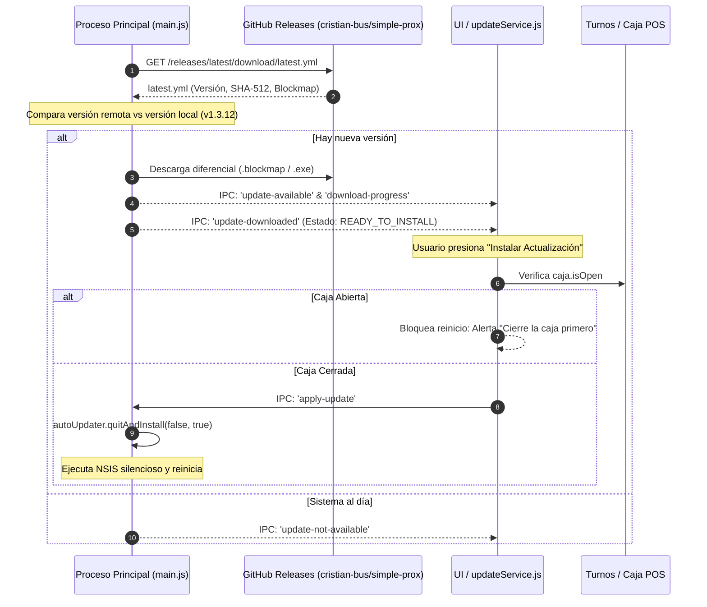

# SISTEMA DE ACTUALIZACIONES AUTOMÁTICAS Y DISTRIBUCIÓN (SIMPLE PROX v1.3.12)

> **Documento:** `DOCUMENTACION_IA/07_ACTUALIZACIONES.md`  
> **Estado:** `[IMPLEMENTADO]` / `[INSPECCIONADO]` / `[TEST_MANUAL_DOCUMENTADO]`  
> **Referencia de Código:** Commit `4e145bba6b4553c289727a90c569124bef8ed24b` + rama `security/phase-0.2.2-event-idempotency`  
> **Archivos Principales:** [electron/main.js](file:///c:/Users/Pininas/KioscoProX/electron/main.js), [src/services/updateService.js](file:///c:/Users/Pininas/KioscoProX/src/services/updateService.js), [package.json](file:///c:/Users/Pininas/KioscoProX/package.json), [src/constants/version.js](file:///c:/Users/Pininas/KioscoProX/src/constants/version.js)  
> **Regla de oro:** Jamás forzar el reinicio ni aplicar una actualización si la caja del comercio se encuentra abierta (`caja.isOpen === true`).

---

## 1. ARQUITECTURA GENERAL DE ACTUALIZACIÓN

Simple ProX utiliza el ecosistema estándar de **`electron-updater`** (`^6.8.9`) integrado con **GitHub Releases** como canal de distribución oficial. El sistema permite descargar e instalar parches y nuevas versiones sin intervención técnica en el punto de venta.



---

## 2. CONFIGURACIÓN DEL DISTRIBUIDOR (`package.json`)

En [package.json](file:///c:/Users/Pininas/KioscoProX/package.json) (sección `build`):

* **Identidad de Aplicación:**
  - `appId`: `"com.simpleprox.app"`
  - `productName`: `"Simple ProX"`
  - `artifactName`: `"Simple-ProX-Setup-${version}.${ext}"` (Garantiza nombres canónicos como `Simple-ProX-Setup-1.3.12.exe` requeridos por `latest.yml`).
* **Canal de Publicación:**
  ```json
  "publish": [
    {
      "provider": "github",
      "owner": "cristian-bus",
      "repo": "simple-prox"
    }
  ]
  ```
* **Instalador NSIS para Windows:**
  - `oneClick: false`: Muestra asistente de instalación controlado.
  - `perMachine: false`: Instalación por usuario (`%LOCALAPPDATA%\Programs\Simple ProX`), **sin requerir permisos de Administrador de Windows (UAC)**, facilitando auto-actualizaciones desatendidas sin bloqueos del sistema operativo.
  - `allowToChangeInstallationDirectory: true`.
  - `createDesktopShortcut: true` y `createStartMenuShortcut: true`.

---

## 3. CONTROL DE VERSIONES Y MANIFIESTO DE DISTRIBUCIÓN

### A. Sincronización Tripartita de Versión
Para que una nueva versión sea válida y aceptada sin discrepancias por el updater, el número semántico (ej. `1.3.12`) debe estar estrictamente alineado en 3 archivos:
1. [package.json](file:///c:/Users/Pininas/KioscoProX/package.json) (`"version": "1.3.12"`).
2. [package-lock.json](file:///c:/Users/Pininas/KioscoProX/package-lock.json) (`"version": "1.3.12"` en raíz y dependencias).
3. [src/constants/version.js](file:///c:/Users/Pininas/KioscoProX/src/constants/version.js) (`export const APP_VERSION = '1.3.12';`).

### B. El Manifiesto `latest.yml`
Generado automáticamente en `release/latest.yml` al compilar:
```yaml
version: 1.3.12
files:
  - url: Simple-ProX-Setup-1.3.12.exe
    sha512: c+XQbLrI1Ix8p9KrCQ8lFxxdDLIsH8NVowKpzDN76BW6y942VbKAZ/P7jv0IL4yZDUlueqjep54JdUdgFM6xgw==
    size: 197272586
    blockMapSize: 203306
path: Simple-ProX-Setup-1.3.12.exe
sha512: c+XQbLrI1Ix8p9KrCQ8lFxxdDLIsH8NVowKpzDN76BW6y942VbKAZ/P7jv0IL4yZDUlueqjep54JdUdgFM6xgw==
releaseDate: '2026-11-16T21:36:23.000Z'
```
* **SHA-512:** `electron-updater` calcula el hash criptográfico del binario descargado y lo compara estrictamente contra `sha512` de `latest.yml`. Si un byte no coincide (descarga corrupta o alterada), el archivo se descarta de inmediato sin ejecutarse.
* **Descargas Diferenciales (`.blockmap`):** Permite actualizar instalaciones preexistentes descargando únicamente los bloques binarios modificados en lugar de los 197 MB completos.

---

## 4. FLUJO DE EJECUCIÓN EN EL PROCESO PRINCIPAL ([electron/main.js](file:///c:/Users/Pininas/KioscoProX/electron/main.js))

### A. Configuración Defensiva de AutoUpdater (Líneas 13-16)
```javascript
autoUpdater.autoDownload = true;
autoUpdater.autoInstallOnAppQuit = true;
```
- `autoDownload = true`: Inicia la descarga en segundo plano sin interrumpir al cajero.
- `autoInstallOnAppQuit = true`: Si una actualización ya fue descargada y validada, se aplica automáticamente la próxima vez que el usuario cierre el programa.

### B. Programación de Sondeos
1. **Comprobación Inicial:** Se ejecuta a los 4 segundos del arranque de la ventana principal para no ralentizar el inicio del POS.
2. **Sondeo Recurrente:** Se repite cada **4 horas** de ejecución continua (`setInterval`).
3. **Mapeo de IPCs hacia el Renderer:**
   - `autoUpdater.on('update-available')` $\rightarrow$ `win.webContents.send('update-available')`
   - `autoUpdater.on('download-progress')` $\rightarrow$ `win.webContents.send('update-download-progress')`
   - `autoUpdater.on('update-downloaded')` $\rightarrow$ `win.webContents.send('update-downloaded')`
   - `autoUpdater.on('update-not-available')` $\rightarrow$ `win.webContents.send('update-not-available')`

---

## 5. LA GUARDIA DE SEGURIDAD COMERCIAL ([src/services/updateService.js](file:///c:/Users/Pininas/KioscoProX/src/services/updateService.js))

### A. Estados del Ciclo de Vida (`UPDATE_STATUS`)
- `IDLE`: En reposo.
- `CHECKING`: Consultando manifiesto en GitHub Releases.
- `AVAILABLE`: Nueva versión detectada en el repositorio.
- `DOWNLOADING`: Descarga de binarios y verificación de hash SHA-512 en progreso.
- `READY_TO_INSTALL`: Instalador descargado y verificado en la carpeta temporal de Electron.
- `UP_TO_DATE`: El sistema opera en la versión más reciente.
- `ERROR`: Falla de red o de verificación de firma.

### B. Guardia de Caja Abierta (`applyUpdateSafe`)
```javascript
// src/services/updateService.js (línea 83)
export function applyUpdateSafe(isSafeToRestart = true) {
  if (!isSafeToRestart) {
    console.warn('[UpdateService] Bloqueado: No se puede reiniciar con operaciones de caja abiertas.');
    return { success: false, reason: 'CAJA_OPEN' };
  }
  if (window.api?.applyUpdate && currentUpdateState.status === UPDATE_STATUS.READY_TO_INSTALL) {
    window.api.applyUpdate();
    return { success: true };
  }
  return { success: false, reason: 'NO_UPDATE_READY' };
}
```
En [src/screens/Configuracion.jsx](file:///c:/Users/Pininas/KioscoProX/src/screens/Configuracion.jsx), el botón de instalación evalúa:
$$\text{isSafeToRestart} = (\text{kiosco.caja?.isOpen} === \text{false})$$
Si la caja está abierta, se rechaza la llamada y se presenta un modal de advertencia exigiendo realizar el Cierre de Caja antes de proceder al reinicio.

---

## 6. PRESERVACIÓN DE DATOS Y LICENCIAS TRAS LA ACTUALIZACIÓN

El proceso de actualización **nunca altera los datos del comercio ni su activación**:
1. **Separación de Directorios:**
   - El ejecutable reside en: `%LOCALAPPDATA%\Programs\Simple ProX\`.
   - La base de datos LevelDB y la configuración residen en: `%APPDATA%\Simple ProX\` (o `%APPDATA%\simple-prox\` en desarrollo).
2. **Inmunidad de `localStorage`:** El instalador NSIS sobrescribe exclusivamente los binarios de la aplicación (`resources/app.asar`, DLLs de Electron). Los datos en `AppData\Roaming` no son tocados.
3. **Preservación de Licencia:** El token Ed25519 (`kioscoprox_license_token`) y el `installationId` permanecen en LevelDB; al reiniciar en la nueva versión, `App.jsx` lee las mismas claves y continúa operando con el mismo plan sin requerir re-activación.

---

## 7. PROCEDIMIENTO OFICIAL DE PUBLICACIÓN DE UNA NUEVA VERSIÓN

Para compilar y publicar una versión de Simple ProX:
1. Sincronizar el número de versión en `package.json`, `package-lock.json` y `version.js`.
2. Ejecutar la compilación y empaquetado:
   ```powershell
   npm run electron:dist
   ```
3. Verificar en la carpeta `release/` que existan:
   - `Simple-ProX-Setup-X.Y.Z.exe`
   - `Simple-ProX-Setup-X.Y.Z.exe.blockmap`
   - `latest.yml`
4. Crear un Release en GitHub (`github.com/cristian-bus/simple-prox/releases`):
   - Tag: `vX.Y.Z` (ej. `v1.3.12`).
   - Título: `Simple ProX vX.Y.Z`.
   - Adjuntar los 3 archivos de `release/`.
5. Publicar el Release. Todas las terminales activas detectarán la actualización en un lapso máximo de 4 horas o cuando el usuario pulse "Buscar Actualizaciones" en Configuración.

---

## 8. PROTOCOLO DE PRUEBAS DE REGRESIÓN

1. **Prueba de Guardia de Caja:**
   - Abrir un turno de caja con $5.000 de inicial.
   - Ir a Configuración con un update listo para instalar.
   - Presionar "Instalar Actualización"; verificar que el sistema rechace el reinicio y muestre advertencia.
   - Cerrar el turno de caja (Cierre X / Z).
   - Reintentar la instalación; verificar que el reinicio proceda limpiamente.
2. **Prueba de Integridad Post-Update:**
   - Tras el reinicio, comprobar que los productos, ventas previas y clientes sigan presentes.
   - Comprobar que `ActivationGuard` no aparezca y la terminal permanezca activada en su plan correspondiente.
