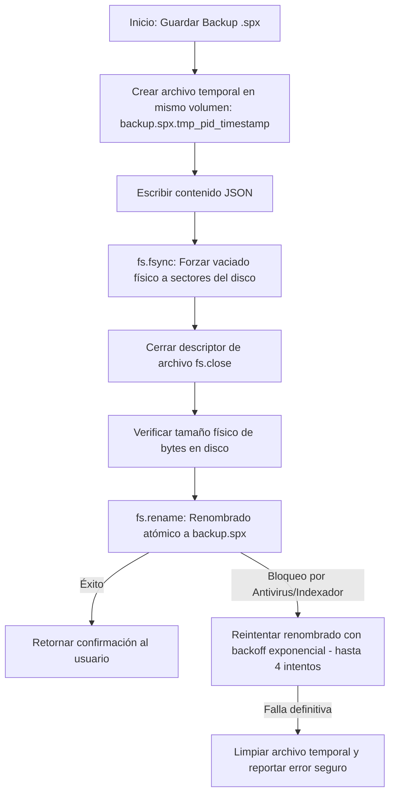
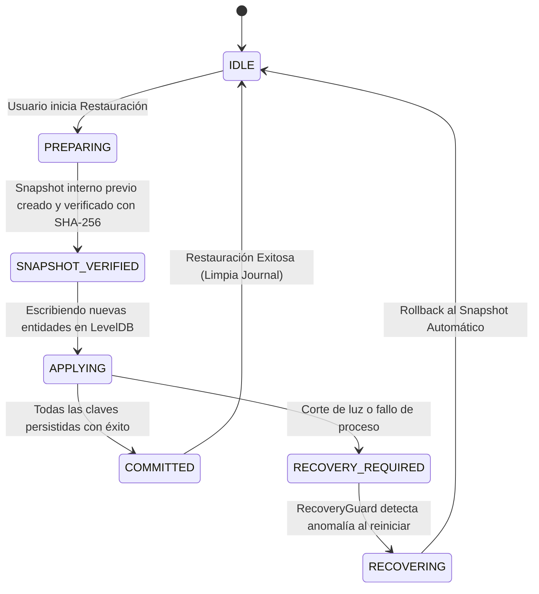

# RESPALDOS, PERSISTENCIA Y RECUPERACIÓN ANTE DESASTRES (SIMPLE PROX v1.3.12)

> **Documento:** `DOCUMENTACION_IA/08_RESPALDOS_Y_PERSISTENCIA.md`  
> **Estado:** `[IMPLEMENTADO]` / `[INSPECCIONADO]` / `[TEST_AUTOMATIZADO]`  
> **Referencia de Código:** Commit `4e145bba6b4553c289727a90c569124bef8ed24b` + rama `security/phase-0.2.2-event-idempotency`  
> **Archivos Principales:** [src/services/backupService.js](file:///c:/Users/Pininas/KioscoProX/src/services/backupService.js), [electron/safeBackupWriter.js](file:///c:/Users/Pininas/KioscoProX/electron/safeBackupWriter.js), [src/services/recoveryService.js](file:///c:/Users/Pininas/KioscoProX/src/services/recoveryService.js), [src/components/RecoveryGuard.jsx](file:///c:/Users/Pininas/KioscoProX/src/components/RecoveryGuard.jsx)  
> **Regla de oro:** La exportación o restauración de copias de seguridad jamás debe sobrescribir ni alterar el `installationId` ni el `kioscoprox_license_token` del equipo de destino.

---

## 1. ARQUITECTURA DE PERSISTENCIA LOCAL (OFFLINE-FIRST)

Simple ProX no requiere de un motor SQL cliente pesado (SQLite, PostgreSQL embebido) para operar en el punto de venta. Emplea la combinación de **React State en Memoria + Serialización Reactiva en LevelDB de Chromium**:

```mermaid
flowchart TD
    subgraph UI ["Capa de Interfaz (React 19)"]
        SCREENS["12 Pantallas del POS"]
        HOOK["useKiosco.js (Estado Reactivo)"]
    end

    subgraph Memory ["Memoria RAM"]
        STATE["products, sales, purchases, clients, caja, shifts..."]
    end

    subgraph LevelDBStorage ["Almacenamiento Físico en Disco"]
        LEVELDB["Chromium LevelDB (Transaccional Append-Only)"]
        FILES["%APPDATA%\Simple ProX\Local Storage\leveldb\*.ldb"]
    end

    SCREENS -->|Acciones y Mutaciones| HOOK
    HOOK <-->|Lectura / Escritura Rápida| STATE
    HOOK -->|useEffect JSON.stringify()| LEVELDB
    LEVELDB --> FILES
```

### A. Claves de Persistencia Maestras (`KEYS`)
Gestionadas de forma centralizada en [src/hooks/useKiosco.js](file:///c:/Users/Pininas/KioscoProX/src/hooks/useKiosco.js):
- `kioscoprox_products`: Catálogo de artículos, precios, costos, stock y combos.
- `kioscoprox_sales`: Historial de comprobantes de ventas emitidos.
- `kioscoprox_purchases`: Comprobantes de compras a proveedores.
- `kioscoprox_clients`: Base de clientes, saldos deudores y cuentas corrientes.
- `kioscoprox_caja`: Estado del turno activo (`isOpen`, `efectivo`, `openedAt`, `movimientos`).
- `kioscoprox_shifts`: Historial de turnos de caja cerrados (Arqueos X / Z).
- `kioscoprox_users`: Operadores locales y administradores con roles.
- `kioscoprox_categories`: Árbol jerárquico de rubros y categorías.
- `kioscoprox_suppliers`: Directorio de proveedores.
- `kioscoprox_reservations`: Registro de reservas y pedidos pendientes de entrega.
- `kioscoprox_business_config`: Perfil comercial, parámetros de tickets, márgenes y activación.

---

## 2. FORMATO DEL ARCHIVO DE RESPALDO COMERCIAL (`.spx`)

Definido en [src/services/backupService.js](file:///c:/Users/Pininas/KioscoProX/src/services/backupService.js):
* **Identificador de Formato:** `SimpleProX_Backup`
* **Versión de Esquema:** `1`
* **Extensión Oficial:** `.spx` (archivo JSON estructurado y verificable).

### A. Estructura del Documento `.spx`
```json
{
  "format": "SimpleProX_Backup",
  "version": 1,
  "backupId": "spx-bkp-1789000000000-ABCDEF",
  "createdAt": "2026-11-18T20:30:00.000Z",
  "appVersion": "1.3.12",
  "storeName": "Kiosco Central",
  "businessType": "kiosco",
  "summary": {
    "productsCount": 120,
    "salesCount": 450,
    "purchasesCount": 35,
    "clientsCount": 40,
    "shiftsCount": 18,
    "categoriesCount": 8
  },
  "data": {
    "products": [...],
    "sales": [...],
    "purchases": [...],
    "clients": [...],
    "caja": { "isOpen": false, "efectivo": 0, "openedAt": null, "movimientos": [] },
    "shifts": [...],
    "categories": {...},
    "suppliers": [...],
    "reservations": [...],
    "users": [...],
    "preferences": {...}
  },
  "checksum": "a8f3b2... (Hash SHA-256 de 64 caracteres hexadecimales)"
}
```

---

## 3. SEGREGACIÓN DE DATOS Y SANITIZACIÓN DEFENSIVA

Para garantizar la seguridad de la información y la portabilidad entre computadoras, `generateBackupPayload()` aplica un filtro estricto:

### A. Datos Excluidos Categóricamente del Respaldo:
1. **Identificadores Fijos de Equipo:** No exporta `installationId` (evita clonación de licencias).
2. **Tokens y Certificados:** No exporta `kioscoprox_license_token` ni `licenseKey`.
3. **Credenciales Sensibles de Usuarios:** Los usuarios se exportan sanitizados (`id`, `name`, `role`, `email`, `isActive`), **excluyendo los códigos PIN de 4 dígitos**.
4. **Secretos de Conexión:** No exporta claves maestras ni credenciales de Supabase.

---

## 4. ESCRITURA ATÓMICA Y SEGURA ([electron/safeBackupWriter.js](file:///c:/Users/Pininas/KioscoProX/electron/safeBackupWriter.js))

Para evitar que un corte repentino de energía o un cuelgue del sistema operativo deje un archivo `.spx` dañado a medio escribir, el proceso principal implementa el patrón **TempFile + Fsync + Atomic Rename**:



* **Prevención de Concurrencia:** La colección `activeBackupSaves` en memoria bloquea intentos simultáneos de sobreescritura sobre el mismo archivo.

---

## 5. INFRAESTRUCTURA DE CONTINGENCIA Y ROLLBACK (`RecoveryGuard.jsx`)

Ubicado en [src/services/recoveryService.js](file:///c:/Users/Pininas/KioscoProX/src/services/recoveryService.js) y [src/components/RecoveryGuard.jsx](file:///c:/Users/Pininas/KioscoProX/src/components/RecoveryGuard.jsx).



### A. El Diario de Restauración (`restore_journal.json`)
Antes de sobrescribir cualquier dato en `localStorage` durante una restauración:
1. `recoveryService` toma una **instantánea de emergencia completa** (`createInternalSnapshot`) de las entidades comerciales actuales.
2. Calcula su hash SHA-256 y la guarda en `%APPDATA%\...\recovery\snapshots\emergency_snapshot_[id].json`.
3. Registra el estado `SNAPSHOT_VERIFIED` en el diario de recuperación (`restore_journal.json`).
4. Pasa el diario a estado `APPLYING` mientras reemplaza las claves de `localStorage`.
5. Una vez que todas las entidades fueron aplicadas con éxito, marca `COMMITTED` y purga el diario.

### B. El Guardián en Primer Arranque (`RecoveryGuard.jsx`)
En [src/main.jsx](file:///c:/Users/Pininas/KioscoProX/src/main.jsx), `<RecoveryGuard>` envuelve la aplicación raíz `<App />`.  
Si ocurre un corte de luz cuando el journal estaba en `APPLYING`:
- Al reabrir Simple ProX, `RecoveryGuard` intercepta el montaje **antes de que cargue el POS**.
- Muestra una pantalla de contingencia indicando: *"Se detectó una restauración interrumpida de forma anormal"*.
- Ofrece el botón *"Restaurar Copia Previa de Emergencia"*, ejecutando el rollback automático hacia el snapshot verificado para que el negocio continúe operando sin inconsistencias de datos.

---

## 6. PROTECCIÓN CONTRA ARCHIVOS ALTERADOS O MALICIOSOS

1. **Verificación Criptográfica Obligatoria:**
   Antes de restaurar un archivo `.spx`, `restoreBackupPayload()` recalcula el hash SHA-256 del bloque `data`. Si un solo carácter fue editado manualmente o corrupto por fallo de disco, la importación se rechaza con el mensaje:  
   *`"Integridad SHA-256 violada. El respaldo está corrupto o fue adulterado."`*
2. **Defensa contra Path Traversal en Snapshots:**
   En [electron/main.js](file:///c:/Users/Pininas/KioscoProX/electron/main.js) (líneas 324-326), al leer un snapshot por IPC, el sistema valida:
   ```javascript
   const resolved = path.resolve(snapshotPath);
   const resolvedUserData = path.resolve(app.getPath('userData'));
   if (!resolved.toLowerCase().startsWith(resolvedUserData.toLowerCase())) {
     return { success: false, error: 'Acceso denegado: la ruta del snapshot debe pertenecer al perfil de usuario.' };
   }
   ```
   Cualquier intento de inyectar rutas relativas (`..\..\Windows\System32`) es neutralizado.

---

## 7. SUITE DE PRUEBAS AUTOMATIZADAS EXISTENTES

La robustez de este subsistema fue verificada mediante suites de prueba automatizadas disponibles en el repositorio:
* [tests/fase4b05_adversarial_backup_runner.mjs](file:///c:/Users/Pininas/KioscoProX/tests/fase4b05_adversarial_backup_runner.mjs): Prueba adversaria de escrituras atómicas, validación de schemas malformados y protección contra corrupción.
* [tests/test_stage5b4_validation.mjs](file:///c:/Users/Pininas/KioscoProX/tests/test_stage5b4_validation.mjs): Validación de seguridad contra path traversal y contención estricta en `userData`.

---

## 8. PROTOCOLO DE PRUEBAS DE REGRESIÓN RECOMENDADO

1. **Ciclo Completo de Respaldo y Restauración:**
   - Crear un producto de prueba *"Alfajor Test 999"*.
   - Generar respaldo `.spx` desde Configuración.
   - Limpiar la base de datos con "Limpiar todos los datos".
   - Verificar que el catálogo quede vacío.
   - Restaurar el archivo `.spx` generado.
   - Comprobar que *"Alfajor Test 999"*, los clientes y los turnos reaparezcan íntegros.
2. **Prueba de Rechazo de Respaldo Adulterado:**
   - Abrir un archivo `.spx` con un editor de texto plano y cambiar un precio de `100` a `200`.
   - Intentar restaurarlo en Simple ProX.
   - Comprobar que el sistema rechace la carga indicando violación de la suma SHA-256.
3. **Prueba de Preservación de Licencia:**
   - Restaurar un `.spx` proveniente de otro equipo o instalación de prueba.
   - Comprobar que el `installationId` local y el estado de activación comercial **no se modifiquen**.
