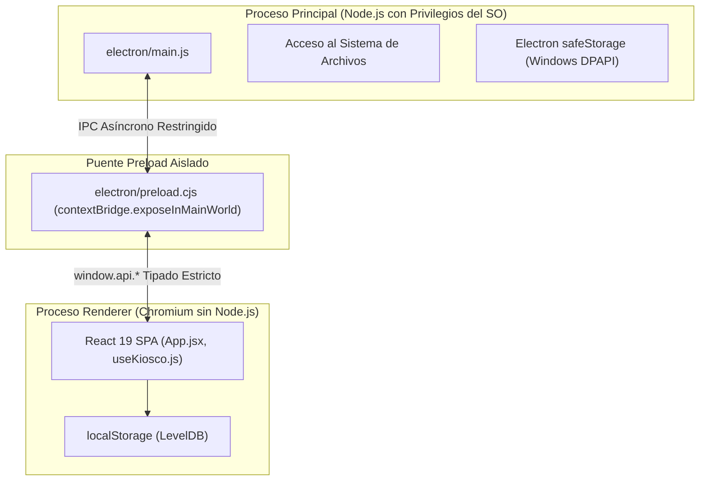

# SEGURIDAD, MODELO DE AMENAZAS Y SUPERFICIE DE RIESGO (SIMPLE PROX v1.3.12)

> **Documento:** `DOCUMENTACION_IA/09_SEGURIDAD_Y_RIESGOS.md`  
> **Estado:** `[IMPLEMENTADO]` / `[INSPECCIONADO]` / `[TEST_AUTOMATIZADO]`  
> **Referencia de Código:** Commit `4e145bba6b4553c289727a90c569124bef8ed24b` + rama `security/phase-0.2.2-event-idempotency`  
> **Regla de oro:** Cero almacenamiento de secretos en el cliente. La seguridad de la aplicación no depende de la ofuscación del frontend sino del aislamiento estricto de procesos, criptografía asimétrica y RLS en la base de datos.

---

## 1. SEGURIDAD DEL RUNTIME ELECTRON Y AISLAMIENTO DE PROCESOS

Simple ProX opera bajo un modelo multiproceso con **aislamiento estricto de privilegios** configurado en [electron/main.js](file:///c:/Users/Pininas/KioscoProX/electron/main.js) (líneas 24-29):

### A. Políticas Clave de Seguridad Web
1. **`nodeIntegration: false`:** El proceso Chromium (React) **no tiene acceso a primitivas de Node.js** (`fs`, `child_process`, `net`, `require`). Un eventual ataque de inyección de script (XSS) no puede escalar a ejecución remota de código (RCE) en el sistema operativo.
2. **`contextIsolation: true`:** Garantiza que los scripts del preload y los scripts del frontend se ejecuten en contextos de JavaScript completamente independientes. El renderer no puede manipular los prototipos ni los objetos internos de Electron.
3. **`devTools: process.env.NODE_ENV === 'development'`:** En compilaciones de producción comercial, las herramientas de desarrollador (`DevTools`) quedan **100% deshabilitadas**, impidiendo que usuarios finales o empleados modifiquen estados en memoria, ejecuten scripts en consola o inspeccionen tokens de sesión.
4. **Política Deny-by-Default de Ventanas (`setWindowOpenHandler`):**
   - La creación de nuevas ventanas hijas (`BrowserWindow`) está categóricamente rechazada (`action: 'deny'`).
   - Los enlaces salientes (ej. WhatsApp de distribuidores) son interceptados y delegados exclusivamente al navegador externo predeterminado de Windows con `shell.openExternal`, previa validación estricta del protocolo (`https:`, `http:`, `mailto:`).

---

## 2. AUTENTICACIÓN LOCAL Y CONTROL DE ACCESO BASADO EN ROLES (RBAC)

### A. Almacenamiento y Roles de Usuarios
- Entidad: `kioscoprox_users` en `localStorage`.
- Roles soportados:
  - `admin`: Acceso irrestricto a todo el sistema (configuración, auditoría, reportes, usuarios).
  - `cajero`: Operación restringida a facturación en Punto de Venta, cobro de fiados y consulta básica de clientes.
- Credencial: Código PIN numérico de 4 dígitos.

### B. El Guardián de Pestañas Protegidas (`isProtectedTab`)
En [src/App.jsx](file:///c:/Users/Pininas/KioscoProX/src/App.jsx) (líneas 35, 240-275):
- Las pantallas `productos`, `inventario`, `usuarios`, `reportes` y `configuracion` están marcadas como protegidas.
- Si el usuario activo tiene rol `cajero` y no ha superado la autenticación temporal de administrador (`globalAdminAuthed`), la interfaz superpone una cortina opaca con candado exigiendo el PIN de Administrador para desbloquear la vista.

---

## 3. SEGURIDAD CRIPTOGRÁFICA DEL LICENCIAMIENTO

Implementada en [src/utils/licenseCrypto.js](file:///c:/Users/Pininas/KioscoProX/src/utils/licenseCrypto.js) mediante la API nativa **WebCrypto** (`crypto.subtle`):

1. **Criptografía Asimétrica de Curva Elíptica (Ed25519):**
   - El cliente **solo contiene las claves públicas** (`BASIC_PUBLIC_KEY_JWK` y `PUBLIC_KEY_JWK`).
   - Las claves privadas correspondientes **nunca residen en el cliente ni en el repositorio**.
2. **Vinculación Matemática al Hardware:**
   - Cada certificado digital incluye en su carga útil el `installationId` del equipo.
   - Si un usuario copia el token a otra computadora, la verificación falla inmediatamente porque el `installationId` local no coincide con la firma.
3. **Inmutabilidad y No-Repudio:**
   - Cualquier intento de modificar manualmente los campos de un certificado (como cambiar el plan de `'Básico'` a `'Pro'` o alterar la fecha de expiración) invalida la firma criptográfica Ed25519, provocando el bloqueo automático en `checkLicense()`.

---

## 4. PROTECCIÓN DEL IDENTIFICADOR DE INSTALACIÓN (`installationId`)

- Ubicación: `localStorage.getItem('kioscoprox_installation_id')`.
- Formato: `spx_inst_[timestamp]_[entropía]`.
- **Regla de No-Exportación:** Está estrictamente excluido del archivo de respaldo comercial `.spx` ([src/services/backupService.js](file:///c:/Users/Pininas/KioscoProX/src/services/backupService.js)). Al restaurar una copia de seguridad proveniente de otro kiosco, el `installationId` de la máquina receptora se mantiene intacto, impidiendo la colisión de identidades o anulación de licencias.

---

## 5. ALMACENAMIENTO SEGURO DE CREDENCIALES (WINDOWS DPAPI)

Simple ProX utiliza **Data Protection API (DPAPI)** de Windows mediante Electron `safeStorage`:
- La credencial de sincronización de la terminal (`terminalToken`) emitida tras la activación se cifra con las claves maestras de usuario de Windows mediante `safeStorage.encryptString()`.
- El token cifrado resultante se persiste como cadena hexadecimal.
- Solo el mismo usuario de Windows en esa máquina física puede descifrar el token (`safeStorage.decryptString()`), protegiendo la identidad de la terminal contra copias no autorizadas de archivos del perfil de usuario.

---

## 6. SEGURIDAD DEL BACKEND SUPABASE Y EDGE FUNCTIONS

### A. Políticas Row Level Security (RLS) en PostgreSQL
- Todas las tablas maestras (`merchants`, `terminal_identities`, `campaigns`, `distributors`, `campaign_events`) tienen RLS activado.
- El rol anónimo (`anon`) tiene privilegios mínimos: no puede listar comercios, ni leer tokens, ni modificar campañas.
- La modificación de campañas y cuotas financieras exige una sesión autenticada con JWT de administrador (`authenticated`).

### B. Hardening en Edge Functions
1. **Rate Limiting Anti-Fuerza Bruta en `/activate-device`:**
   - La RPC `check_and_record_activation_attempt` computa hashes SHA-256 de la IP y del identificador de hardware.
   - Aplica bloqueo automático temporal ($15 \text{ minutos}$) si un dispositivo o red supera 5 intentos fallidos consecutivos de Clave Maestra.
2. **Ingesta Idempotente en `/terminal-sync/events`:**
   - Cada evento se valida con UUID y se inserta mediante `ON CONFLICT (id) DO NOTHING`, evitando ataques de replay o manipulación de estadísticas.
3. **Endpoint Administrativo `/revoke`:**
   - Protegido por validación estricta de Service Role / JWT Admin. Inhabilita la credencial de terminal en la tabla `terminal_identities`, cortando el acceso a futuras descargas de ofertas.

---

## 7. MATRIZ DE RIESGOS TÉCNICOS Y SUPERFICIES CRÍTICAS

| Vector de Riesgo | Gravedad | Mecanismo de Defensa Implementado | Advertencia Quirúrgica |
| :--- | :---: | :--- | :--- |
| **Pérdida Aparente de Activación** | **CRÍTICA** | `checkLicense()` pospone bloqueo si `window.__ACTIVE_SALE__ === true`. | Al guardar configuración en `Configuracion.jsx` o `saveCommerceProfile`, **siempre preservar** `isActivated: true`, `installationId` y `plan`. |
| **Corrupción de Datos por Corte Eléctrico** | **ALTA** | LevelDB append-only + `safeBackupWriter` atómico + `RecoveryGuard`. | No escribir directamente en archivos del SO sin pasar por `safeBackupWriter.js`. |
| **Manipulación de Precios en Backup** | **ALTA** | Firma de integridad SHA-256 sobre el bloque `data` del `.spx`. | No desactivar la verificación SHA-256 en `restoreBackupPayload()`. |
| **Reinicio Inoportuno durante Cobro** | **ALTA** | `applyUpdateSafe` bloquea reinicio si `caja.isOpen === true`. | No invocar `applyUpdate()` sin comprobar `!kiosco.caja?.isOpen`. |
| **Ataque de Path Traversal en Snapshots** | **MEDIA** | `path.resolve` + validación estricta de pertenencia a `userData` en `main.js`. | No permitir rutas de archivo arbitrarias pasadas desde el renderer. |
| **Fuga de Métricas por Memoria Llena** | **BAJA** | Cola Dead Letter acotada a un máximo de 200 ítems con rotación FIFO. | No incrementar indefinidamente el límite de `kioscoprox_outbox_deadletter`. |

---

## 8. SUPERFICIES CRÍTICAS PROTEGIDAS (NO TOCAR SIN AUDITORÍA)

> [!CAUTION] ZONAS DE ALTO IMPACTO EN MODIFICACIONES
> 1. **`src/utils/licenseCrypto.js`:** La modificación de las claves públicas JWK o de la lógica de verificación invalidará las licencias comerciales de todas las terminales desplegadas.
> 2. **`electron/main.js` (`webPreferences`):** Jamás habilitar `nodeIntegration: true` ni desactivar `contextIsolation: false`.
> 3. **`src/components/RecoveryGuard.jsx`:** Debe montarse siempre envolviendo la raíz de la aplicación antes de que React instancie los hooks de negocio.
> 4. **`electron/safeBackupWriter.js`:** Debe conservar siempre la secuencia `fsync + close + atomic rename` para preservar la resiliencia física en disco.
