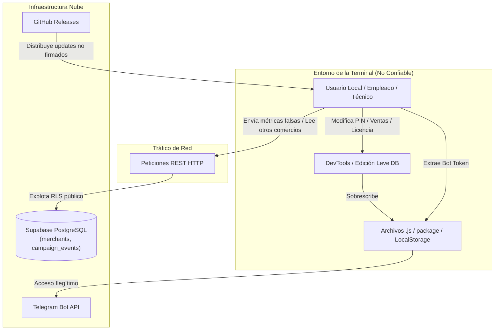

# KioscoProX — Security Audit

**Documento:** Auditoría Integral de Seguridad y Arquitectura Defensiva  
**Proyecto:** KioscoProX (Simple ProX Desktop & B2B Ads)  
**Versión Auditada:** 1.3.9  
**Fecha:** 23 de Septiembre de 2026  
**Clasificación:** Confidencial / Auditoría Técnica  
**Estado:** Inspección y Diagnóstico Completo (Sin modificaciones de código)

---

## 1. Resumen Ejecutivo

Se ha llevado a cabo una auditoría de seguridad exhaustiva, estática y arquitectónica sobre el repositorio de **KioscoProX (Simple ProX)**, abarcando el núcleo de Electron, la aplicación de escritorio React (Vite), los mecanismos de persistencia local, el sistema de licenciamiento, la integración de publicidad B2B y la base de datos remota Supabase (PostgreSQL).

### Estado General de Seguridad
El análisis de la evidencia técnica demuestra que **el sistema presenta vulnerabilidades críticas y estructurales que impiden su distribución masiva o comercial segura en su estado actual**. 

El software fue concebido bajo un modelo de confianza implícita en el cliente final, lo cual contradice el principio fundamental de seguridad para aplicaciones de escritorio distribuidas: *todo código, dato y almacenamiento que reside en el equipo del cliente debe considerarse potencialmente hostil o manipulable*.

### Principales Vectores de Riesgo Identificados:
1. **Filtración y Manipulación Multi-Tenant en Supabase (CRÍTICO):** Las políticas RLS en PostgreSQL permiten a cualquier usuario con la clave anónima pública leer, insertar y modificar registros de todos los comercios (`merchants`), así como leer e inyectar métricas publicitarias arbitrarias (`campaign_events`).
2. **Exposición de Credenciales y Control de Bot de Telegram (CRÍTICO):** El token del Bot de Telegram y el Chat ID del administrador se encuentran embebidos en texto plano en el cliente (`activationService.js`). La aplicación consulta `getUpdates` directamente desde las terminales clientes, exponiendo el historial de comandos, la clave maestra y el control del bot.
3. **Generador y Secreto de Licencias en el Cliente (CRÍTICO):** El algoritmo de generación de licencias y la sal secreta (`KioscoProX_Secret_2026`) están distribuidos dentro del código fuente de la aplicación, permitiendo a cualquier usuario generar claves de activación "PRO" ilimitadas sin pagar ni contactar al propietario.
4. **Vulnerabilidad de Ejecución en Electron / Shell External (ALTO):** El canal IPC `open-external` y el manejador `setWindowOpenHandler` no validan esquemas URI ni restringen protocolos arbitrarios antes de invocar `shell.openExternal`.
5. **Persistencia Local en Texto Plano y Ausencia de Integridad (ALTO):** Las ventas, caja, inventario, clientes y usuarios con sus contraseñas/PINes residen en `localStorage` (LevelDB de Electron) sin cifrado, sin firmas criptográficas y sin cadenas de auditoría inmutables.
6. **Cadena de Suministro y Actualizaciones no Firmadas (ALTO):** Los ejecutables distribuidos mediante `autoUpdater` y GitHub Releases carecen de firma digital Authenticode. Además, existen 31 vulnerabilidades reportadas en dependencias npm, incluyendo bibliotecas críticas de procesamiento como `xlsx`.

---

## 2. Arquitectura Actual Detectada

| Componente | Tecnología / Mecanismo | Implementación Real Observada |
| :--- | :--- | :--- |
| **Shell de Escritorio** | Electron 41.3.0 | `electron/main.js`, `electron/preload.cjs`. Aislamiento de contexto activo (`contextIsolation: true`), `nodeIntegration: false`. No obstante, el filtrado de URLs externas y de nuevas ventanas posee fallas de contención. |
| **Frontend Renderer** | React 19.2.0 + Vite 7.3.1 | Single Page Application empaquetada localmente en producción (`dist/index.html`). Carga local offline-first. |
| **Base de Datos Local** | Web Storage API (`localStorage`) | Todos los módulos centrales (Ventas, Caja, Productos, Clientes, Deudas, Usuarios, Licencias) se serializan como cadenas JSON en `localStorage`. No se utiliza SQLite ni IndexedDB. |
| **Backend Remoto** | Supabase (PostgreSQL 17) | Proyecto `qtixbiikhvhzwshfgyeo`. Tablas: `campaigns`, `campaign_events`, `merchants`, `remote_config`. Autenticación remota no utilizada por los comercios del POS (usan clave anónima directa). |
| **Sincronización** | SyncService + Outbox Local | Cola en `localStorage` (`kioscoprox_outbox`) con reintentos para eventos publicitarios (`campaign_events`) y datos del comercio (`merchants`). |
| **Licenciamiento** | Simétrico / Hash Local | Basado en `installationId` + `SECRET_SALT` local mediante un hash simple de desplazamiento de bits (32-bit integer). Validación puramente local en el frontend. |
| **Canal Publicitario B2B** | AdSyncEngine | Descarga de campañas desde Supabase mediante REST API (`/campaigns?select=*`), almacenamiento en caché local, tracking de impresiones y aperturas, redirección a WhatsApp vía URL externa. |
| **Actualizaciones** | `electron-updater` 6.8.9 | Proveedor GitHub Releases (`cristian-bus/simple-prox`). Descarga e instalación silenciosa automática (`quitAndInstall`). Sin firma digital configurada en `package.json`. |

---

## 3. Vulnerabilidades CRÍTICAS

### VULN-01: Exposición Total y Modificación de Datos de Comercios en Supabase (Falta de Aislamiento Multi-Tenant)
* **Severidad:** CRÍTICO
* **Componente:** Base de Datos Supabase (PostgreSQL) / RLS
* **Archivo:** Configuración de RLS en base de datos (`pg_policies` en Supabase `qtixbiikhvhzwshfgyeo`)
* **Línea:** Políticas `merchants_select_public` y `merchants_update_public`
* **Evidencia:**
  ```sql
  -- Consulta a pg_policies:
  merchants | merchants_select_public | roles: {public} | cmd: SELECT | qual: true
  merchants | merchants_update_public | roles: {public} | cmd: UPDATE | qual: true | with_check: true
  merchants | merchants_insert_public | roles: {public} | cmd: INSERT | with_check: true
  ```
* **Riesgo:** La clave anónima (`anon key`) está presente en todos los clientes dentro de `public/ad_config.json` y `adSyncEngine.js`. Al tener RLS con `qual: true` para el rol público, cualquier usuario puede ejecutar un `GET /rest/v1/merchants` y extraer los nombres, teléfonos, direcciones, identificadores y versiones de TODOS los comercios registrados en la red. Asimismo, cualquier usuario puede enviar un `PATCH /rest/v1/merchants?id=eq.<otro_comercio>` y modificar o corromper los datos de competidores o de cualquier tienda.
* **Impacto:** Filtración masiva de datos comerciales privados (violación directa de privacidad), alteración no autorizada de registros y colapso de la integridad del sistema central.
* **Recomendación:** Reestructurar RLS en `merchants`. Los clientes no autenticados con Auth (JWT de usuario) nunca deben poder leer (`SELECT`) la tabla completa de comercios ni actualizar filas ajenas. Si la terminal no tiene sesión de usuario en Supabase, el registro y heartbeat deben canalizarse a través de una Edge Function con validación o RLS estricta basada en firmas o tokens de terminal.

---

### VULN-02: Clave Secreta y Algoritmo de Licencias Distribuidos en el Cliente (Bypass Total del Plan PRO)
* **Severidad:** CRÍTICO
* **Componente:** Sistema de Licenciamiento
* **Archivo:** [installationService.js](file:///c:/Users/Pininas/KioscoProX/src/services/installationService.js#L15-L33) y [licenciaskioscoprox.html](file:///c:/Users/Pininas/KioscoProX/generador-licencias/licenciaskioscoprox.html#L193-L207)
* **Línea:** Líneas 15 a 33 en `installationService.js`
* **Evidencia:**
  ```javascript
  const SECRET_SALT = 'KioscoProX_Secret_2026';

  export function calculateLicenseKey(installationId) {
    if (!installationId) return '';
    const cleanId = String(installationId).replace(/^id:\s*/i, '').trim();
    let hash = 0;
    const str = cleanId + SECRET_SALT;
    for (let i = 0; i < str.length; i++) {
      const char = str.charCodeAt(i);
      hash = ((hash << 5) - hash) + char;
      hash = hash & hash;
    }
    const hex = Math.abs(hash).toString(16).toUpperCase().padStart(8, '0');
    return `${hex.slice(0, 4)}-${hex.slice(4, 8)}`;
  }
  ```
* **Riesgo:** El código del generador de licencias está duplicado e incluido literalmente dentro de la aplicación distribuida a los clientes. Un usuario con mínimos conocimientos técnicos puede abrir la consola de Electron o descompilar el archivo JS empaquetado, ver la sal `KioscoProX_Secret_2026`, o simplemente invocar `calculateLicenseKey(installationId)` para obtener la clave PRO de su equipo sin pagar.
* **Impacto:** Pérdida total del control de ingresos comerciales por venta de licencias PRO.
* **Recomendación:** Migrar a un esquema de **firmas digitales asimétricas (Ed25519 o ECDSA)**. La clave privada solo debe existir en el servidor del desarrollador o en una Edge Function protegida. El cliente Electron únicamente debe poseer la clave pública para verificar criptográficamente si la firma de la licencia es auténtica y si contiene la fecha de vigencia y el `installationId` legítimo.

---

### VULN-03: Token del Bot de Telegram y Credenciales Maestras Hardcodeadas en el Cliente
* **Severidad:** CRÍTICO
* **Componente:** Servicio de Activación Remota
* **Archivo:** [activationService.js](file:///c:/Users/Pininas/KioscoProX/src/services/activationService.js#L5-L10) y [activationService.js](file:///c:/Users/Pininas/KioscoProX/src/services/activationService.js#L43-L79)
* **Línea:** Líneas 5-10 y 43-79
* **Evidencia:**
  ```javascript
  const DEFAULT_CONFIG = {
    remoteConfigUrl: '',
    telegramBotToken: '8929069889:AAEGeygVdVXdp-V1llq3UrcksgIVVEQytpE', // Token preconfigurado
    telegramChatId: '1103915546',   // ID del chat del dueño preconfigurado
    defaultMasterKey: 'SiMple2026' // Clave maestra por defecto
  };

  // En fetchRemoteMasterKey():
  const url = `https://api.telegram.org/bot${botToken}/getUpdates?allowed_updates=["message"]`;
  const response = await fetch(url, ...);
  ...
  fetch(`https://api.telegram.org/bot${botToken}/getUpdates?offset=${highestUpdateId + 1}`).catch(() => {});
  ```
* **Riesgo:**
  1. El token del bot de Telegram permite tomar control total del bot vía la API de Telegram (`https://api.telegram.org/bot<TOKEN>/...`).
  2. La función `fetchRemoteMasterKey` llama a `getUpdates` directamente desde la terminal del cliente. Un atacante puede extraer el token y leer todos los mensajes y comandos privados enviados por el dueño (incluyendo `/clave <ClaveMaestra>`).
  3. Al llamar a `offset = highestUpdateId + 1`, las terminales consumen y purgan los mensajes de la cola de Telegram de forma concurrente, provocando condiciones de carrera y borrado prematuro de actualizaciones.
  4. La clave maestra de activación (`SiMple2026`) está escrita en texto plano en el archivo.
* **Impacto:** Secuestro del bot de Telegram, interceptación de notificaciones de nuevos clientes instalados, descubrimiento de claves maestras y suplantación de identidad administrativa.
* **Recomendación:** Revocar inmediatamente el bot token en Telegram (`@BotFather`). Eliminar toda invocación directa a la API de Telegram desde el cliente Electron. Las notificaciones y configuraciones maestras deben gestionarse exclusivamente desde un backend central autenticado.

---

### VULN-04: Falsificación y Contaminación Irrestricta de Métricas Publicitarias B2B
* **Severidad:** CRÍTICO
* **Componente:** Métricas B2B / Supabase
* **Archivo:** Configuración de RLS en tabla `campaign_events` y [syncService.js](file:///c:/Users/Pininas/KioscoProX/src/services/syncService.js#L127-L145)
* **Línea:** RLS policy `campaign_events_insert_public` (with_check: `true`)
* **Evidencia:**
  Cualquier persona puede ejecutar peticiones HTTP hacia:
  `POST https://qtixbiikhvhzwshfgyeo.supabase.co/rest/v1/campaign_events`
  con el encabezado `apikey` público y cargar millones de registros con `event_type: 'click'`, `campaign_id` arbitrario y `merchant_id` falsos.
  Adicionalmente, la política `campaign_events_select_public` (`qual: true`) permite a cualquier usuario o competidor consultar todas las métricas de todas las campañas y de todos los clientes.
* **Impacto:** Fraude publicitario B2B masivo. Los anunciantes y mayoristas no pueden confiar en las métricas de facturación por impresiones o clics si cualquier agente externo puede inflar los contadores sin autenticación ni firma.
* **Recomendación:** Implementar una función RPC o Edge Function con rate-limiting, validación de token de terminal y un esquema de agregación con control de anomalías. Bloquear `SELECT` público sobre `campaign_events`.

---

## 4. Vulnerabilidades ALTAS

### VULN-05: Invocación de Esquemas Peligrosos y Brecha en `setWindowOpenHandler` / `open-external`
* **Severidad:** ALTO
* **Componente:** Electron Main Process
* **Archivo:** [main.js](file:///c:/Users/Pininas/KioscoProX/electron/main.js#L81-L87) y [main.js](file:///c:/Users/Pininas/KioscoProX/electron/main.js#L154-L158)
* **Línea:** Líneas 81-87 y 154-158
* **Evidencia:**
  ```javascript
  // 1. setWindowOpenHandler:
  win.webContents.setWindowOpenHandler(({ url }) => {
    if (url && (url.startsWith('http://') || url.startsWith('https://') || url.startsWith('whatsapp:') || url.startsWith('mailto:'))) {
      shell.openExternal(url).catch(err => ...);
      return { action: 'deny' };
    }
    return { action: 'allow' }; // <-- RIESGO CRÍTICO: Permite abrir cualquier otro protocolo
  });

  // 2. IPC open-external:
  ipcMain.on('open-external', (event, url) => {
    if (url && typeof url === 'string') {
      shell.openExternal(url).catch(err => ...);
    }
  });
  ```
* **Riesgo:**
  - En `setWindowOpenHandler`, cualquier esquema que **no** comience con http/https/whatsapp/mailto (por ejemplo `file:`, `javascript:`, `about:blank`, o protocolos de Windows como `ms-msdt:`, `calculator:`) recibe la respuesta `{ action: 'allow' }`, lo que causa que Electron instancie una nueva ventana secundaria sin la configuración segura de la ventana principal.
  - En `open-external`, no se realiza ninguna validación de esquema ni de lista blanca. Si el frontend (o un script inyectado mediante XSS o manipulado en el DOM) envía `openExternal("file:///C:/Windows/System32/cmd.exe")` o URLs maliciosas, `shell.openExternal` instruirá al sistema operativo Windows para ejecutar dicho comando o recurso.
* **Impacto:** Potencial ejecución de código arbitrario (RCE) o invocación de binarios locales de Windows desde el contexto de la aplicación.
* **Recomendación:**
  - En `setWindowOpenHandler`, retornar siempre `{ action: 'deny' }` por defecto.
  - En el listener `open-external`, parsear la URL con `new URL(url)` y validar estrictamente que el protocolo sea exclusivamente `http:`, `https:` o `mailto:`, y en caso de WhatsApp validar que comience con `https://api.whatsapp.com/` o `https://wa.me/`.

---

### VULN-06: Bypass de Autenticación de Administrador en el Panel Web (`panel-admin/index.html`)
* **Severidad:** ALTO
* **Componente:** Panel de Administración B2B
* **Archivo:** [panel-admin/index.html](file:///c:/Users/Pininas/KioscoProX/panel-admin/index.html#L2044-L2056)
* **Línea:** Líneas 2044 a 2056
* **Evidencia:**
  ```javascript
  async function checkSession() {
    if (initSupabase()) {
      try {
        const { data } = await supabaseClient.auth.getSession();
        if (data && data.session) {
          authSession = data.session;
        }
      } catch(e) {}
    }
    const authOverlay = document.getElementById('auth-overlay');
    if (authOverlay) authOverlay.style.display = 'none'; // <-- OCULTA EL LOGIN SIEMPRE
    initApp(); // <-- INICIALIZA EL PANEL SIN IMPORTAR SI HAY SESIÓN O NO
  }
  ```
* **Riesgo:** La función `checkSession` oculta la pantalla de inicio de sesión (`authOverlay.style.display = 'none'`) e inicializa toda la interfaz (`initApp()`) de manera incondicional, incluso cuando `authSession` es `null`. Debido a que las políticas RLS sobre `campaigns`, `campaign_events` y `merchants` tienen lectura pública permitida (`SELECT qual: true`), el panel carga y muestra todos los datos comerciales sin requerir credenciales válidas.
* **Impacto:** Acceso no autenticado al panel de control de administración y a los reportes de comercios.
* **Recomendación:** Bloquear la renderización del panel si `!authSession`. Exigir sesión válida con rol administrativo y asegurar que las tablas en Supabase requieran `auth.role() = 'authenticated'` para operaciones sensibles.

---

### VULN-07: Almacenamiento Desprotegido de Datos Críticos y Contraseñas de Usuarios en `localStorage`
* **Severidad:** ALTO
* **Componente:** Persistencia Local
* **Archivo:** [useKiosco.js](file:///c:/Users/Pininas/KioscoProX/src/hooks/useKiosco.js#L4-L16) y [useKiosco.js](file:///c:/Users/Pininas/KioscoProX/src/hooks/useKiosco.js#L49-L55)
* **Línea:** Líneas 4-16 y 49-55
* **Evidencia:**
  ```javascript
  const KEYS = {
    PRODUCTS: 'kioscoprox_products',
    SALES: 'kioscoprox_sales',
    PURCHASES: 'kioscoprox_purchases',
    CLIENTS: 'kioscoprox_clients',
    CAJA: 'kioscoprox_caja',
    SHIFTS: 'kioscoprox_shifts',
    USERS: 'kioscoprox_users',
    ...
  };
  // Usuario administrador inicial en texto plano:
  { id: 1, name: "Administrador", email: "", role: "Admin", pin: "1234", isActive: true }
  ```
* **Riesgo:**
  - Los PINes de seguridad y roles de usuario se almacenan en texto plano en la base de datos LevelDB del navegador/Electron (`%APPDATA%\simple-prox\Local Storage\leveldb`).
  - Cualquier empleado en la terminal de cobro con acceso al equipo puede inspeccionar estos archivos o usar la consola para leer el PIN del Administrador, cambiar su propio rol a `Admin` o alterar saldos de caja y deudas de clientes sin dejar rastro alguno.
* **Impacto:** Manipulación interna de fondos de caja, alteración de inventario y borrado de deudas por parte de empleados infieles.
* **Recomendación:** Almacenar los PINes y contraseñas hasheados con algoritmos robustos (ej. Argon2id o bcrypt). Para la persistencia de datos críticos de negocio (ventas, caja, clientes), migrar progresivamente de `localStorage` a una base de datos local SQLite o SQLCipher cifrada con clave vinculada a la máquina o credenciales de la cuenta.

---

### VULN-08: Actualizaciones Automáticas sin Firma de Código (Unsigned Binaries)
* **Severidad:** ALTO
* **Componente:** Actualizador / Empaquetado
* **Archivo:** [package.json](file:///c:/Users/Pininas/KioscoProX/package.json#L24-L51) y [main.js](file:///c:/Users/Pininas/KioscoProX/electron/main.js#L11-L14)
* **Línea:** Líneas 18-51 en `package.json`
* **Evidencia:**
  En `package.json`, la configuración `build.win` especifica el target `nsis` sin ningún certificado digital Authenticode ni directiva de firma de código (`certificateFile`, `cscLink`, etc.):
  ```json
  "publish": [
    {
      "provider": "github",
      "owner": "cristian-bus",
      "repo": "simple-prox"
    }
  ]
  ```
  En `main.js`:
  ```javascript
  autoUpdater.autoDownload = true;
  autoUpdater.autoInstallOnAppQuit = true;
  ```
* **Riesgo:** Las actualizaciones descargadas desde GitHub Releases no están firmadas digitalmente. Si un atacante consigue acceso a la cuenta de GitHub o manipula el repositorio, puede publicar un instalador malicioso que todas las terminales en producción descargarán e instalarán automáticamente de forma silenciosa.
* **Impacto:** Compromiso total de la flota de terminales de punto de venta (distribución de malware / ransomware a través de la cadena de actualización).
* **Recomendación:** Configurar firma digital obligatoria de código (Authenticode / certificado EV o estándar) en `electron-builder`. Habilitar la verificación estricta de firmas en `electron-updater`.

---

## 5. Vulnerabilidades MEDIAS

### VULN-09: Falta de Content Security Policy (CSP)
* **Severidad:** MEDIO
* **Componente:** Seguridad Web / Renderer
* **Archivo:** [index.html](file:///c:/Users/Pininas/KioscoProX/index.html#L1-L14)
* **Línea:** 1 a 14
* **Evidencia:**
  El archivo `index.html` no contiene metaetiqueta `http-equiv="Content-Security-Policy"`, ni se inyectan cabeceras CSP desde `electron/main.js` mediante `session.defaultSession.webRequest.onHeadersReceived`.
* **Riesgo:** Ante cualquier posible vulnerabilidad de Cross-Site Scripting (XSS) o inyección de recursos externos en campañas publicitarias (imágenes de servidores no controlados, scripts dinámicos), el navegador de Electron no aplicará restricciones de origen ni impedirá la ejecución de código embebido.
* **Impacto:** Mayor superficie de ataque y facilidad de explotación si se produce una inyección en el DOM.
* **Recomendación:** Definir e inyectar una directiva CSP estricta tanto en `index.html` como a nivel de sesión en Electron.

---

### VULN-10: Bypass Local de la Pantalla de Activación (`ActivationGuard`)
* **Severidad:** MEDIO
* **Componente:** Control de Acceso Local
* **Archivo:** [App.jsx](file:///c:/Users/Pininas/KioscoProX/src/App.jsx#L94-L96) y [ActivationGuard.jsx](file:///c:/Users/Pininas/KioscoProX/src/components/ActivationGuard.jsx#L88-L101)
* **Línea:** Líneas 94-96 en `App.jsx`
* **Evidencia:**
  ```javascript
  if (!kiosco.businessConfig?.isActivated) {
    return <ActivationGuard kiosco={kiosco} />;
  }
  ```
* **Riesgo:** El estado de activación depende exclusivamente de la propiedad booleana `isActivated: true` almacenada en `kioscoprox_business_config` dentro de `localStorage`. Modificar esa clave en el almacenamiento local elimina permanentemente el bloqueo de activación sin que intervenga ninguna comprobación criptográfica o de servidor.
* **Impacto:** Activación no autorizada de terminales sin registro ni control.
* **Recomendación:** Vincular la activación a un token de instalación firmado por el servidor o basado en hardware ID validado.

---

### VULN-11: Dependencias Vulnerables en Cadena de Suministro (31 CVEs Detectadas)
* **Severidad:** MEDIO
* **Componente:** Dependencias npm (`package.json`)
* **Archivo:** [package.json](file:///c:/Users/Pininas/KioscoProX/package.json#L52-L75) y registro de `npm audit`
* **Evidencia:**
  `npm audit` detectó 31 vulnerabilidades (3 críticas, 23 altas, 3 moderadas, 2 bajas). Entre las dependencias directas destaca `xlsx: ^0.18.5` con vulnerabilidades conocidas de *Prototype Pollution* (GHSA-4r6h-8v6p-xvw6) y *Regular Expression Denial of Service* (GHSA-5pgg-2g8v-p4x9). En las dependencias de empaquetado figuran vulnerabilidades en `shell-quote`, `tar` y versiones intermedias de `electron`.
* **Riesgo:** El procesamiento de archivos de Excel importados por los comerciantes podría desencadenar denegación de servicio o manipulación de prototipos de objetos en memoria.
* **Impacto:** Estabilidad comprometida del proceso al importar listas de precios maliciosas.
* **Recomendación:** Evaluar la sustitución de `xlsx` por bibliotecas activamente mantenidas como `exceljs` y planificar la actualización de dependencias de build sin romper compatibilidades.

---

## 6. Vulnerabilidades BAJAS

### VULN-12: Identificadores de Hardware Basados en Funciones Seudoaleatorias
* **Severidad:** BAJO
* **Componente:** Servicio de Activación
* **Archivo:** [activationService.js](file:///c:/Users/Pininas/KioscoProX/src/services/activationService.js#L204)
* **Línea:** Línea 204
* **Evidencia:**
  ```javascript
  const hardwareId = 'PC-' + Math.random().toString(36).substring(2, 9).toUpperCase();
  ```
* **Riesgo:** El `hardwareId` reportado a Telegram durante la activación no está vinculado a ningún componente físico real del equipo (como UUID de placa madre, MAC address o identificador de CPU). Si el almacenamiento local se reinicia, se generará un nuevo ID, imposibilitando el seguimiento certero de una misma máquina.
* **Impacto:** Telemetría imprecisa y dificultad para auditar activaciones clonadas.
* **Recomendación:** Integrar una función en el proceso principal de Electron que derive un hash estable del equipo a partir de datos del sistema operativo de bajo nivel.

---

### VULN-13: Ausencia de Validación de Integridad de Imágenes Remotas de Banners
* **Severidad:** BAJO
* **Componente:** Ofertas B2B
* **Archivo:** [OfertaDetailModal.jsx](file:///c:/Users/Pininas/KioscoProX/src/components/OfertaDetailModal.jsx#L72-L78)
* **Línea:** Líneas 72 a 78
* **Evidencia:**
  ```jsx
  {campaign.imageUrl && (
    
  )}
  ```
* **Riesgo:** Las URLs de imágenes de campañas provienen directamente de Supabase. Si una URL apunta a un servidor externo comprometido o de terceros, podría utilizarse para registrar peticiones HTTP no deseadas o consumir ancho de banda del comercio.
* **Impacto:** Exposición de IP de la terminal al descargar recursos desde servidores de terceros no verificados.
* **Recomendación:** Forzar que las URLs de imágenes provengan exclusivamente del bucket de almacenamiento configurado en Supabase Storage o de un dominio CDN predefinido.

---

## 7. Riesgos Potenciales no Confirmados

1. **Manipulación del Reloj del Sistema:** La aplicación calcula vigencias de ofertas y horarios de turnos basándose en `new Date()`. Un usuario que modifique la fecha del reloj de Windows podría ver ofertas vencidas o alterar el orden temporal de las transacciones registradas localmente.
2. **Denegación de Servicio en Base de Datos por Heartbeat Masivo:** `sendHeartbeat` se ejecuta cada 30 minutos y ante recuperaciones de red en cada terminal. Si se alcanzan miles de comercios concurrentes enviando peticiones de actualización a la tabla `merchants` con resolución de duplicados, la base de datos Supabase (nivel Free o inicial) podría experimentar saturación de conexiones si no se media una capa de API intermedia.

---

## 8. Secretos y Credenciales Detectados

| Secreto / Clave | Ubicación | Exposición en Cliente | Estado / Diagnóstico |
| :--- | :--- | :--- | :--- |
| **Telegram Bot Token** | `src/services/activationService.js` (L. 7) | **SÍ** | `8929069889:AAEGey****` — **EXPUESTO**. Permite acceso directo a la API de Telegram. |
| **Telegram Chat ID** | `src/services/activationService.js` (L. 8) | **SÍ** | `1103915546` — Expuesto en texto plano. |
| **Clave Maestra por Defecto** | `src/services/activationService.js` (L. 9) | **SÍ** | `SiMple2026` — Expuesta en texto plano. |
| **Sal Secreta de Licencias** | `src/services/installationService.js` (L. 15) | **SÍ** | `KioscoProX_Secret_2026` — Expuesta en el código de producción. |
| **Supabase URL** | `public/ad_config.json`, `syncService.js` | SÍ | `https://qtixbiikhvhzwshfgyeo.supabase.co` (Pública por diseño). |
| **Supabase Anon Key** | `public/ad_config.json`, `panel-admin/index.html` | SÍ | `eyJhbGciOiJIUzI1Ni...` (Pública por diseño, pero peligrosa por RLS excesivamente permisivo). |
| **Service Role Secret** | Inspección en código | **NO** | No se encontró la clave `service_role` en los archivos cliente analizados. |

---

## 9. Electron Security Audit

### Configuración de BrowserWindow
* `nodeIntegration`: **false** *(Seguro)*
* `contextIsolation`: **true** *(Seguro)*
* `sandbox`: No especificado explícitamente (asume default de Electron según versión).
* `webSecurity`: No modificado (habilitado por defecto) *(Seguro)*
* `allowRunningInsecureContent`: No modificado (deshabilitado por defecto) *(Seguro)*
* `preload`: Configurado a `electron/preload.cjs` *(Correcto)*
* `devTools`: Condicionado a `process.env.NODE_ENV === 'development'` *(Adecuado en UI, pero el binario sigue aceptando flags de Chromium en ejecución)*

### Análisis de Canales IPC en `electron/preload.cjs` y `main.js`:

| Canal IPC | Tipo | Función | Datos Recibidos | Validación Existente | Nivel de Riesgo |
| :--- | :--- | :--- | :--- | :--- | :--- |
| `get-app-version` | `handle` | Retorna versión de la app | Ninguno | N/A | **SEGURO** |
| `check-for-updates`| `on` | Dispara comprobación de updates | Ninguno | N/A | **SEGURO** |
| `apply-update` | `on` | Ejecuta reinicio e instalación | Ninguno | N/A | **MEDIO** (No verifica si hay operaciones abiertas en main) |
| `confirm-close` | `on` | Destruye la ventana principal | Ninguno | N/A | **SEGURO** |
| `open-external` | `on` | Abre URL en navegador externo | `url` (string) | **Ninguna validación de protocolo** | **ALTO** (Invocación directa de `shell.openExternal`) |

---

## 10. Supabase Security Audit

* **Clave Utilizada:** Clave JWT Anónima (`anon`). La clave `service_role` **no** está presente en el código cliente.
* **Conexión:** HTTPS REST Directo (`/rest/v1/...`).
* **Vulnerabilidad Estructural:** Debido a que el software de punto de venta no utiliza autenticación por usuario (`auth.users`) para cada kiosco, todas las terminales comparten exactamente la misma identidad anónima. En consecuencia, **el motor de base de datos no puede distinguir qué comercio está ejecutando una petición sin confiar ciegamente en el payload enviado por el cliente**.

---

## 11. Auditoría de Row Level Security (RLS) y Multi-Tenancy

| Tabla | RLS Habilitado | SELECT | INSERT | UPDATE | DELETE | Nivel de Riesgo |
| :--- | :---: | :---: | :---: | :---: | :---: | :---: |
| `public.merchants` | **SÍ** | `true` (Público) | `true` (Público) | `true` (Público) | Requiere Auth | **CRÍTICO** (Lectura y modificación arbitraria entre comercios) |
| `public.campaign_events` | **SÍ** | `true` (Público) | `true` (Público) | Requiere Auth | Requiere Auth | **CRÍTICO** (Lectura e inyección masiva de eventos falsos) |
| `public.campaigns` | **SÍ** | `true` (Público) | Requiere Auth | Requiere Auth | Requiere Auth | **MEDIO** (Lectura de borradores y ofertas no activas) |
| `public.remote_config` | **SÍ** | `true` (Público) | Bloqueado / Auth | Bloqueado / Auth | Bloqueado / Auth | **SEGURO** |

### Respuesta al Aislamiento Multi-Tenant:
> **¿Puede un comercio A consultar o modificar información del comercio B?**  
> **SÍ.** Actualmente un comercio A (o cualquier atacante con la anon key) puede realizar peticiones REST a Supabase para consultar la lista completa de comercios y modificar los campos de cualquier comercio B enviando `PATCH /rest/v1/merchants?id=eq.<ID_DE_B>`.

---

## 12. Licensing Security (Auditoría del Sistema de Licencias)

### Mecánica Actual
1. Al iniciar, la aplicación genera o lee un `installationId` guardado en `localStorage`.
2. Para activar el plan "PRO", el usuario ingresa una clave generada mediante el algoritmo de hash con la sal `'KioscoProX_Secret_2026'`.
3. La validación se ejecuta en el hook `useKiosco.js` mediante la función `isValidLicenseKey(installationId, licenseKey)`.
4. Si la clave coincide, `businessConfig.plan` permanece en `'Pro'`.

### Vectores de Evasión Identificados:
1. **Fabricación Local de Licencias:** Como el código de `calculateLicenseKey` está en `installationService.js`, cualquier usuario puede autogenerar su clave sin pagar.
2. **Modificación de LocalStorage:** El usuario puede cambiar `businessConfig.plan` de `'Básico'` a `'Pro'` en `localStorage`, o forzar que `isValidLicenseKey` siempre retorne `true`.
3. **Clonación de Licencia:** Si un usuario copia el valor de `kioscoprox_business_config` e `kioscoprox_installation_id` de una terminal licenciada a otra, la segunda terminal se considerará automáticamente licenciada.

### Evaluación Criptográfica
El esquema actual utiliza una función de hash simétrica no criptográfica con sal fija pública. **No ofrece resistencia contra ingeniería inversa**.

---

## 13. Local Data Security (Auditoría de Almacenamiento Local)

| Dato | Clave Storage | Ubicación | Sensibilidad | ¿Manipulable? | Riesgo |
| :--- | :--- | :--- | :--- | :---: | :---: |
| **Ventas Realizadas** | `kioscoprox_sales` | LocalStorage (JSON) | Alta | Sí | **ALTO** (Modificación de montos e historial) |
| **Movimientos de Caja** | `kioscoprox_caja` / `shifts` | LocalStorage (JSON) | Alta | Sí | **ALTO** (Alteración de efectivo inicial/final) |
| **Stock de Productos** | `kioscoprox_products` | LocalStorage (JSON) | Media-Alta | Sí | **MEDIO** (Modificación de cantidades y costos) |
| **Clientes y Saldos Fiados** | `kioscoprox_clients` | LocalStorage (JSON) | Alta | Sí | **ALTO** (Condonación de deudas arbitrarias) |
| **Usuarios y PINes** | `kioscoprox_users` | LocalStorage (JSON) | Crítica | Sí | **ALTO** (Lectura de PIN admin, elevación de rol) |
| **Configuración y Licencia** | `kioscoprox_business_config` | LocalStorage (JSON) | Alta | Sí | **ALTO** (Bypass de licencia PRO) |
| **Métricas Pendientes** | `kioscoprox_outbox` | LocalStorage (JSON) | Media | Sí | **MEDIO** (Alteración de contadores de clics) |

---

## 14. Sync Security (Auditoría de Sincronización Outbox)

* **Idempotencia en Métricas:** El `syncService.js` genera identificadores únicos de evento (`event_id: 'tx-' + timestamp + '-' + random`). En la base de datos Supabase, `event_id` es de tipo `text`. No obstante, la columna no posee una restricción `UNIQUE` explícita en PostgreSQL que garantice la deduplicación a nivel de motor de datos.
* **Manipulación de Cantidades:** El cliente puede despachar lotes de eventos con timestamps manipulados o eventos en masa.
* **Resiliencia:** El patrón Outbox implementado con reintentos y retroceso exponencial básico funciona correctamente para la tolerancia a caídas de red, cumpliendo el principio Offline-First.

---

## 15. Advertising / Metrics Security (Seguridad Publicitaria B2B)

* **¿Puede el cliente falsificar estadísticas?**  
  **SÍ.** Como la inserción a la tabla `campaign_events` es pública y directa, un atacante o cliente deshonesto puede enviar miles de eventos `impression` y `whatsapp_click` mediante scripts o llamadas REST repetidas.
* **Impacto Comercial:** Esto generaría métricas distorsionadas para los mayoristas y proveedores que pagan por pauta publicitaria en Simple ProX.
* **Control Faltante:** Validación en servidor de frecuencia máxima de eventos por `installation_id`, firmas de eventos emitidos y control de anomalías.

---

## 16. Update Security (Seguridad de Actualizaciones)

* **Canal:** GitHub Releases público (`cristian-bus/simple-prox`).
* **Protocolo:** HTTPS proporcionado por GitHub CDN.
* **Firma de Binarios:** **Inexistente**. La aplicación no está firmada con un certificado de firma de código de Windows (Authenticode).
* **Riesgo:** Si un actor malicioso consigue comprometer las credenciales del repositorio de GitHub o generar un release fraudulento, las instalaciones existentes descargarán y aplicarán el binario sin que el sistema operativo o Electron puedan detectar la falta de autenticidad del creador.

---

## 17. Supply Chain (Auditoría de Dependencias)

* **Total de Vulnerabilidades:** 31 identificadas por auditoría de seguridad de paquetes.
* **Paquetes Relevantes:**
  - `xlsx` (SheetJS): Vulnerable a Contaminación de Prototipos y ReDoS. Al procesar planillas de productos subidas por el usuario, podría bloquear el proceso.
  - `electron-builder` / `tar` / `shell-quote`: Vulnerabilidades en herramientas de empaquetado y build.
* **Recomendación:** Planificar la sustitución progresiva de librerías no mantenidas sin alterar la funcionalidad offline del POS.

---

## 18. Threat Model (Modelo de Amenazas)



### Matriz de Actores de Amenaza:
1. **Empleado Infiel:** Modifica el `localStorage` para alterar arqueos de caja, borrar ventas o ver el PIN del dueño.
2. **Comerciante Técnico:** Extrae la sal `SECRET_SALT` o llama a `calculateLicenseKey()` para activar licencias PRO sin costo.
3. **Atacante Externo con Anon Key:** Consulta todos los registros de la tabla `merchants` para obtener teléfonos y datos de contacto de toda la red de kioscos.
4. **Competidor o Anunciante Malicioso:** Inyecta cientos de miles de clics falsos en `campaign_events` para distorsionar las métricas publicitarias B2B.
5. **Secuestrador de Bot de Telegram:** Utiliza el token filtrado en `activationService.js` para leer mensajes privados del canal del administrador y enviar mensajes no autorizados.

---

## 19. Security Roadmap (Hoja de Ruta Defensiva)

### FASE 0 — CRÍTICO (Inmediato / Previo a distribución masiva)
1. **Revocación de Credenciales de Telegram:** Revocar el bot token expuesto en BotFather y desactivar las llamadas directas desde el cliente a Telegram.
2. **Corrección de Políticas RLS en Supabase:**
   - Desactivar `SELECT` público en `merchants` y `campaign_events`.
   - Restringir `UPDATE` en `merchants` para que un cliente no pueda sobreescribir datos de terceros.
3. **Cierre de Brecha en Electron `open-external` y `setWindowOpenHandler`:**
   - Restringir la apertura externa exclusivamente a protocolos `https:` y `http:`.
   - Denegar por defecto en `setWindowOpenHandler`.
4. **Protección del Panel Web de Administración:** Exigir autenticación activa y no ocultar el modal de login de forma incondicional.

### FASE 1 — ALTA PRIORIDAD (Estabilización y Modelo Comercial)
1. **Migración del Esquema de Licencias a Firma Asimétrica (Ed25519):**
   - El cliente solo verifica con clave pública.
   - Preservar compatibilidad con los `installationId` existentes mediante un adaptador transitorio.
2. **Hashing de PINes de Usuarios:** Aplicar hashing seguro para contraseñas y PINes en el almacenamiento local.
3. **Firma de Código Authenticode en Instaladores:** Configurar certificado de firma digital para las publicaciones en GitHub Releases.

### FASE 2 — HARDENING (Robustecimiento de Datos)
1. **Migración de Persistencia Local a Base de Datos Cifrada:** Reemplazar el almacenamiento de ventas, caja e inventario en `localStorage` por SQLite / SQLCipher local.
2. **Implementación de Content Security Policy (CSP):** Definir políticas estrictas en Electron y HTML para neutralizar inyecciones de contenido remoto.
3. **Validación y Deduplicación Estricta de Métricas:** Establecer constraints `UNIQUE` en `event_id` y rate limiting en Supabase.

### FASE 3 — SEGURIDAD AVANZADA (Escalado de Red B2B)
1. **Identidad de Terminal Basada en Certificados de Dispositivo:** Generación de un par de claves por terminal para firmar heartbeats y métricas comerciales.
2. **Detección de Fraude en Publicidad:** Algoritmos en servidor para filtrar patrones anómalos de clics e impresiones.

---

## 20. Clasificación de Cambios Recomendados

### Cambios Obligatorios
* Revocar y eliminar el token de bot de Telegram del código fuente del cliente.
* Modificar las políticas RLS de `merchants` y `campaign_events` para cancelar la visibilidad pública irrestricta.
* Validar esquemas de URL en `electron/main.js` antes de invocar `shell.openExternal`.
* Reparar la condición de bypass de sesión en `panel-admin/index.html`.

### Cambios Altamente Recomendados
* Reemplazar el generador simétrico de licencias por firmas asimétricas con clave pública en el cliente.
* Hashear los PINes de administración y cajeros almacenados localmente.
* Habilitar firma Authenticode para las actualizaciones automáticas.

### Mejoras Futuras
* Migrar el almacenamiento de transacciones a SQLite local con respaldo periódico.
* Implementar Content Security Policy (CSP) restrictiva.
* Reemplazar la biblioteca vulnerable `xlsx` por una alternativa segura.
