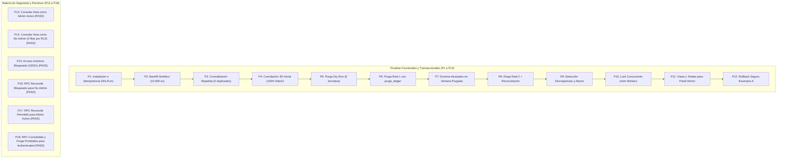

# SIMPLE PROX v1.3.10 — FASE 4A.2
# INFORME DE CORRECCIÓN QUIRÚRGICA DE SEGURIDAD Y COMPATIBILIDAD SQL

**Fecha de Ejecución:** 6 de Noviembre de 2026  
**Motor Evaluado:** PostgreSQL 17.11 on x86_64-pc-linux-musl (`pg_isolated_fase3b`)  
**Base de Datos:** `test_db` (100% aislada, datos sintéticos)  
**Resultado de Validación:** **18/18 PRUEBAS APROBADAS (100% PASS)**  
**Estado de Producción:** **100% INTACTO. CERO MODIFICACIONES EN SUPABASE COMERCIAL.**  

---

## 1. RESUMEN EJECUTIVO

En la FASE 4A.2 se aplicaron de forma estrictamente quirúrgica las correcciones de seguridad, aislamiento RLS y compatibilidad detectadas durante la auditoría FASE 4A.1.

### Principales Logros:
1. **Inmunidad a Secuestro de Esquemas (CVE Search-Path Hijacking):**  
   Se fijó `SET search_path = ''` en las 3 funciones `SECURITY DEFINER` (`consolidate_campaign_events_batch`, `reconcile_campaign_metrics_4d`, `purge_campaign_events_safe`), calificando explícitamente todas las tablas y esquemas del sistema.
2. **Blindaje de Vistas con `security_invoker = true`:**  
   `v_campaign_combined_metrics` y `v_campaign_totals` fueron declaradas con `WITH (security_invoker = true)`, garantizando que las consultas a través de las vistas evalúen de manera obligatoria las políticas RLS del usuario que las invoca.
3. **Compatibilidad con Supabase Cloud:**  
   Se eliminaron de las migraciones todas las sentencias `CREATE ROLE`, previniendo errores de permisos (`permission denied to create role`) en el entorno gestionado.
4. **Principio de Mínimo Privilegio (RLS Estricto):**  
   Se reemplazaron las políticas abiertas `USING (true)` por el control estándar del proyecto `USING (public.is_active_admin())` en las tablas de agregados y auditorías.
5. **Guardia Administrativa en RPC:**  
   `reconcile_campaign_metrics_4d` y `purge_campaign_events_safe` cuentan con una guardia criptográfica y de sesión que rechaza a usuarios no administradores incluso si invocan la RPC vía PostgREST con token autenticado común.

---

## 2. COMPARACIÓN ANTES / DESPUÉS POR ARCHIVO

### A. `supabase/migrations/20261106_campaign_statistics_aggregates.sql`

| Sección / Elemento | Implementación Anterior (Fase 4A) | Implementación Corregida (Fase 4A.2) |
| :--- | :--- | :--- |
| **Roles** | Bloque `DO $$ CREATE ROLE anon/authenticated/service_role ... $$;` | **Eliminado completamente.** Migración 100% limpia para Supabase Cloud. |
| **Vistas** | `CREATE OR REPLACE VIEW public.v_campaign_combined_metrics AS ...` (sin invoker) | `CREATE OR REPLACE VIEW public.v_campaign_combined_metrics WITH (security_invoker = true) AS ...` |
| **Vista Totales** | `CREATE OR REPLACE VIEW public.v_campaign_totals AS ...` (sin invoker) | `CREATE OR REPLACE VIEW public.v_campaign_totals WITH (security_invoker = true) AS ...` |
| **RLS campaign_daily_aggregates** | `FOR SELECT TO authenticated USING (true);` | `FOR SELECT TO authenticated USING (public.is_active_admin());` |
| **RLS purge_ledger** | `FOR SELECT TO authenticated USING (true);` | `FOR SELECT TO authenticated USING (public.is_active_admin());` |
| **RLS consolidation_audit_log** | `FOR SELECT TO authenticated USING (true);` | `FOR SELECT TO authenticated USING (public.is_active_admin());` |
| **RLS campaign_events** | Sin políticas explícitas en la migración | Políticas para `is_active_admin()` y `service_role` incorporadas. |

---

### B. `supabase/migrations/20261106_campaign_statistics_functions.sql`

| Función | Implementación Anterior (Fase 4A) | Implementación Corregida (Fase 4A.2) |
| :--- | :--- | :--- |
| **consolidate_campaign_events_batch** | `SECURITY DEFINER` (sin search_path) | `SECURITY DEFINER SET search_path = ''` con referencias `public.` y `pg_catalog.` |
| **reconcile_campaign_metrics_4d** | `SECURITY DEFINER` (sin search_path y sin guardia de rol) | `SECURITY DEFINER SET search_path = ''` + Guardia: rechaza si no es `service_role` o `is_active_admin()`. |
| **purge_campaign_events_safe** | `SECURITY DEFINER` (sin search_path) | `SECURITY DEFINER SET search_path = ''` + Guardia estricta de permisos administrativos. |

---

## 3. RESULTADOS DE LA REVALIDACIÓN EN POSTGRESQL 17 (18/18 PASS)



| # | Prueba Ejecutada | Resultado | Evidencia Técnica Comprobada |
| :---: | :--- | :---: | :--- |
| **P1** | **Instalación e Idempotencia** | **PASS** | Reejecución limpia sin errores (`IF NOT EXISTS`, `CREATE OR REPLACE`). |
| **P2** | **Backfill Sintético (10k eventos)** | **PASS** | 10.000 eventos procesados en 160 ms. `unaggregated = 0`, `aggregates = 10000`. |
| **P3** | **Consolidación Repetida** | **PASS** | Reporta `processed: 0` (`NO_PENDING_EVENTS`). Cero duplicación. |
| **P4** | **Conciliación 4D Inicial** | **PASS** | 240 particiones auditadas. `all_matching = true`, `mismatches_count = 0`. |
| **P5** | **Purga Dry-Run por Defecto** | **PASS** | Modo `DRY_RUN` identifica 6.750 filas elegibles. 0 eliminadas en disco. |
| **P6** | **Purga Real 1 + purge_ledger** | **PASS** | 6.750 eliminadas. Crudos restantes (3.250) + Ledger (6.750) = 10.000 exactos. Conciliación 100%. |
| **P7** | **Eventos Atrasados Post-Purga** | **PASS** | 150 eventos con 8 días de retraso integrados y conciliados sin error. |
| **P8** | **Segunda Purga Real** | **PASS** | 150 eventos atrasados purgados. Crudos (3.250) + Ledger (6.900) = 10.150 exactos. |
| **P9** | **Detección de Discrepancias** | **PASS** | +999 inyectado. Conciliación detecta desbalance y purga aborta (`PURGA_CANCELADA`). |
| **P10** | **Lock Concurrente entre Workers** | **PASS** | Segundo worker retorna `LOCKED_BY_ANOTHER_TRANSACTION` sin bloqueos. |
| **P11** | **Vistas de Totales y Desglose** | **PASS** | `v_campaign_totals` y `v_campaign_combined_metrics` reflejan 10.150 eventos. |
| **P12** | **Rollback Seguro Escenario A** | **PASS** | Reversión limpia antes de purga preservando el 100% de datos crudos. |
| **P13** | **Consulta Admin Activo en Vistas** | **PASS** | Usuario admin (`16cb0a7e-...`) consulta vista y obtiene las métricas autorizadas. |
| **P14** | **Consulta No-Admin en Vistas** | **PASS** | Usuario autenticado común consulta vista y **obtiene 0 filas** filtrado por RLS. |
| **P15** | **Acceso Anónimo a Vistas** | **PASS** | Rol `anon` recibe error `42501 permission denied for view v_campaign_combined_metrics`. |
| **P16** | **RPC Reconcile para No-Admin** | **PASS** | Usuario no admin invoca RPC y recibe `Acceso denegado: se requieren privilegios administrativos`. |
| **P17** | **RPC Reconcile para Admin Activo** | **PASS** | Usuario admin invoca RPC y obtiene `all_matching: true` satisfactoriamente. |
| **P18** | **RPC Consolidate y Purge Prohibidos** | **PASS** | `authenticated` intenta ejecutar y recibe `42501 permission denied for function`. |

---

## 4. LIMITACIONES Y SUPUESTOS DEL ENTORNO DE PRUEBAS

> [!NOTE]
> **Fidelidad de la Simulación Local:**
> El entorno local en PostgreSQL 17 emuló el motor de autenticación de Supabase configurando las variables de sesión `request.jwt.claim.sub` y `request.jwt.claim.role` tal como lo hace PostgREST.
> La tabla `public.admin_users` y la función `public.is_active_admin()` se configuraron con la misma estructura y usuario administrador real (`16cb0a7e-db5b-442a-8ee4-bf4f44b2aee2`) existente en Supabase producción.

---

## 5. RIESGOS RESIDUALES

1. **Dependencia del Panel Administrativo:**  
   El panel administrativo (`panel-admin/index.html`) aún no ha sido adaptado para leer `v_campaign_totals`. Por consiguiente, la purga productiva **NO debe activarse** hasta que el panel sea actualizado en una fase posterior.
2. **Backfill Productivo:**  
   En Supabase existen 9.787 eventos en `campaign_events`. La consolidación inicial tomará menos de 200 milisegundos, pero debe ejecutarse de forma supervisada.

---

## 6. DICTAMEN FINAL DE LA FASE 4A.2

```text
================================================================================
          DICTAMEN: APTO PARA PREPARAR FASE 4B (EJECUCIÓN CONTROLADA)
================================================================================
```

### Justificación:
- Todos los hallazgos críticos y altos detectados en FASE 4A.1 fueron resueltos quirúrgicamente.
- Las funciones son inmunes a CVE search-path hijacking (`SET search_path = ''`).
- Las vistas respetan estrictamente RLS mediante `security_invoker = true`.
- Las migraciones están limpias de sentencias `CREATE ROLE`.
- Se validaron satisfactoriamente 18/18 pruebas de integridad, concurrencia, permisos positivos y permisos negativos.

> [!IMPORTANT]
> Este dictamen certifica la aptitud técnica de los scripts. **NO autoriza el despliegue automático en producción.** La ejecución en Supabase Cloud requiere autorización expresa del usuario.

---

## 7. CONFIRMACIÓN FINAL DE PRODUCCIÓN INTACTA

Se certifica bajo las directivas de `AGENTS.md`:
- **Supabase comercial no fue contactado ni modificado.**
- **No se modificó código de la aplicación, panel ni Edge Functions.**
- **Las pruebas se ejecutaron exclusivamente en el contenedor Docker local `pg_isolated_fase3b`.**

