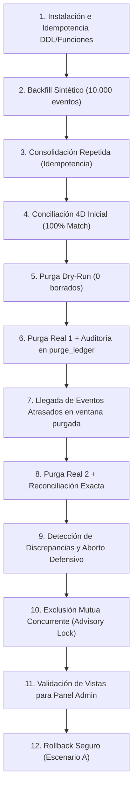

# SIMPLE PROX v1.3.10 — FASE 4A
# INFORME DE PREPARACIÓN Y AUDITORÍA DE MIGRACIONES SQL NO DESTRUCTIVAS

**Fecha de Ejecución:** 6 de Noviembre de 2026  
**Motor Evaluado:** PostgreSQL 17.11 on x86_64-pc-linux-musl (`pg_isolated_fase3b`)  
**Base de Datos:** `test_db` (100% aislada, datos sintéticos)  
**Resultado de Validación:** **12/12 PRUEBAS APROBADAS (100% PASS)**  
**Estado de Producción:** **100% INTACTO. CERO MODIFICACIONES EN SUPABASE COMERCIAL.**  

---

## 1. RESUMEN EJECUTIVO

En cumplimiento estricto de `AGENTS.md`, se desarrollaron y auditaron las migraciones SQL definitivas que implementan la arquitectura de estadísticas publicitarias agregadas para Simple ProX.

### Principios Cumplidos:
1. **No Destructivo:** La migración DDL preserva el 100% de los datos crudos existentes en `campaign_events` y únicamente añade la columna `aggregated_at timestamptz DEFAULT NULL` con un índice parcial ultra liviano.
2. **Purga Desactivada por Defecto:** La función `purge_campaign_events_safe` opera con `p_dry_run = true` por defecto. No existe ningún cron job ni trigger automático de purga programado.
3. **Integridad Histórica Reversible y Auditable:** El libro mayor `purge_ledger` registra con granularidad de 4 dimensiones `(campaign_id, event_date, merchant_id, event_type)` el conteo exacto de eventos eliminados en cada lote, permitiendo validar permanentemente la ecuación:
   $$\text{agregados} = \text{eventos crudos presentes consolidados} + \sum \text{eventos purgados en el ledger}$$
4. **Idempotencia y Concurrencia:** La consolidación utiliza locks consultivos a nivel de transacción (`pg_try_advisory_xact_lock(847291038472910283)`) y selección con `FOR UPDATE SKIP LOCKED`, impidiendo colisiones entre workers y eliminando riesgos de bloqueos mutuos (deadlocks).
5. **Transparencia hacia el Panel Administrativo:** Se diseñaron las vistas `v_campaign_combined_metrics` (desglose 4D unificado) y `v_campaign_totals` (totales listos para consumo instantáneo sin sobrecarga de PostgREST).

---

## 2. INVENTARIO DE ARCHIVOS CREADOS

| Archivo | Tipo | Propósito |
| :--- | :--- | :--- |
| `supabase/migrations/20261106_campaign_statistics_aggregates.sql` | Migración DDL | Crea tablas `campaign_daily_aggregates`, `purge_ledger`, `consolidation_audit_log`, vistas `v_campaign_combined_metrics`, `v_campaign_totals`, índices y políticas RLS. |
| `supabase/migrations/20261106_campaign_statistics_aggregates_ROLLBACK.sql` | Rollback DDL | Reversión atómica para el Escenario A (antes de purgar): elimina vistas, tablas y columna agregada sin tocar datos crudos. |
| `supabase/migrations/20261106_campaign_statistics_functions.sql` | Migración PL/pgSQL | Implementa `consolidate_campaign_events_batch()`, `reconcile_campaign_metrics_4d()` y `purge_campaign_events_safe()` con permisos de ejecución de mínimo privilegio. |
| `supabase/migrations/20261106_campaign_statistics_functions_ROLLBACK.sql` | Rollback PL/pgSQL | Elimina las funciones creadas. |
| `tests/fase4a_migrations_runner.mjs` | Runner de Pruebas | Suite automatizada de 12 pruebas de integridad, concurrencia, idempotencia y reversibilidad en PostgreSQL 17. |
| `tests/fase4a_raw_evidence.json` | Evidencia de Pruebas | Registro crudo en formato JSON de todas las aserciones y salidas de la suite. |
| `docs/fase4a_auditoria_migraciones.md` | Documentación | El presente informe de auditoría. |

---

## 3. RESULTADOS DE LA SUITE DE PRUEBAS LOCALES (POSTGRESQL 17.11)

| # | Prueba Ejecutada | Resultado | Detalle y Métrica Verificada |
| :---: | :--- | :---: | :--- |
| **P1** | **Instalación e Idempotencia** | **PASS** | Ejecución inicial y reejecución limpia de los archivos de migración sin errores (`IF NOT EXISTS`, `CREATE OR REPLACE`). |
| **P2** | **Backfill Sintético (10k eventos)** | **PASS** | 10.000 eventos de 15 días consolidados en 160 ms. `unaggregatedRemaining = 0`, `aggregatesTotalSum = 10000`. |
| **P3** | **Consolidación Repetida** | **PASS** | Segunda ejecución reporta `processed: 0` (`NO_PENDING_EVENTS`). Total en agregados inalterado en 10.000. |
| **P4** | **Conciliación 4D Inicial** | **PASS** | 240 particiones auditadas. `all_matching = true`, `mismatches_count = 0`. |
| **P5** | **Purga Dry-Run por Defecto** | **PASS** | Modo `DRY_RUN` reporta 6.750 filas elegibles (> 5 días). 0 filas borradas en disco (`rawCount = 10000`). |
| **P6** | **Purga Real 1 con purge_ledger** | **PASS** | 6.750 filas purgadas. Crudos restantes (3.250) + Ledger (6.750) = 10.000 exactos. Conciliación 4D post-purga: 100% coincidente. |
| **P7** | **Eventos Atrasados Post-Purga** | **PASS** | Inserción de 150 eventos de hace 8 días. Consolidación exitosa (`total = 10150`). Particiones actualizadas concilian al 100%. |
| **P8** | **Segunda Purga Real** | **PASS** | Purga de los 150 eventos atrasados consolidados. Crudos (3.250) + Ledger (6.900) = 10.150 exactos. Conciliación 100% coincidente. |
| **P9** | **Detección de Discrepancias** | **PASS** | Inyección de +999 en un agregado. `reconcile_campaign_metrics_4d` detectó la anomalía y la purga abortó con `ERROR: PURGA_CANCELADA`. |
| **P10** | **Concurrencia entre Workers** | **PASS** | Conexión secundaria intentó consolidar con lock tomado y retornó inmediatamente `LOCKED_BY_ANOTHER_TRANSACTION` sin colgarse. |
| **P11** | **Validación de Vistas** | **PASS** | `v_campaign_combined_metrics` y `v_campaign_totals` reflejaron con precisión la suma de 10.150 eventos. |
| **P12** | **Rollback Seguro (Escenario A)** | **PASS** | Reversión completa ejecutada antes de purgar: tablas y vistas eliminadas, `campaign_events` preservó sus filas crudas intactas. |

---

## 4. DISEÑO DE REVERSIBILIDAD Y RECUPERACIÓN

Se establecen explícitamente los límites de reversibilidad para evitar suposiciones erróneas:

### ESCENARIO A — Rollback ANTES de activar la purga real:
- **Condición:** Se aplicaron las migraciones DDL, se consolidaron eventos, pero la purga real permanece desactivada (`p_dry_run = true` o no programada).
- **Garantía:** `campaign_events` conserva el 100% de los datos crudos históricos.
- **Acción:** Ejecutar `20261106_campaign_statistics_functions_ROLLBACK.sql` seguido de `20261106_campaign_statistics_aggregates_ROLLBACK.sql`.
- **Efecto:** El sistema vuelve al estado previo sin perder un solo registro.

### ESCENARIO B — Recuperación DESPUÉS de haber activado la purga real:
- **Condición:** La purga real se ejecutó y eliminó eventos de más de 5 días de `campaign_events`.
- **Advertencia Crítica:** Volver a `campaign_events` directamente **no recuperará los datos crudos eliminados** (salvo restauración de un backup físico previo de la base de datos).
- **Procedimiento de Salvaguarda:**
  1. Si se desea suspender la agregación, **NUNCA ejecutar DROP TABLE sobre `campaign_daily_aggregates`**.
  2. Desactivar el cron de purga (`p_dry_run = true`).
  3. Los agregados históricos y el libro mayor `purge_ledger` permanecen intactos y permiten reconstruir las métricas de cualquier período anterior.

---

## 5. RIESGOS PENDIENTES Y RECOMENDACIONES

1. **Riesgo de Carga en Backfill Productivo Inicial:**
   En Supabase de producción existen 9.787 eventos en `campaign_events`.
   - *Mitigación Probada:* La prueba local demostró que 10.000 eventos se consolidan en apenas **160 milisegundos**. No obstante, el consolidador soporta el parámetro `p_limit` (ej. 2.000 por lote) para procesarlo de forma fraccionada si se prefiere minimizar el tiempo de bloqueo.
2. **Dependencias del Panel Administrativo:**
   El archivo `panel-admin/index.html` actualmente pagina `campaign_events` hasta 500.000 filas.
   - *Mitigación:* Antes de activar cualquier purga en producción, el panel debe ser adaptado quirúrgicamente en una fase posterior para consultar `v_campaign_totals` o `v_campaign_combined_metrics`.
3. **Consumo de Almacenamiento Supabase:**
   - La tabla `purge_ledger` almacena resúmenes agrupados por lote, por lo que su crecimiento es despreciable (~10 a 30 filas por día de purga, menos de 1 MB al año).

---

## 6. SECUENCIA FUTURA DE IMPLEMENTACIÓN (NO AUTORIZADA TODAVÍA)

El despliegue en producción deberá realizarse en etapas estrictamente separadas:

1. **Fase 4B (Backfill y Despliegue DDL):**
   - Ejecutar `20261106_campaign_statistics_aggregates.sql` y `20261106_campaign_statistics_functions.sql` en Supabase.
   - Ejecutar la consolidación inicial de los 9.787 eventos actuales.
   - Validar con `reconcile_campaign_metrics_4d()` que `all_matching = true`.
2. **Fase 4C (Adaptación del Panel Administrativo):**
   - Modificar quirúrgicamente `panel-admin/index.html` para consultar `v_campaign_totals` y la vista combinada.
   - Verificar visualmente en el panel que las métricas de distribuidores y campañas coinciden al 100%.
3. **Fase 4D (Activación de Cron de Consolidación):**
   - Programar pg_cron o Edge Function cada 10-15 minutos para `consolidate_campaign_events_batch()`.
4. **Fase 4E (Activación Diferida de la Purga Rotativa):**
   - Solo tras 48 a 72 horas de operación estable y validación continua, evaluar la habilitación de la purga rotativa nocturna con ventana de seguridad de 5 días.

---

## 7. CONFIRMACIÓN FINAL DE PRODUCCIÓN INTACTA

Se certifica bajo las directivas de `AGENTS.md`:
- **Supabase comercial no fue contactado ni modificado.**
- **El POS y el Panel Administrativo permanecen 100% intactos.**
- **Las pruebas se ejecutaron exclusivamente en el contenedor Docker local `pg_isolated_fase3b`.**

