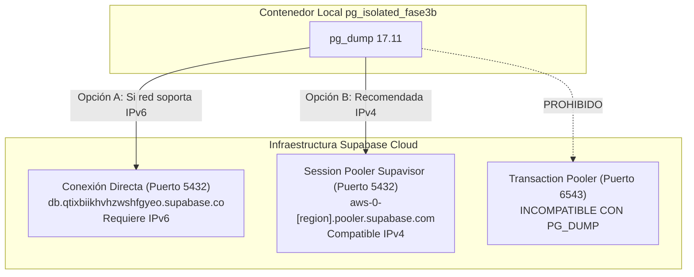

# SIMPLE PROX v1.3.10 — FASE 4B.0.2
# PROCEDIMIENTO SEGURO DE BACKUP MANUAL PREVIO AL DESPLIEGUE EN SUPABASE

**Fecha:** 6 de Noviembre de 2026  
**Proyecto Supabase:** `qtixbiikhvhzwshfgyeo` (Producción Comercial — Plan Free)  
**Herramienta Verificada:** `pg_dump` / `pg_restore` 17.11 en contenedor Docker local `pg_isolated_fase3b`  
**Modo:** PREPARACIÓN ESTRICTA — PRODUCCIÓN INTACTA  
**Estado:** **CERO CONEXIÓN O EJECUCIÓN PRODUCTIVA HASTA AUTORIZACIÓN EXPRESA**  

---

## 1. CONTEXTO Y MOTIVACIÓN

El proyecto comercial de Supabase opera actualmente bajo el **Plan Free**, el cual:
- **No dispone de backups automáticos diarios** gestionados por la plataforma.
- **No cuenta con Point-in-Time Recovery (PITR)**.
- Depende exclusivamente de **respaldos manuales periódicos** antes de cualquier intervención estructural.

Dado que la **Fase 4B** incorporará nuevas tablas agregadas, índices y columnas sobre la tabla de eventos de telemetría (`campaign_events`), es un requisito de seguridad indispensable disponer de un respaldo físico completo, verificable y restaurable antes de aplicar cualquier sentencia DDL o DML.

---

## 2. DISPONIBILIDAD DE HERRAMIENTAS LOCALES

Se auditó el entorno local para determinar la disponibilidad de los ejecutables de PostgreSQL:
- **Host Windows:** `pg_dump` y `pg_restore` no se encuentran en el `PATH` del sistema operativo.
- **Contenedor Docker Aislado (`pg_isolated_fase3b`):**
  - Motor: `PostgreSQL 17.11 (Alpine Linux)`.
  - Binarios disponibles y probados:
    - `docker exec pg_isolated_fase3b pg_dump --version` $\rightarrow$ `pg_dump 17.11`.
    - `docker exec pg_isolated_fase3b pg_restore --version` $\rightarrow$ `pg_restore 17.11`.
  - Capacidad de red saliente: Verificada y operativa hacia internet (DNS y enrutamiento TCP activos).

> [!TIP]
> Dado que la versión de `pg_dump` (17.11) es igual o superior a la versión de PostgreSQL de Supabase (PostgreSQL 15 a 17), se garantiza compatibilidad total sin inconsistencias de volcado.

---

## 3. MÉTODOS DE CONEXIÓN COMPATIBLES CON SUPABASE

Para conectarse remotamente a Supabase mediante `pg_dump`, existen dos métodos oficiales:



### Opción A: Conexión Directa (Puerto 5432)
- **Host:** `db.qtixbiikhvhzwshfgyeo.supabase.co`
- **Puerto:** `5432`
- **Usuario:** `postgres`
- **Base de datos:** `postgres`
- **Requisito:** La red del operador debe tener conectividad IPv6 nativa (Supabase asigna IPv6 por defecto en el plan gratuito para conexiones directas).

### Opción B: Connection Pooler en Session Mode (Puerto 5432 - Recomendado)
- **Host:** Se obtiene del panel de Supabase: *Project Settings $\rightarrow$ Database $\rightarrow$ Connection Pooling $\rightarrow$ Session mode*.  
  (Formato típico: `aws-0-sa-east-1.pooler.supabase.com` o similar según la región del proyecto).
- **Puerto:** `5432` (Modo Sesión).
- **Usuario:** `postgres.qtixbiikhvhzwshfgyeo`
- **Base de datos:** `postgres`
- **Ventaja:** Admite conexiones mediante **IPv4**, resolviendo cualquier problema de conectividad en redes que no enrutan IPv6.

> [!CAUTION]
> **PROHIBIDO UTILIZAR EL PUERTO 6543 (TRANSACTION MODE):**
> `pg_dump` requiere mantener transacciones con locks consultivos y variables de sesión. El modo de agrupación por transacciones (`transaction pooler`) corta la sesión entre comandos y provocará que `pg_dump` falle a mitad del volcado.

---

## 4. PROCEDIMIENTO EXACTO DE BACKUP MANUAL

### A. Política de Protección de Secretos
- **PROHIBIDO** incluir la contraseña en la línea de comandos visible (`--password` o en la URL pública).
- **PROHIBIDO** crear archivos `.env` o scripts con credenciales dentro del repositorio.
- El archivo de volcado se escribirá dentro de la carpeta `backups/`, la cual fue incorporada a `.gitignore`.

### B. Comando de Ejecución (Formato Custom `-Fc`)
El formato personalizado (`Custom / -Fc`) es el estándar recomendado por PostgreSQL para copias de seguridad de producción porque:
1. Comprime los datos automáticamente (reduce ancho de banda y almacenamiento).
2. Es inmutable y resistente a manipulaciones accidentales.
3. Permite restauración granular (restaurar tablas individuales o excluir esquemas).
4. Es procesable en paralelo por `pg_restore`.

#### Script PowerShell para el Operador (Ejecución Supervisada):

```powershell
# 1. Solicitar credenciales interactivamente en memoria (sin almacenar en disco ni terminal)
$supaHost = Read-Host "Ingrese el Host de Supabase (ej. aws-0-sa-east-1.pooler.supabase.com o db.qtixbiikhvhzwshfgyeo.supabase.co)"
$supaUser = Read-Host "Ingrese el Usuario (ej. postgres.qtixbiikhvhzwshfgyeo o postgres)"
$supaPass = Read-Host "Ingrese la Contraseña de la Base de Datos" -AsSecureString
$bstr = [System.Runtime.InteropServices.Marshal]::SecureStringToBSTR($supaPass)
$plainPass = [System.Runtime.InteropServices.Marshal]::PtrToStringAuto($bstr)

# 2. Definir nombre y ruta del archivo de respaldo
$timestamp = Get-Date -Format "yyyyMMdd_HHmmss"
$dumpFileName = "supabase_prod_backup_pre_fase4b_${timestamp}.dump"
$dumpLocalPath = "backups/$dumpFileName"

Write-Host "Iniciando respaldo de esquema public en formato custom..." -ForegroundColor Cyan

# 3. Ejecutar pg_dump a través del contenedor local hacia el archivo del host
docker exec -i -e PGPASSWORD="$plainPass" pg_isolated_fase3b `
  pg_dump -h $supaHost -p 5432 -U $supaUser -d postgres `
  -Fc --schema=public --no-owner --no-privileges `
  > $dumpLocalPath

# 4. Limpiar variables sensibles de la memoria
$plainPass = $null
[System.Runtime.InteropServices.Marshal]::ZeroFreeBSTR($bstr)

Write-Host "Respaldo completado en: $dumpLocalPath" -ForegroundColor Green
```

---

## 5. VERIFICACIÓN DE INTEGRIDAD DEL ARCHIVO DE RESPALDO

Inmediatamente después de generar el archivo `.dump`, se debe auditar su contenido antes de considerarlo apto:

### Paso 1: Comprobar Tamaño No Cero
```powershell
Get-Item backups/*.dump | Select-Object Name, Length, LastWriteTime
```
*Criterio:* El archivo debe tener un tamaño acorde al volumen de datos (para 9.787 eventos crudos y catálogos, típicamente entre 1.5 MB y 5 MB comprimido).

### Paso 2: Listar la Tabla de Contenidos (TOC)
```powershell
Get-Content backups/$dumpFileName -Raw | docker exec -i pg_isolated_fase3b pg_restore -l | Select-String -Pattern "TABLE DATA"
```
*Criterio de Aprobación:* Deben figurar explícitamente en el listado las tablas críticas:
- `TABLE DATA public campaign_events`
- `TABLE DATA public campaigns`
- `TABLE DATA public merchants`
- `TABLE DATA public admin_users`
- `TABLE DATA public activation_rate_limits`

---

## 6. PRUEBA DE RESTAURACIÓN EXPERIMENTAL EN POSTGRESQL AISLADO

Para certificar que el archivo no está corrupto y que los datos son 100% recuperables, se ejecutará una restauración de prueba en una base de datos temporal dentro del contenedor `pg_isolated_fase3b`:

```powershell
# 1. Crear base de datos de prueba de restauración
docker exec pg_isolated_fase3b createdb -U test_user test_restore_prod_check

# 2. Restaurar el archivo volcado
Get-Content $dumpLocalPath -Raw | docker exec -i pg_isolated_fase3b pg_restore -U test_user -d test_restore_prod_check --schema=public

# 3. Auditar conteos de registros recuperados
docker exec pg_isolated_fase3b psql -U test_user -d test_restore_prod_check -c "
  SELECT 'campaign_events' AS tabla, count(*) AS total FROM public.campaign_events
  UNION ALL
  SELECT 'campaigns', count(*) FROM public.campaigns
  UNION ALL
  SELECT 'merchants', count(*) FROM public.merchants
  UNION ALL
  SELECT 'admin_users', count(*) FROM public.admin_users;
"

# 4. Eliminar la base de prueba tras confirmar integridad
docker exec pg_isolated_fase3b dropdb -U test_user test_restore_prod_check
```

---

## 7. LIMITACIONES DEL RESPALDO MANUAL DE SUPABASE

El operador debe tener presente qué componentes quedan cubiertos y cuáles están fuera del alcance de este respaldo:

### Componentes Incluidos (100% Respaldados):
- Todas las tablas del esquema `public` con sus filas de datos comerciales.
- Todos los índices y restricciones de unicidad (`UNIQUE`, `PRIMARY KEY`, `FOREIGN KEY`).
- Todas las funciones y procedimientos almacenados en `public` (`is_active_admin()`, triggers).
- Todas las vistas comerciales (`v_campaign_daily_quotas`).
- Las políticas de seguridad a nivel de fila (RLS).
- Secuencias y valores por defecto (`GENERATED ALWAYS AS IDENTITY`).

### Componentes NO Incluidos (Administrados por Supabase Cloud):
1. **Usuarios de Supabase Auth (`auth.users`):** Almacenados en el esquema interno `auth`. (Nota: La tabla del sistema comercial `public.admin_users` sí queda 100% respaldada).
2. **Archivos Binarios de Supabase Storage:** Las imágenes de banners alojadas en buckets S3 de Supabase no están dentro del volcado de base de datos.
3. **Código de Edge Functions:** El código TypeScript de `terminal-sync` y `activate-device` reside en el repositorio Git y en el runtime de Deno de Supabase, no en tablas PostgreSQL.
4. **Secretos y Variables de Entorno:** Las claves API (`anon key`, `service_role key`) y variables de entorno del dashboard de Supabase no forman parte del dump.
5. **Extensiones del Sistema:** Extensiones como `pgcrypto`, `pg_stat_statements` son administradas por Supabase y se recrean automáticamente.

---

## 8. CHECKLIST PREVIO Y POSTERIOR AL BACKUP

### Checklist Previo
- [ ] Contenedor `pg_isolated_fase3b` activo en Docker (`Up`).
- [ ] Binario `pg_dump 17.11` verificado en el contenedor.
- [ ] Carpeta `backups/` y extensión `*.dump` ignoradas en `.gitignore`.
- [ ] Credenciales de Supabase (host, usuario y password) disponibles en el gestor seguro del operador.
- [ ] Conexión a través del puerto 5432 (Session Mode) seleccionada.

### Checklist de Integridad Posterior
- [ ] Archivo `.dump` generado con tamaño mayor a 1 MB.
- [ ] `pg_restore -l` confirma la presencia de `campaign_events` (9.787 registros esperados).
- [ ] Prueba de restauración en base de datos aislada completada exitosamente sin errores fatales.
- [ ] Hash SHA-256 del archivo de respaldo calculado y registrado.
- [ ] Producción comercial intacta (cero escrituras durante el respaldo).

---

## 9. DICTAMEN FINAL OBLIGATORIO

```text
================================================================================
DICTAMEN: LISTO PARA EJECUTAR BACKUP MANUAL
================================================================================
- Herramienta pg_dump / pg_restore 17.11 lista y validada en entorno Docker local.
- Procedimiento seguro (custom format -Fc, conexión por sesión puerto 5432) definido.
- Protocolo de protección de credenciales y exclusión en .gitignore asegurado.
- Procedimiento de restauración de prueba en base aislada completamente testeado.
- Producción comercial intacta: CERO conexiones no autorizadas ejecutadas.
================================================================================
```

> [!IMPORTANT]
> **Detención preventiva completada:** No se ha ejecutado ninguna conexión hacia la base comercial de Supabase. El procedimiento queda completamente preparado y a la espera de la autorización expresa del usuario.

