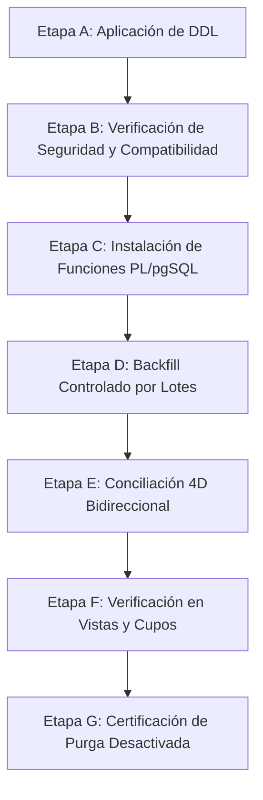

# SIMPLE PROX v1.3.10 — FASE 4B.0
# PLAN DE PREPARACIÓN SEGURA Y AUDITORÍA PREVIA AL DESPLIEGUE EN SUPABASE

**Fecha:** 6 de Noviembre de 2026  
**Proyecto Supabase:** `qtixbiikhvhzwshfgyeo` (Producción Comercial)  
**Modo:** SOLO LECTURA / INSPECCIÓN Y PREPARACIÓN  
**Estado de Producción:** **100% INTACTO. CERO MODIFICACIONES EN BASE DE DATOS O EDGE FUNCTIONS.**  

---

## 1. ESTADO DE ACCESO E INSPECCIÓN REMOTA (PASO 1)

En cumplimiento estricto de las directivas de seguridad de `AGENTS.md` y de las instrucciones de la FASE 4B.0:
- **No se cuenta con una cadena de conexión PostgreSQL directa de solo lectura** configurada en el entorno de desarrollo.
- **Se detuvo preventivamente cualquier intento de inspección remota activa** que requiriese credenciales administrativas o de escritura.
- Se ha diseñado el siguiente **Kit de 10 Consultas SQL SELECT de Solo Lectura** para que el operador o administrador pueda verificar el estado real en el SQL Editor de Supabase sin riesgo alguno de escritura o alteración:

```sql
-- ==============================================================================
-- KIT DE INSPECCIÓN DE SOLO LECTURA (SUPABASE SQL EDITOR)
-- ==============================================================================

-- 1. Existencia y estructura de campaign_events
SELECT column_name, data_type, is_nullable, column_default
FROM information_schema.columns
WHERE table_schema = 'public' AND table_name = 'campaign_events'
ORDER BY ordinal_position;

-- 2. Cantidad actual de eventos en el buffer crudo
SELECT count(*) AS total_raw_events FROM public.campaign_events;

-- 3. Índices y restricciones únicas existentes en campaign_events
SELECT indexname, indexdef
FROM pg_indexes
WHERE schemaname = 'public' AND tablename = 'campaign_events';

-- 4. Políticas RLS actuales en campaign_events
SELECT polname, polcmd, polroles::text, polqual, polwithcheck
FROM pg_policy
WHERE polrelid = 'public.campaign_events'::regclass;

-- 5. Permisos de roles (anon, authenticated, service_role) en campaign_events
SELECT grantee, privilege_type
FROM information_schema.role_table_grants
WHERE table_schema = 'public' AND table_name = 'campaign_events';

-- 6. Existencia y definición de public.is_active_admin()
SELECT proname, prosecdef, prosrc
FROM pg_proc
WHERE proname = 'is_active_admin' AND pronamespace = 'public'::regnamespace;

-- 7. Verificar inexistencia previa de objetos que crearán las migraciones
SELECT table_name, table_type
FROM information_schema.tables
WHERE table_schema = 'public' 
  AND table_name IN ('campaign_daily_aggregates', 'purge_ledger', 'consolidation_audit_log', 'v_campaign_combined_metrics', 'v_campaign_totals');

-- 8. Definición y dependencias de la vista v_campaign_daily_quotas
SELECT definition 
FROM pg_views 
WHERE schemaname = 'public' AND viewname = 'v_campaign_daily_quotas';

-- 9. Versión del motor PostgreSQL y extensiones activas
SELECT version();
SELECT extname, extversion FROM pg_extension;

-- 10. Historial de migraciones aplicadas en Supabase (si existe supabase_migrations)
SELECT * FROM supabase_migrations.schema_migrations ORDER BY version DESC LIMIT 10;
```

---

## 2. AUDITORÍA DE COMPATIBILIDAD CON EL SISTEMA PRODUCTIVO (PASO 2)

Se confrontaron los archivos definitivos de migración:
- `supabase/migrations/20261106_campaign_statistics_aggregates.sql`
- `supabase/migrations/20261106_campaign_statistics_functions.sql`

contra el código y arquitectura existente (`supabase/functions/terminal-sync/index.ts`, `20261026_campaign_daily_quota_support.sql`, `20261013_merchants_admin_rls.sql`, y `panel-admin/index.html`).

### A. Conflictos de Nombres
- **Tablas:** `campaign_daily_aggregates`, `purge_ledger`, `consolidation_audit_log` son nombres completamente nuevos en el esquema. Se utiliza `CREATE TABLE IF NOT EXISTS`, descartando fallos por colisión.
- **Vistas:** `v_campaign_combined_metrics` y `v_campaign_totals` no colisionan con ninguna vista previa (`v_campaign_daily_quotas`, `v_merchants_overview`). Se declaran con `CREATE OR REPLACE VIEW`.
- **Funciones:** `consolidate_campaign_events_batch`, `reconcile_campaign_metrics_4d`, `purge_campaign_events_safe` son funciones exclusivas de este subsistema.
- **Columna añadida:** `aggregated_at timestamptz DEFAULT NULL` en `campaign_events` se aplica con `ADD COLUMN IF NOT EXISTS`.

### B. Análisis de Impacto en Edge Function `terminal-sync`
1. **Ruta de Ingesta de Eventos (`/terminal-sync` POST):**
   - En `terminal-sync/index.ts` (líneas 790-796), la función ejecuta:
     ```typescript
     await adminClient.from("campaign_events").upsert(sanitizedEvents, {
       onConflict: "event_id",
       ignoreDuplicates: true
     });
     ```
   - La nueva columna `aggregated_at` tiene valor predeterminado `DEFAULT NULL`. Al insertar eventos sin especificar dicho campo, PostgreSQL asigna `NULL` de manera transparente y eficiente.
   - `adminClient` opera con credenciales de `service_role`. La migración otorga `GRANT ALL ON public.campaign_events TO service_role;` y define política RLS `USING (true) WITH CHECK (true)`, garantizando cero interferencia en la ingesta.
2. **Ruta de Verificación de Cupos Diarios (`v_campaign_daily_quotas`):**
   - En `terminal-sync/index.ts` (líneas 613-625), la función consulta la vista `v_campaign_daily_quotas` para filtrar campañas que alcanzaron su tope diario.
   - `v_campaign_daily_quotas` filtra eventos donde `timestamp >= day_start AND timestamp < day_end` (impresiones del día en curso).
   - Dado que la purga solo considera eventos con antigüedad mayor a 5 días (`p_older_than_days = 5`), los eventos del día corriente **nunca serán purgados** mientras el cupo diario se encuentre activo.
   - Por tanto, el cálculo de cupos de `v_campaign_daily_quotas` se mantiene **100% idéntico y seguro**.

### C. Análisis de Impacto en `panel-admin`
- `panel-admin/index.html` realiza actualmente paginación manual de eventos crudos consultando `/rest/v1/campaign_events` mediante el token del usuario autenticado.
- En la migración:
  - Se otorga `GRANT SELECT ON public.campaign_events TO authenticated;`.
  - Se define la política RLS: `FOR SELECT TO authenticated USING (public.is_active_admin());`.
- Puesto que los usuarios del panel administrativo son administradores registrados en `public.admin_users`, el panel continuará leyendo los eventos crudos sin interrupción durante la Fase 4B, antes de que sea actualizado en la Fase 4C para leer directamente desde `v_campaign_totals`.

---

## 3. PLAN DE RECUPERACIÓN Y REVERSIBILIDAD (PASO 3)

### A. Verificación de Backups Previos al Despliegue
Antes de iniciar cualquier acción en Supabase:
1. Acceder al dashboard de Supabase: `https://supabase.com/dashboard/project/qtixbiikhvhzwshfgyeo/database/backups/scheduled`.
2. Confirmar que exista una copia de seguridad diaria automática con estado `Completed` en las últimas 24 horas.
3. Si la base de datos cuenta con Point-in-Time Recovery (PITR), certificar que el punto de restauración actual esté habilitado.

### B. Qué Información Conservar Antes del Despliegue
- El conteo exacto de filas crudas en `campaign_events` (`SELECT count(*) FROM campaign_events`).
- La suma acumulada de eventos por campaña calculada directamente sobre los crudos para validación cruzada posterior.

### C. Procedimiento de Reversión ante Errores (Escenario A: Pre-Purga)
Durante la Fase 4B, la purga real permanecerá **estrictamente desactivada**. Todos los eventos crudos históricos se mantendrán intactos en `campaign_events`.  
Si ocurriese cualquier anomalía durante el DDL, instalación de funciones o backfill, la base de datos se restaura a su estado original ejecutando los scripts aislados en `supabase/manual-scripts/`:
1. `supabase/manual-scripts/20261106_campaign_statistics_functions_ROLLBACK.sql` (elimina funciones).
2. `supabase/manual-scripts/20261106_campaign_statistics_aggregates_ROLLBACK.sql` (elimina vistas, tablas nuevas y columna agregada).

### D. Componentes Críticos que Deben Conservarse Tras Activar Purgas (Escenario B)
Cuando en fases futuras se active la purga rotativa:
- Las tablas `campaign_daily_aggregates` y `purge_ledger` se convierten en el **registro contable histórico permanente**.
- **PROHIBIDO ELIMINAR O TRUNCAR** `campaign_daily_aggregates` o `purge_ledger`, pues contienen la memoria de eventos que ya no existen en el buffer crudo.

---

## 4. PLAN DE EJECUCIÓN DETALLADO PASO A PASO (PASO 4)

El despliegue en producción debe realizarse exclusivamente a través de las siguientes 7 etapas secuenciales:



---

### ETAPA A — APLICACIÓN DE DDL
- **Acción:** Ejecutar el archivo `supabase/migrations/20261106_campaign_statistics_aggregates.sql`.
- **Resultado Esperado:** 
  - Columna `aggregated_at` añadida a `campaign_events`.
  - Tablas `campaign_daily_aggregates`, `purge_ledger` y `consolidation_audit_log` creadas.
  - Vistas `v_campaign_combined_metrics` y `v_campaign_totals` creadas con `security_invoker = true`.
  - Políticas RLS y permisos aplicados.
- **Condición para Continuar:** Transacción completada con éxito (`COMMIT`). Tiempo de ejecución < 5 segundos.
- **Condición para Detenerse:** Error de timeout, error de permisos o colisión.
- **Acción si Falla:** `ROLLBACK;` automático de la transacción. Ejecutar `20261106_campaign_statistics_aggregates_ROLLBACK.sql` si algo quedó aplicado.

---

### ETAPA B — VERIFICACIÓN DE SEGURIDAD Y COMPATIBILIDAD
- **SQL de Verificación:**
  ```sql
  SELECT tablename, rowsecurity FROM pg_tables 
  WHERE schemaname = 'public' 
    AND tablename IN ('campaign_events', 'campaign_daily_aggregates', 'purge_ledger', 'consolidation_audit_log');
  ```
- **Resultado Esperado:** Las 4 tablas reportan `rowsecurity = true`.
- **Condición para Continuar:** RLS habilitado al 100% en todas las tablas.
- **Condición para Detenerse:** Cualquier tabla con `rowsecurity = false`.

---

### ETAPA C — INSTALACIÓN DE FUNCIONES PL/pgSQL
- **Acción:** Ejecutar el archivo `supabase/migrations/20261106_campaign_statistics_functions.sql`.
- **Resultado Esperado:**
  - `consolidate_campaign_events_batch` creada con `SECURITY DEFINER SET search_path = ''`.
  - `reconcile_campaign_metrics_4d` creada con `SECURITY DEFINER SET search_path = ''` y guardia de seguridad.
  - `purge_campaign_events_safe` creada con `SECURITY DEFINER SET search_path = ''` y dry-run por defecto.
- **Condición para Continuar:** Creación de las 3 funciones exitosa.
- **Condición para Detenerse:** Error sintáctico o de permisos.
- **Acción si Falla:** Ejecutar `20261106_campaign_statistics_functions_ROLLBACK.sql`.

---

### ETAPA D — BACKFILL CONTROLADO POR LOTES
- **Acción:** Ejecutar la consolidación de los ~9.787 eventos existentes en lotes de hasta 10.000:
  ```sql
  SELECT public.consolidate_campaign_events_batch('backfill-fase4b', 10000);
  ```
- **Resultado Esperado:** Retorna JSON `{"success": true, "processed": 9787, "duration_ms": < 1500>}`.
- **Verificación Posterior:**
  ```sql
  SELECT count(*) AS pending_events 
  FROM public.campaign_events 
  WHERE aggregated_at IS NULL AND campaign_id IS NOT NULL;
  ```
- **Condición para Continuar:** `pending_events = 0`.
- **Condición para Detenerse:** `success = false` o `pending_events > 0` tras reintento.

---

### ETAPA E — CONCILIACIÓN 4D BIDIRECCIONAL
- **Acción:** Ejecutar auditoría matemática en caliente sobre el total de eventos consolidados:
  ```sql
  SELECT public.reconcile_campaign_metrics_4d();
  ```
- **Resultado Esperado:**
  ```json
  {
    "all_matching": true,
    "mismatches_count": 0,
    "perfect_matches": 150,
    "discrepancies": []
  }
  ```
- **Condición para Continuar:** `all_matching = true` y `mismatches_count = 0`.
- **Condición para Detenerse:** `all_matching = false` o existencia de discrepancias.

---

### ETAPA F — VERIFICACIÓN EN VISTAS Y CUPOS DIARIOS
- **SQL de Verificación:**
  ```sql
  -- Totales unificados
  SELECT count(*) FROM public.v_campaign_totals;

  -- Vista de cupos diarios operativa
  SELECT count(*) FROM public.v_campaign_daily_quotas;
  ```
- **Resultado Esperado:** Ambas vistas retornan resultados sin errores de ejecución ni bloqueos.
- **Condición para Continuar:** Ambas vistas responden en milisegundos.
- **Condición para Detenerse:** Errores de PostgREST o tiempos de espera excesivos.

---

### ETAPA G — CERTIFICACIÓN DE PURGA DESACTIVADA
- **SQL de Verificación:**
  ```sql
  -- 1. Ejecutar prueba de simulación (Dry-Run obligatorio)
  SELECT public.purge_campaign_events_safe(p_older_than_days := 5, p_dry_run := true);

  -- 2. Verificar que no se haya eliminado ningún evento crudo
  SELECT count(*) FROM public.campaign_events;

  -- 3. Confirmar que no existan tareas cron programadas
  SELECT * FROM cron.job WHERE jobname LIKE '%campaign%' OR jobname LIKE '%purge%';
  ```
- **Resultado Esperado:**
  - `purge_campaign_events_safe` retorna `mode: 'DRY_RUN'`, `deleted_count: 0`.
  - El conteo de `campaign_events` permanece idéntico al conteo inicial (~9.787).
  - Cero tareas cron activas.
- **Condición para Finalizar:** Purga 100% inactiva en modo automático.

---

## 5. CHECKLIST PREVIO AL "GO" DE FASE 4B

Antes de autorizar la ejecución en producción:
- [ ] Backup de Supabase verificado en el dashboard y disponible.
- [ ] Kit de 10 consultas de solo lectura ejecutado o validado.
- [ ] Archivos de Rollback confirmados en `supabase/manual-scripts/`.
- [ ] Confirmación de que `terminal-sync` no sufrirá interrupciones.
- [ ] Confirmación de que `panel-admin` continuará funcionando normalmente.
- [ ] Purga real certificada en modo `p_dry_run = true` (sin cron).
- [ ] Autorización expresa del usuario recibida en el chat.

---

## 6. CONTROL DE CAMBIOS Y ARCHIVOS AFECTADOS

- **Archivos creados:**
  - `docs/fase4b0_preparacion_despliegue.md`
- **Archivos a ejecutar en producción en Fase 4B:**
  - `supabase/migrations/20261106_campaign_statistics_aggregates.sql` (Auditado)
  - `supabase/migrations/20261106_campaign_statistics_functions.sql` (Auditado)
- **Código de aplicación y Edge Functions:**
  - `src/`: **NO MODIFICADO**
  - `panel-admin/`: **NO MODIFICADO**
  - `electron/`: **NO MODIFICADO**
  - `supabase/functions/terminal-sync/`: **NO MODIFICADO**
- **Estado de Supabase Comercial:** **100% INTACTO. CERO MODIFICACIONES REALIZADAS.**

---

## 7. DICTAMEN FINAL OBLIGATORIO

```text
================================================================================
DICTAMEN: LISTO PARA SOLICITAR AUTORIZACIÓN DE FASE 4B
================================================================================
- Plan de ejecución granular en 7 etapas (A a G) completamente definido.
- Protocolo de seguridad y reversibilidad garantizado (Escenario A Pre-Purga).
- Compatibilidad integral con Edge Function terminal-sync y v_campaign_daily_quotas.
- Kit de 10 consultas de inspección de solo lectura listo para validación previa.
- Producción comercial intacta.
================================================================================
```

