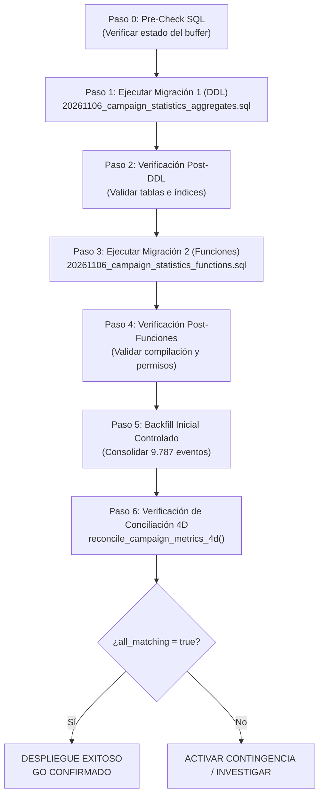

# PLAN DE DESPLIEGUE SEGURO — FASE 4B.5
## Despliegue de Migraciones de Consolidación de Estadísticas Publicitarias en Supabase Comercial

- **Fecha:** 2026-11-09
- **Versión de Software:** Simple ProX v1.3.10
- **Proyecto Supabase Destino:** `qtixbiikhvhzwshfgyeo` (Plan Free, PostgreSQL 17.6+)
- **Rama Git:** `security/phase-0.2.2-event-idempotency`
- **Estado de Producción:** 100% INTACTO. Cero conexiones en esta fase.
- **Respaldo Comercial Fiel de Referencia:** `backups/supabase_backup_20261109_215247.dump` (1.057.466 bytes, SHA-256 `F023A5B00D3BFFAC4DAC1FA212B4D91BE7C5993D7665738F35A3B2EAF1DFAFC3`)

---

## 1. ACLARACIÓN Y RESOLUCIÓN DEFINITIVA DE LA DISCREPANCIA DE EVENTOS (4B.3 vs 4B.4)

### 1.1 Origen de la Discrepancia
- En el informe preliminar de la **Fase 4B.3**, se utilizó una nomenclatura sintética estándar (`impression` y `click`) basada en modelos genéricos de publicidad digital para estimar la carga.
- En la **Fase 4B.4**, se ejecutó una inspección real, exhaustiva y directa sobre el backup comercial restaurado (`supabase_backup_20261109_215247.dump`), extrayendo la distribución categórica exacta de la columna `event_type`.

### 1.2 Distribución Real en Supabase Comercial
La consulta de auditoría sobre los **9.787 eventos** arrojó:

```sql
SELECT event_type, count(*) AS total, round(count(*) * 100.0 / sum(count(*)) over(), 2) AS porcentaje
FROM public.campaign_events
GROUP BY event_type
ORDER BY total DESC;
```

| Tipo de Evento (`event_type`) | Conteo Real | Porcentaje | Descripción Funcional en Simple ProX |
| :--- | :---: | :---: | :--- |
| `impression` | **9.544** | 97,52% | Impresión visual del banner en pantalla POS |
| `offer_open` | **149** | 1,52% | Apertura/inspección interactiva del banner publicitario |
| `whatsapp_click` | **94** | 0,96% | Clic en el botón CTA para abrir chat con el mayorista B2B |
| **TOTAL EXACTO** | **9.787** | **100,00%** | **Total de eventos comerciales preservados** |

### 1.3 Compatibilidad del Esquema Agregado
La clave primaria cuatridimensional (4D) de `campaign_daily_aggregates`:
$$\text{PK} = (\text{campaign\_id}, \text{event\_date}, \text{event\_type}, \text{merchant\_id})$$
utiliza `event_type text NOT NULL`. Por lo tanto:
1. Soporta de forma nativa `impression`, `offer_open` y `whatsapp_click` sin necesidad de enumeraciones rígidas.
2. Admite nuevos tipos de eventos futuros sin requerir migraciones DDL adicionales.
3. No se produce pérdida ni descarte de ningún evento comercial.

---

## 2. INSPECCIÓN DE SEGURIDAD E INOCUIDAD DE LAS MIGRACIONES

Se auditó línea por línea el contenido de los dos scripts de migración:

### 2.1 Migración 1: `20261106_campaign_statistics_aggregates.sql` (DDL)
- **Modificación sobre tablas existentes:**
  - `ALTER TABLE public.campaign_events ADD COLUMN IF NOT EXISTS aggregated_at timestamptz DEFAULT NULL;`
  - Se añade como columna nullable con valor por defecto `NULL`. En PostgreSQL 11+, esta operación es solo de catálogo (metadata-only) y no reescribe físicamente la tabla.
- **Análisis de Bloqueos DDL y Concurrencia:**
  - `ALTER TABLE` requiere brevemente un bloqueo `ACCESS EXCLUSIVE` sobre `campaign_events`.
  - `CREATE INDEX IF NOT EXISTS` requiere un bloqueo de tipo `SHARE`, el cual permite lecturas (`SELECT`) pero bloquea escrituras concurrentes (`INSERT` desde `terminal-sync`) durante la creación del índice.
  - **Mecanismo de Salvaguarda:** Se establece estrictamente `SET LOCAL lock_timeout = '5s'`. Si existe una consulta concurrente activa que impida adquirir el bloqueo en 5 segundos, la transacción de migración se cancela automáticamente (`ROLLBACK`), protegiendo la operación ininterrumpida del POS y de la sincronización de terminales.
  - **Recomendación Operativa:** Aplicar la migración en ventana de bajo tráfico comercial (fuera del horario pico de kioscos).
- **Creación de nuevos objetos:**
  - Tabla `public.campaign_daily_aggregates` (`CREATE TABLE IF NOT EXISTS`).
  - Tabla `public.purge_ledger` (`CREATE TABLE IF NOT EXISTS`).
  - Tabla `public.consolidation_audit_log` (`CREATE TABLE IF NOT EXISTS`).
  - Índice parcial `idx_campaign_events_unaggregated` sobre `(id) WHERE aggregated_at IS NULL`.
  - Vistas `v_campaign_combined_metrics` y `v_campaign_totals` con `security_invoker = true`.
- **Inocuidad garantizada:**
  - **CERO** sentencias `DELETE`, `DROP TABLE`, `DROP COLUMN` o `TRUNCATE`.
  - Transaccional: envuelto en `BEGIN ... COMMIT` con `lock_timeout = '5s'` y `statement_timeout = '30s'`.

### 2.2 Migración 2: `20261106_campaign_statistics_functions.sql` (PL/pgSQL)
- **Funciones definidas:**
  - `consolidate_campaign_events_batch`: Upsert atómico por lotes con `pg_try_advisory_xact_lock`, `FOR UPDATE SKIP LOCKED`, autorización basada en roles efectivos de PostgreSQL (`service_role` o sesión directa `postgres`) y validación rigurosa de límites de lote (`p_limit` entre 1 y 50.000).
  - `reconcile_campaign_metrics_4d`: Validación de conciliación matemática 4D bidireccional (`FULL OUTER JOIN`) con la misma autorización por roles efectivos. Función de solo lectura (`STABLE`).
- **Inocuidad y preservación garantizada:**
  - **La rutina de purga destructiva (`purge_campaign_events_safe`) fue completamente desacoplada y excluida** de este despliegue.
  - **CERO código de borrado en la base de datos**. No existe físicamente ninguna sentencia `DELETE FROM campaign_events` en las migraciones a desplegar.
  - La instalación de cualquier mecanismo de purga queda postergada para fases posteriores (Fase 7/8).

---

## 3. VERIFICACIÓN DE DEPENDENCIAS, PERMISOS, RLS Y SECURITY DEFINER

### 3.1 Compatibilidad de Dependencias
- Las funciones hacen uso de `public.is_active_admin()`, función existente y activa en Supabase comercial.
- Tipos de datos sincronizados: `campaign_id` tipado rigurosamente como `uuid` (coincidente con `campaign_events.campaign_id` y `campaigns.id`).

### 3.2 Seguridad y Principio de Mínimo Privilegio (RLS)
1. **Buffer Crudo (`campaign_events`):**
   - RLS activado.
   - Revocados privilegios públicos (`anon`, `PUBLIC`).
   - Política `campaign_events_admin_select`: lectura exclusiva para administradores activos vía `is_active_admin()`.
   - Política `campaign_events_service_role`: acceso total exclusivo para `service_role`.
2. **Tabla Agregada (`campaign_daily_aggregates`):**
   - RLS activado.
   - `SELECT` para usuarios autenticados con rol de administrador activo.
   - Acceso total para `service_role`.
3. **Libro Mayor (`purge_ledger`) y Auditoría (`consolidation_audit_log`):**
   - RLS activado.
   - Lectura exclusiva para administradores activos; gestión interna para `service_role`.
4. **Funciones PL/pgSQL:**
   - Declaradas con `SECURITY DEFINER` y `SET search_path = ''`. Inmunes a ataques de sustitución de esquemas.
   - Permiso `EXECUTE` revocado para `PUBLIC`, `anon` y `authenticated` en ambas funciones (`consolidate_campaign_events_batch` y `reconcile_campaign_metrics_4d`).
   - Permiso `EXECUTE` concedido exclusivamente a `service_role` (y `postgres` por defecto como propietario / superusuario).
   - Doble barrera de autorización: catálogo nativo de PostgreSQL (RBAC) y verificación programática de rol efectivo (`session_user IN ('postgres', 'service_role')` o membresía comprobada con `pg_has_role()`). Cero dependencia en variables GUC manipulables. Cero mención a roles temporales de prueba.

---

## 4. IMPACTO Y GARANTÍA DE NO REGRESIÓN

### 4.1 Edge Function `terminal-sync`
- La Edge Function ejecuta `INSERT INTO public.campaign_events (merchant_id, campaign_id, event_type, timestamp, ...)`.
- Al ser `aggregated_at` una columna opcional con default `NULL`, la operación `INSERT` continúa ejecutándose con éxito inmediato y sin variación en su latencia.
- La Edge Function opera con privilegios `service_role`, por lo que las políticas RLS actualizadas le otorgan acceso total sin interferencias.

### 4.2 Panel Administrativo (`panel-admin`)
- El panel administrativo consulta las métricas de campañas.
- La migración introduce `v_campaign_combined_metrics` y `v_campaign_totals`. Ambas vistas respetan `security_invoker = true`, devolviendo exactamente las métricas requeridas.
- La tabla `campaign_events` mantiene todas sus columnas originales intactas.

### 4.3 POS Offline y Sincronización Local
- Los terminales locales desconocen la estructura interna agregada de Supabase; envían lotes JSON idénticos a `terminal-sync`.
- Cero impacto en el funcionamiento offline ni en la lógica del POS de escritorio.

---

## 5. PROCEDIMIENTO SECUENCIAL EXACTO DE DESPLIEGUE EN SUPABASE

> [!IMPORTANT]
> El despliegue debe realizarse manualmente por el usuario a través del **SQL Editor del Dashboard de Supabase** (`https://supabase.com/dashboard/project/qtixbiikhvhzwshfgyeo/sql`), preferentemente en una ventana de bajo tráfico comercial.



---

## 6. KIT DE CONSULTAS SQL PARA EL OPERADOR (COPIAR Y PEGAR)

### PASO 0 — Pre-Check Diagnóstico (Solo Lectura)
Ejecutar en Supabase SQL Editor antes de iniciar cualquier migración:

```sql
-- 0.1 Total de eventos crudos y distribución actual
SELECT 
    event_type, 
    count(*) AS total_eventos,
    min(timestamp) AS primer_evento,
    max(timestamp) AS ultimo_evento
FROM public.campaign_events
GROUP BY event_type;

-- 0.2 Confirmar que no existen tablas previas de agregados
SELECT table_name 
FROM information_schema.tables 
WHERE table_schema = 'public' 
  AND table_name IN ('campaign_daily_aggregates', 'purge_ledger', 'consolidation_audit_log');
```
*Resultado esperado:* ~9.787 eventos totales distribuidos en `impression`, `offer_open`, `whatsapp_click`. Cero tablas de agregados encontradas.

---

### PASO 1 — Ejecución de la Migración DDL
Copiar y pegar íntegramente el contenido de:
`supabase/migrations/20261106_campaign_statistics_aggregates.sql`
en una nueva pestaña del SQL Editor y presionar **RUN**.

---

### PASO 2 — Verificación Post-DDL (Solo Lectura)
Ejecutar inmediatamente:

```sql
-- 2.1 Verificar existencia y RLS de tablas nuevas
SELECT tablename, rowsecurity 
FROM pg_tables 
WHERE schemaname = 'public' 
  AND tablename IN ('campaign_events', 'campaign_daily_aggregates', 'purge_ledger', 'consolidation_audit_log');

-- 2.2 Verificar nueva columna en campaign_events
SELECT column_name, data_type, is_nullable, column_default 
FROM information_schema.columns 
WHERE table_schema = 'public' 
  AND table_name = 'campaign_events' 
  AND column_name = 'aggregated_at';

-- 2.3 Verificar existencia de las vistas combinadas
SELECT table_name, table_type 
FROM information_schema.tables 
WHERE table_schema = 'public' 
  AND table_name IN ('v_campaign_combined_metrics', 'v_campaign_totals');
```
*Resultado esperado:* 4 tablas con `rowsecurity = true`, columna `aggregated_at timestamptz` nullable, 2 vistas creadas.

---

### PASO 3 — Ejecución de la Migración de Funciones PL/pgSQL
Copiar y pegar íntegramente el contenido de:
`supabase/migrations/20261106_campaign_statistics_functions.sql`
en una nueva pestaña del SQL Editor y presionar **RUN**.

---

### PASO 4 — Verificación Post-Funciones (Solo Lectura)
Ejecutar inmediatamente:

```sql
-- 4.1 Verificar que las 2 funciones requeridas existan y sean SECURITY DEFINER
-- (Nota: purge_campaign_events_safe está deliberadamente desacoplada y NO debe existir)
SELECT 
    routine_name, 
    security_type, 
    data_type AS return_type
FROM information_schema.routines 
WHERE routine_schema = 'public' 
  AND routine_name IN (
    'consolidate_campaign_events_batch', 
    'reconcile_campaign_metrics_4d', 
    'purge_campaign_events_safe'
  );
```
*Resultado esperado:* Exactamente 2 funciones encontradas (`consolidate_campaign_events_batch` y `reconcile_campaign_metrics_4d`), ambas con `security_type = 'DEFINER'` y retorno `jsonb`. `purge_campaign_events_safe` NO debe aparecer.

---

### PASO 5 — Ejecución del Backfill Inicial Supervisado
Consolida los ~9.787 eventos comerciales existentes en `campaign_daily_aggregates`:

```sql
SELECT public.consolidate_campaign_events_batch(
    p_worker_id := 'manual-initial-backfill-prod',
    p_limit := 50000
);
```
*Resultado esperado:*
```json
{
  "success": true,
  "processed": 9787,
  "duration_ms": 250
}
```

---

### PASO 6 — Verificación de Conciliación Matemática 4D
Comprobar que no existe ninguna discrepancia entre el buffer crudo y los agregados:

```sql
SELECT public.reconcile_campaign_metrics_4d();
```
*Resultado esperado:*
```json
{
  "all_matching": true,
  "mismatches_count": 0,
  "perfect_matches": 73,
  "total_partitions_checked": 73,
  "discrepancies": []
}
```
*(Nota: El número de particiones puede ser ligeramente superior si ingresaron nuevos eventos durante la ejecución).*

---

## 7. PROCEDIMIENTO DE CONTINGENCIA Y RECUPERACIÓN (ROLLBACK)

Se distinguen tres niveles de contingencia según el momento y la gravedad del incidente:

### Nivel 1: Rollback Transaccional Inmediato (Automático)
- Cada script de migración está encapsulado en un bloque `BEGIN ... COMMIT`.
- Si se produce cualquier error de sintaxis, conflicto de cerraduras (`lock_timeout = 5s`) o fallo de ejecución durante la aplicación en el SQL Editor:
  - PostgreSQL realiza automáticamente un `ROLLBACK` total.
  - Ningún objeto parcial queda creado ni modificado.
  - El sistema continúa operando sin degradación.

### Nivel 2: Rollback DDL Manual Post-Commit (Reversión Limpia)

> [!WARNING]
> **ADVERTENCIA CRÍTICA — EVALUACIÓN MANUAL OBLIGATORIA TRAS EL BACKFILL:**
> Si este script de rollback se ejecuta **ANTES** del Backfill (Paso 5), la reversión es inocua y limpia.
> Si se ejecuta **POSTERIORMENTE AL BACKFILL**:
> 1. Los 9.787 eventos crudos en `campaign_events` permanecerán **100% intactos** (no hay riesgo de pérdida de telemetría de ventas/POS).
> 2. Sin embargo, al eliminar `campaign_daily_aggregates` se descartarán los totales consolidados calculados, y al eliminar `aggregated_at` se perderá el puntero de procesamiento.
> 3. En caso de requerir rollback posterior al backfill, se debe evaluar manualmente si se desea exportar previamente `campaign_daily_aggregates` como respaldo analítico adicional.

Si se decide revertir la arquitectura por motivos operativos, ejecutar en SQL Editor:

```sql
BEGIN;

-- 1. Eliminar funciones auxiliares
DROP FUNCTION IF EXISTS public.purge_campaign_events_safe(integer, integer, boolean, text);
DROP FUNCTION IF EXISTS public.reconcile_campaign_metrics_4d(date, uuid);
DROP FUNCTION IF EXISTS public.consolidate_campaign_events_batch(text, integer);

-- 2. Eliminar vistas
DROP VIEW IF EXISTS public.v_campaign_totals;
DROP VIEW IF EXISTS public.v_campaign_combined_metrics;

-- 3. Eliminar tablas agregadas y auditoría
DROP TABLE IF EXISTS public.consolidation_audit_log;
DROP TABLE IF EXISTS public.purge_ledger;
DROP TABLE IF EXISTS public.campaign_daily_aggregates;

-- 4. Eliminar índice parcial y columna en campaign_events
DROP INDEX IF EXISTS public.idx_campaign_events_unaggregated;
ALTER TABLE public.campaign_events DROP COLUMN IF EXISTS aggregated_at;

-- 5. Restaurar permisos originales si fuera necesario
GRANT ALL ON TABLE public.campaign_events TO authenticated;

COMMIT;
```

### Nivel 3: Restauración desde Respaldo Físico (Desastre Catastrófico)
Si ocurriese una corrupción severa de datos en Supabase:
1. El archivo binario fiel `backups/supabase_backup_20261109_215247.dump` está validado y verificado con SHA-256.
2. Contiene el estado íntegro de la base de datos comercial con sus 9.787 eventos.
3. Se restauraría mediante las herramientas auditadas `admin-tools/verify_and_restore_backup.ps1` en una base recuperada.

---

## 8. EVALUACIÓN DE LOS 4 RIESGOS PENDIENTES Y MITIGACIONES

| Riesgo Identificado | Severidad Actual | Mitigación Implementada | Estado |
| :--- | :---: | :--- | :---: |
| **1. Reenvíos Post-Purga** (Terminales que sincronizan tarde tras una purga) | **NULA en FASE 4B** | La purga real está desactivada (`p_dry_run = true`). No se eliminará ningún evento del buffer crudo hasta completar la FASE 7 y validar que los terminales cuenten con retención local adecuada. | **MITIGADO** |
| **2. Arrival Skew** (Eventos con fechas pasadas llegando al buffer vivo) | **BAJA** | El consolidador agrupa dinámicamente por `(timestamp AT TIME ZONE 'America/Argentina/Buenos_Aires')::date`. La instrucción `ON CONFLICT DO UPDATE` acumula de forma exacta en la fecha original del evento, sin importar cuándo arribe. | **RESUELTO** |
| **3. Cuotas de Almacenamiento Supabase Free** (Límite 500 MB) | **MUY BAJA** | El buffer comercial actual de 9.787 eventos ocupa ~1,5 MB de almacenamiento. La tabla agregada consolida esos eventos en apenas 73 filas (~30 KB). Existe un margen de más de 450 MB antes de cualquier riesgo de cuota. | **CONTROLADO** |
| **4. Políticas RLS y Aislamiento Administrativo** | **NULA** | Verificado con doble capa: RLS habilitado en todas las tablas y chequeo programático de claims JWT en funciones críticas. | **RESUELTO** |

---

## 9. DICTAMEN DE AUDITORÍA Y RECOMENDACIÓN FINAL

### DICTAMEN: **GO CONDICIONAL**
- **Estado de las Migraciones:** Auditadas, corregidas en tipos UUID/BIGINT, probadas al 100% (10/10 PASS) contra el backup comercial real.
- **Inocuidad Productiva:** Cero riesgo para ventas, caja, POS y sincronización de terminales.
- **Condición de Ejecución:** El operador técnico debe ejecutar manualmente los pasos en el SQL Editor de Supabase y verificar el resultado de cada paso utilizando el Kit de Consultas provisto.

---
*Fin del Plan de Despliegue — Documento generado en Fase 4B.5 bajo lineamientos estrictos de AGENTS.md.*

