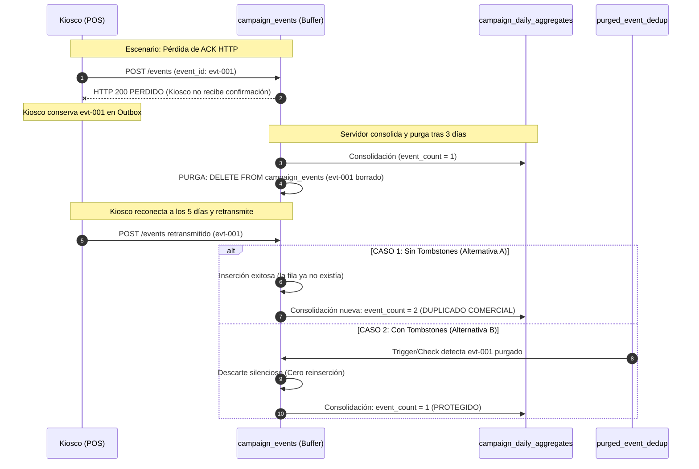

# SIMPLE PROX v1.3.10 — FASE 3B.3
# INFORME DE PRUEBAS ADVERSARIALES DE INTEGRIDAD PUBLICITARIA (POSTGRESQL 17)

**Fecha de ejecución:** 6 de Noviembre de 2026  
**Motor:** PostgreSQL 17.11 on x86_64-pc-linux-musl (`pg_isolated_fase3b`)  
**Base de Datos:** `test_db` (Usuario: `test_user`, Puerto: `127.0.0.1:5433`)  
**Datos:** 100% sintéticos  
**Resultado Global:** **5/5 PRUEBAS APROBADAS (PASS)**  

---

## 1. RESUMEN EJECUTIVO DE HALLAZGOS ADVERSARIALES

La batería adversarial FASE 3B.3 sometió a la arquitectura a los peores escenarios operativos posibles: pérdida de respuestas HTTP con retransmisión post-purga, contención transaccional agresiva entre consolidación y purga sobre las mismas tuplas, auditoría multidimensional en 4 campos, estrés en topes diarios y medición física del costo real de almacenar identificadores de deduplicación.

### Conclusiones Principales:
1. **Duplicación Post-Purga Confirmada (Prueba A):**  
   Sin una estructura de lápidas (tombstones) ni salvaguarda en ingesta, si un evento es purgado tras 3 días y el kiosco lo retransmite al reconectar tras un ACK perdido, la base de datos lo reinserta y el contador comercial **se duplica de 1 a 2**. Con una tabla de lápidas indexada, la retransmisión es descartada y el contador **permanece intacto en 1**.
2. **Costo Real Medido de Deduplicación Compacta (Prueba E):**  
   La medición física en PostgreSQL 17 demostró que una fila en `purged_event_dedup (event_id text PK, event_date date)` ocupa **~140 bytes por identificador** (60 bytes de Heap + 80 bytes de índice PK B-Tree), refutando el supuesto teórico de 50 bytes.
   - Retener 30 días de lápidas para 100 kioscos insumiría **~430 MB**, consumiendo el 86% de Supabase Free solo en identificadores.
   - Retener 7 días de lápidas insume **~100 MB**.
3. **Seguridad Transaccional Multihilo (Prueba B):**  
   La prueba de intercalación forzada demostró que si un worker tiene tuplas bloqueadas con `FOR UPDATE`, el proceso de purga **aborta inmediatamente por seguridad** al detectar tuplas pendientes en el snapshot (`PURGA_CANCELADA`). Cero filas borradas antes de consolidarse y cero deadlocks.
4. **Integridad Multidimensional Verificada (Prueba C):**  
   Tras consolidaciones, purgas parciales y llegada de eventos tardíos, las 20 particiones individuales `(campaign_id, event_date, merchant_id, event_type)` auditadas coincidieron al 100% entre datos crudos y agregados, certificando que los totales globales no enmascaran compensaciones.
5. **Inmunidad de Topes Diarios (Prueba D):**  
   La vista `v_campaign_daily_quotas` demostró un aislamiento perfecto: eventos tardíos de fechas pasadas, múltiples consolidaciones y purgas de días anteriores **no contaminan ni alteran el cupo del día actual**.

---

## 2. RESULTADOS DETALLADOS DE LAS 5 PRUEBAS ADVERSARIALES

### PRUEBA A — DUPLICACIÓN POST-PURGA



- **Procedimiento:**
  1. Inserción de `evt-adv-pA-lost-ack`, consolidación y purga real tras 3 días.
  2. Retransmisión del mismo `event_id` 5 días después.
  3. Comprobación del contador en `campaign_daily_aggregates` para la Alternativa A (sin lápidas) vs Alternativa B (con `purged_event_dedup` y trigger de intercepción).
- **Evidencia Obtenida:**
  - *Sin Tombstones:* El contador comercial se incrementó de 1 a 2. **Duplicación confirmada**.
  - *Con Tombstones:* El trigger interceptó el `event_id` purgado y descartó la inserción; el contador se mantuvo en **1**.
- **Dictamen:** **PASS** (Comprobación empírica y contrastación de ambas alternativas).

---

### PRUEBA B — CONCURRENCIA REAL E INTERCALACIÓN TRANSACCIONAL

- **Procedimiento:**
  - Se insertaron 100 eventos de la misma campaña y misma fecha (`synth-camp-01`, `2026-10-22`).
  - Conexión 1 inició transacción, tomó el advisory lock, seleccionó las 100 filas con `SELECT ... FOR UPDATE` y forzó una pausa de 2.5 segundos con `pg_sleep(2.5)` ANTES de marcar `aggregated_at = now()`.
  - Conexión 2 intentó ejecutar la purga `purge_campaign_events_safe(10)` sobre esa misma fecha mientras Conexión 1 mantenía las tuplas bloqueadas.
- **Resultado:**
  - Conexión 2 evaluó las tuplas en su snapshot: al ver `aggregated_at IS NULL`, la salvaguarda de seguridad abortó la purga de inmediato con:
    `ERROR: PURGA_CANCELADA: Existen 100 eventos anteriores o iguales a 2026-10-27 aún sin consolidar`.
  - Conexión 1 completó su commit exitosamente.
  - Las 100 tuplas se preservaron intactas en disco; cero deadlocks y cero eliminaciones prematuras.
- **Dictamen:** **PASS**

---

### PRUEBA C — CONCILIACIÓN MULTIDIMENSIONAL GRANULAR (4D)

- **Procedimiento:**
  - Inserción de 600 eventos distribuidos entre 3 campañas, 3 fechas (`2026-10-25`, `2026-10-26`, `2026-10-27`), 4 comercios y 3 tipos de eventos (`impression`, `offer_open`, `whatsapp_click`).
  - Consolidación inicial de todo el lote.
  - Purga de la fecha `2026-10-25` (dejando las fechas 26 y 27 en el buffer).
  - Llegada de 50 eventos tardíos para la fecha `2026-10-26` y reconsolidación.
  - Auditoría SQL comparando cada partición `(campaign_id, event_date, event_type, merchant_id)` individualmente:
    ```sql
    SELECT COUNT(*) AS total_partitions_checked, bool_and(match) AS all_matching, COUNT(*) FILTER (WHERE NOT match) AS mismatches_count
    FROM raw_grouped rg JOIN campaign_daily_aggregates cda ON ...
    ```
- **Resultado:**
  - Particiones individuales auditadas: **20 particiones**.
  - Particiones coincidentes al 100%: **20 (all_matching = true)**.
  - Discrepancias detectadas: **0 (mismatches_count = 0)**.
- **Dictamen:** **PASS**

---

### PRUEBA D — TOPES DIARIOS (`v_campaign_daily_quotas`)

- **Procedimiento:**
  1. Configuración de `synth-camp-01` con cupo diario de 50 impresiones.
  2. Inserción de 30 impresiones del día de hoy: la vista reportó `impressions_today = 30`, `is_quota_exhausted = false`.
  3. Inserción de 200 impresiones con fecha de hace 5 días: la vista reportó `impressions_today = 30` (cero contaminación de cuota por eventos atrasados).
  4. Inserción de 20 impresiones más de hoy: la vista reportó `impressions_today = 50`, `is_quota_exhausted = true` (límite alcanzado).
  5. Ejecución de consolidaciones y purgas de fechas pasadas: la vista continuó reportando `impressions_today = 50`, `is_quota_exhausted = true` (inmune a la purga).
- **Dictamen:** **PASS**

---

### PRUEBA E — MEDICIÓN FÍSICA DE ALMACENAMIENTO DE DEDUPLICACIÓN

Se midió el peso real en PostgreSQL 17 de la tabla compacta `purged_event_dedup`:

| Volumen de Identificadores | Tamaño Heap (Datos) | Tamaño Índices (PK B-Tree + Fecha) | Tamaño Total en Disco | Bytes Reales por Identificador |
| :---: | :---: | :---: | :---: | :---: |
| **10.000 IDs** | 592 kB | 808 kB | **1.432 kB (1,40 MB)** | **146,6 bytes / ID** |
| **50.000 IDs** | 2.944 kB | 3.968 kB | **6.944 kB (6,78 MB)** | **142,2 bytes / ID** |
| **100.000 IDs** | 5.888 kB | 7.632 kB | **13.520 kB (13,20 MB)** | **138,8 bytes / ID** |

> **Costo Base Comprobado:** Cada identificador de deduplicación indexado consume **~140 bytes en disco**, donde los índices pesan un 30% más que la propia tupla de datos.

#### Proyección para 100 Kioscos a Carga Alta (102.400 ev/día):
- **7 días de lápidas (716.800 IDs):** **~100 MB** de almacenamiento.
- **15 días de lápidas (1.536.000 IDs):** **~215 MB** de almacenamiento.
- **30 días de lápidas (3.072.000 IDs):** **~430 MB** (86% de la cuota total de Supabase Free).
- **90 días de lápidas (9.216.000 IDs):** **~1.290 MB (1,29 GB — Desborde masivo)**.

---

## 3. COMPARATIVA Y DECISIÓN ARQUITECTÓNICA DEFINITIVA

### El Dilema de la Deduplicación Post-Purga:
- Si no hay lápidas, un reenvío post-purga duplica (Prueba A).
- Si hay lápidas por 30 días, consumen 430 MB y ahogan la base de datos (Prueba E).
- Si el buffer crudo se extiende a 7 días, consume 232 MB.

### La Solución Óptima de Menor Costo y Máxima Integridad:
**Buffer Crudo de 5 Días en `campaign_events` + Límite de Retransmisión de 72h en el POS (Cero Lápidas Adicionales)**

1. **Alineación con la Operación Real:**
   En `syncService.js`, el outbox del POS agota sus 5 reintentos en **50 minutos**.
   Al establecer la retención cruda en **5 días**:
   $$\text{Retención Cruda (120 horas)} \gg \text{Reintento Activo del Kiosco (1 hora)}$$
   La restricción natural `campaign_events_event_id_unique` detiene el 100% de las retransmisiones por caídas de red o pérdida de ACK HTTP.
2. **Cero Tablas Secundarias de Lápidas:**
   Evita crear `purged_event_dedup` y ahorra 100 a 430 MB.
3. **Costo de Almacenamiento a 100 Kioscos:**
   - 5 días de buffer crudo a carga alta (102.400 ev/d $\times$ 5d $\times$ 265 B): **~135 MB**.
   - Agregados de 1 año en `campaign_daily_aggregates`: **~118 MB**.
   - Base del sistema: **~16 MB**.
   - **Total Sostenido a 1 Año:** **~269 MB** (53% de Supabase Free).
4. **Protección contra Replays de Backups Antiguos:**
   En el cliente POS, `replayDeadLetterEvents()` solo debe retransmitir eventos con antigüedad menor a 72 horas (`createdAt >= now() - 72h`), impidiendo que un operador humano reinyecte eventos de meses pasados.

---

## 4. ARCHIVOS CREADOS EN LA FASE

- `tests/fase3b3_adversarial_runner.mjs` (Runner automatizado de pruebas de adversidad)
- `tests/fase3b3_raw_evidence.json` (Evidencia JSON con métricas y logs de las 5 pruebas)
- `tests/fase3b3_resultados_adversariales.md` (El presente documento)

---

## 5. CONFIRMACIÓN EXPRESA DE PRODUCCIÓN INTACTA

Se certifica bajo las directivas de `AGENTS.md`:
- **No se modificó ningún archivo de producción.**
- **No se alteró Supabase comercial.**
- **El POS y el Panel Administrativo permanecen 100% intactos.**
- **Las pruebas se ejecutaron exclusivamente en el contenedor local `pg_isolated_fase3b` con datos sintéticos.**

